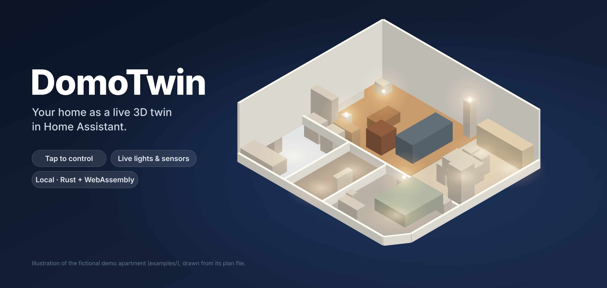
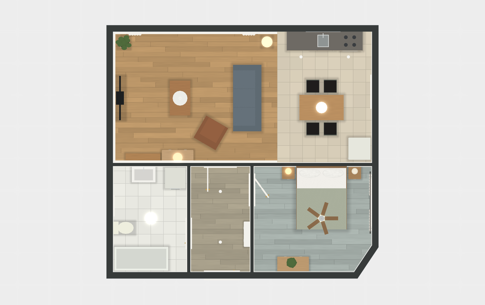
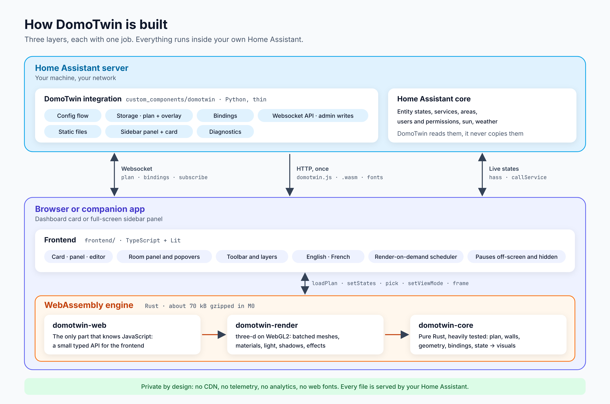

  

<b>Votre logement en jumeau 3D vivant dans Home Assistant.</b> 
Touchez une lampe pour l’allumer, une pièce pour la piloter, et voyez vos capteurs s’animer sur le plan. 
Local, rapide, Rust + WebAssembly.

  

<a href="README.md">Read in English</a>

> [!NOTE]
> **État : développement en cours.** DomoTwin se construit étape par étape
> ([feuille de route](docs/ROADMAP.md), en anglais). L’intégration, le panneau, la carte, l’import
> du plan et les vues 3D et 2D fonctionnent déjà ; le pilotage en direct arrive avec l’étape M2.
> Les fonctionnalités ci-dessous décrivent la version 0.1.0.

## Fonctionnalités

- **Votre plan en 3D et en 2D.** Importez un plan House Maquette (`*.plan.json`) et voyez-le en
  maquette 3D. Les murs face à la caméra s’abaissent automatiquement, comme une maison de poupée
  ouverte. Passez à un plan 2D net avec une transition fluide.
- **Toucher pour piloter.** Touchez une lampe pour l’allumer ou l’éteindre, appuyez longuement pour
  la luminosité et la couleur, touchez une pièce pour retrouver ses lumières, scènes, volets,
  chauffage et lecteurs.
- **En direct.** Les lampes éclairent leur pièce dans leur vraie couleur et luminosité, la télévision
  s’illumine, volets et rideaux bougent, portes et fenêtres s’ouvrent avec leurs capteurs.
- **Calques.** Une carte de chaleur animée (température, humidité ou CO₂), les alertes de sécurité,
  la présence, le vrai soleil à travers vos fenêtres et la consommation électrique.
- **Mode édition.** Déplacez, tournez et empilez les meubles avec aimantation et annulation, liez
  n’importe quel objet à des entités (avec des suggestions tirées de vos pièces), et ajoutez votre
  propre meuble ou appareil avec son modèle 3D.
- **Léger et fluide.** Rust compilé en WebAssembly, un rendu seulement quand quelque chose change,
  des préréglages de qualité pour les vieilles tablettes murales. Le premier chargement est limité à
  1,2 Mo, vérifié par l’intégration continue.
- **À vous.** Anglais et français, suit le thème de Home Assistant, fonctionne dans les applications
  mobiles.

  
  

## Démarrage rapide

1. **Installer.** Utilisez le bouton ci-dessus, ou ajoutez dans HACS
   `https://github.com/arthur-leguennec/ha-domotwin` comme dépôt personnalisé de type *Intégration*,
   installez **DomoTwin** et redémarrez Home Assistant.
2. **Ajouter l’intégration.** Paramètres → Appareils et services → Ajouter une intégration →
   **DomoTwin**. Aucun YAML.
3. **Importer votre plan.** Ouvrez **DomoTwin** dans la barre latérale → **Importer un plan** et
   choisissez votre `*.plan.json`. Pas encore de plan ? Essayez l’appartement fictif
   [`examples/demo-apartment.plan.json`](examples/demo-apartment.plan.json).

Ajoutez ensuite la carte **DomoTwin** à n’importe quel tableau de bord depuis le sélecteur de cartes.

## Configuration

Tout se règle depuis l’interface : les options de l’intégration et l’éditeur visuel de la carte. Le
YAML n’est jamais nécessaire. Pour référence, les options de la carte :

| Option        | Valeurs                             | Défaut     | Description                                   |
| ------------- | ----------------------------------- | ---------- | --------------------------------------------- |
| `type`        | `custom:domotwin-card`              | requis     |                                               |
| `title`       | texte                               | aucun      | En-tête de la carte.                          |
| `view`        | `3d`, `2d`                          | `3d`       | Vue à l’ouverture de la carte.                |
| `height`      | longueur CSS (`400px`, `60vh`…)     | ratio 4:3  | Hauteur fixe ; en sections, la grille décide. |
| `quality`     | `auto`, `eco`, `balanced`, `high`   | `auto`     | Qualité du rendu ; `auto` s’adapte à l’appareil. |
| `cutaway`     | `auto`, `always`, `off`             | `auto`     | Abaissement des murs face à la caméra.        |
| `lighting`    | `auto`, `morning`, `day`, `evening`, `night` | `auto` | Lumière de la scène. `auto` suit le soleil de votre Home Assistant (`sun.sun`), ou l’horloge à défaut. |
| `room`        | un identifiant de pièce du plan     | aucun      | Pièce à cadrer à l’ouverture de la carte.     |
| `font_family` | une famille de police               | incluse    | Police des textes de la carte.                |

Options de l’intégration (Paramètres → Appareils et services → DomoTwin → Configurer) : afficher le
panneau dans la barre latérale, et le réserver aux administrateurs. Seuls les administrateurs peuvent
importer un plan, le modifier et lier des entités.

## Fonctionnement

  

Une intégration Python légère enregistre votre plan, vos modifications et vos liaisons dans Home
Assistant et sert l’interface. L’interface (TypeScript) dialogue avec Home Assistant ; le moteur
(Rust compilé en WebAssembly) lit le plan, construit la géométrie et la dessine en WebGL2. Détails
dans [`docs/ARCHITECTURE.md`](docs/ARCHITECTURE.md) (en anglais).

## FAQ

**Quels formats de plan DomoTwin lit-il ?** Le format de plan House Maquette, décrit dans
[`docs/plan-format.md`](docs/plan-format.md) avec son schéma JSON. Un import de fichiers IFC
(ISO 16739, exportés par FreeCAD, Blender avec Bonsai, ArchiCAD ou Revit) est prévu.

**Faut-il une connexion Internet ?** Non. Voir [Confidentialité](#confidentialité).

**Est-ce que ça tourne sur ma tablette murale ?** Il faut WebGL2, présent dans les navigateurs
actuels et dans les applications mobiles Home Assistant. Sur les appareils anciens, DomoTwin choisit
le préréglage Éco et ne dessine que quand quelque chose change : une vue au repos ne coûte presque
rien.

**Qui peut modifier le plan ?** Tout le monde peut voir et utiliser DomoTwin ; seuls les
administrateurs peuvent importer un plan, le modifier et changer les liaisons.

**Que deviennent mes données si je supprime l’intégration ?** Le plan, les modifications et les
liaisons enregistrés sont supprimés. Utilisez d’abord **Exporter le plan** pour en garder une copie.

## Confidentialité

DomoTwin ne communique qu’avec votre propre Home Assistant. Aucun autre appel réseau : pas de CDN,
pas de télémétrie, pas de statistiques, pas de polices web. Tous les fichiers utilisés (JavaScript,
WebAssembly, polices, matériaux) sont servis par l’intégration. Les diagnostics ne contiennent que
des comptes, jamais de noms, d’identifiants d’entités ou de géométrie.

## Contribuer

Les contributions sont les bienvenues : voir [`CONTRIBUTING.md`](CONTRIBUTING.md) (en anglais).
Problèmes de sécurité : voir [`SECURITY.md`](SECURITY.md).

## Licence

[MIT](LICENSE). La spécification du format de plan et son schéma sont réutilisés sous licence MIT,
et les composants tiers inclus sont listés dans [`THIRD_PARTY_NOTICES.md`](THIRD_PARTY_NOTICES.md).
