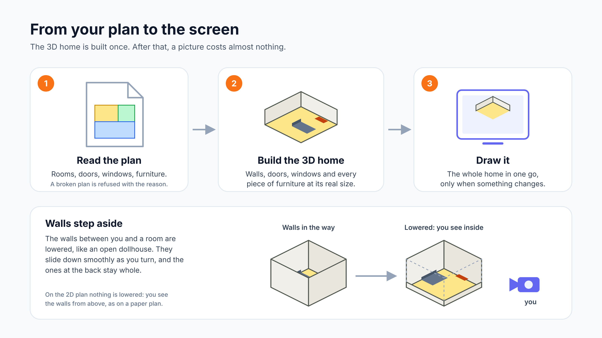
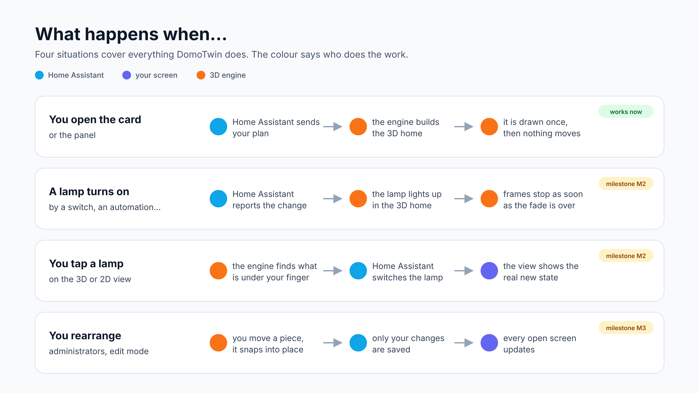

# Architecture

DomoTwin has three layers. Each one does a single job and talks to the next through a small, typed
interface.


## Crates

| Crate             | Depends on              | Knows about                         | Never knows about    |
| ----------------- | ----------------------- | ----------------------------------- | -------------------- |
| `domotwin-core`   | `serde`, `serde_json`   | plans, geometry, bindings, states   | GPU, browser, HA API |
| `domotwin-render` | core, `three-d`, `glow` | meshes, materials, cameras, passes  | browser, HA          |
| `domotwin-web`    | core, render, `web-sys` | canvas, JS values, timing           | HA                   |
| `domotwin-import` | core, models, `serde_json` | IFC, Sweet Home 3D, DXF, scans → plan JSON | GPU, browser, HA |
| `domotwin-models` | `serde_json`, `miniz_oxide` | glTF, OBJ, STL, 3MF → meshes    | core, GPU, HA        |
| `domotwin-planner` | core, `serde_json`     | the plan editor's draft (D-025)     | GPU, browser, HA     |
| `domotwin-analysis` | core, `serde_json`    | radio meshes, automations' configurations (D-043) | GPU, browser, HA |

`domotwin-import` imports the plans of other apps (`ifc-import.md`, `imports.md`, D-040): its own
wasm module, loaded only when such a file is imported. Each reader gives one plan builder a draft;
the builder writes an ordinary plan that the core then reads like any other. It reads ZIP archives
and XML with `domotwin-models`' readers (without its wasm API).
`domotwin-models` reads the 3D files of user models (D-021): its own wasm module too, loaded only
when a plan shows a piece drawn from a 3D file or one is imported. It writes a compact mesh that
the core fits into the piece (`model_mesh`, `scene::imported`).
`domotwin-planner` is the plan editor's draft (`plan-editor.md`, D-025): its own wasm module too,
loaded only when the plan editor opens; the engine shows each version of the draft.
`domotwin-analysis` reads and analyses what Home Assistant says of a radio mesh and of the
automations (`network.md`, `automations.md`, D-043): its own wasm module too, loaded the first time
the network map or the automations are shown. The engine is handed only what it draws: the mesh's
drawing (the devices' pieces and the links' qualities and pulses), which it answers with the room
of each device for the analysis's health, and the automations' placed ends.

`domotwin-core` is where the logic lives and where the tests concentrate. It never panics on input:
every reader returns `Result` with a stable error code that the frontend translates.

## Frontend

- `src/entry.ts` is the module Home Assistant loads on every page (`add_extra_js_url`). It only
  defines the custom elements and registers the card in the card picker. The engine, the panel UI
  and the editor are separate chunks loaded on demand.
- `src/engine/` loads the wasm module once per page and wraps it in a typed API. `src/import/`,
  `src/models/`, `src/planner/` and `src/analysis/` load the plan import, the 3D model readers,
  the plan editor's draft and the analysis the same way, on demand.
- `src/scheduler.ts` drives rendering **on demand** (see the figure below): a frame is requested only when the camera
  moves, a state changes, an animation runs or an edit is dragged; it stops when the engine reports
  that nothing is moving, and pauses entirely when the view is off-screen
  (`IntersectionObserver`) or the tab is hidden (`visibilitychange`).
- `src/live/` is the Home Assistant side of live control: bindings and roles, the default tap and
  long-press actions and running them, the states sent to the engine (only bound entities that
  changed), and the suggestions of the link editor.
- `src/components/` holds the card, the panel, `<domotwin-view>` (one canvas, one engine), the
  panels over the scene (`sheets.ts`: an element's controls, a room's panel), the history report
  (`history-report.ts`) and the link editor; the last three are chunks loaded the first time they
  open.
- `src/demo/` is the demo house (D-050) and `src/sandbox/` the sandbox (D-057): homes kept in the
  page, each with its own `hass` and a connection answering DomoTwin's commands from memory
  (`demo/connection.ts`), shown by the panel in place of the home (`components/demo-switch.ts`).
  The sandbox reads the home once (`sandbox/copy.ts`), plays its day at once
  (`sandbox/engine.ts`, with `templates.ts`, `effects.ts`, `scenario.ts`, `sun.ts`) and says what
  it did (`sandbox/report.ts`); nothing it does is written to Home Assistant.
- `src/i18n/` holds the English and French dictionaries. Every visible string goes through `t()`.


## Rendering



- `domotwin-core::plan` reads the file; `geometry` derives the walls, their heights and the door
  sweeps; `scene` turns the static home into three meshes (opaque, the walls, glass;
  `scene::mesh` packs the vertices) and the moving parts (doors, windows, blinds, curtains) into
  two small ones. A home shown whole has these meshes for each storey (a part with its elevation,
  the elements, rooms, walls and lamps numbered across the home) and a roof over the top one
  (`scene::roof`, D-028); `camera` holds the camera math and the cut-away decision, and the
  walking camera at eye level; `walk` is the floor a walker meets (the walls and windows that stop
  it, the doors it goes through, the way from room to room, the widest view, D-029); `bindings`
  and `live` turn entity states into the look of each element and fade towards it (D-016).
- `domotwin-render` uploads the meshes once and draws them with its own shaders (`shaders.rs`):
  the sun shadow map (Balanced and High, day look), the background (sky, ground and its grid or
  dots), the opaque home and the walls (their tops alone in blueprint), then glass and contact
  shadows, the glass faces of the walls (blueprint), the outlines of the home
  (`scene::lines`), then the halos of lit bulbs. In the looks that glow, all of it is drawn
  offscreen with 4× MSAA, and a bloom of what glows is added on the way to the screen (D-027).
  The look of every element (glow, greyed out, flash) is a small texture the vertex shader reads;
  `lamps.rs` picks the point lights. `view.rs` runs the camera moves, the 2D switch, the wall
  animations and where the storeys go: each storey is drawn moved by its offset (a uniform), up
  and spread apart in 3D, side by side on the 2D plan, the roof above the top one; and the walk:
  a walker's steps on the floor, its way through the doors, the slow turn of a kiosk. Walking
  draws the walls whole and the rooms' ceilings (day look). See D-014, D-016, D-028 and D-029.
- `domotwin-web` exposes a small API: `loadPlan` (or `loadStoreys`, with `setSpread`, `setRoof`,
  `storeyLabels` and `storeyPicture`, for every storey at once), `setBindings`, `setStates`, `highlight`,
  `orbit`, `pan`, `zoom`, `setPlanView`, `overview`, `focusElement`, `views`, `showView`, `pick`,
  `screenPoint`, `stats`, `frame`, walking (`setWalk`, `setWalkVelocity`, `walkTo`) and the kiosk's
  `setAutoOrbit`, and for 3D files `modelFiles` (what to fetch) and `setModelMesh`.
- In the frontend, `src/gestures.ts` turns pointer events into drags, pans, pinches, taps and long
  presses, and `<domotwin-view>` applies them, runs the actions and draws the toolbar.

## Data flow



1. **Load.** The panel or card calls `domotwin/plan/get` (the storey shown, the ground floor by
   default), `domotwin/bindings/get`, `domotwin/settings/get`, `domotwin/upkeep/get` and
   `domotwin/people/get`, then passes the
   plan, the overlay and the bindings to the engine (`load_plan`). With several storeys, the other
   storeys' plans are fetched too, for their rooms' alerts (D-026); a storey switch loads another
   plan in the same engine, and every storey at once loads them all (`loadStoreys`, D-028). The core reads the plan leniently,
   applies the overlay, builds the geometry, and the renderer uploads batched meshes. Pieces drawn
   from 3D files are boxes until the view has fetched each file once
   (`GET /api/domotwin/models/<sha256>.<format>`), read it with the model module and given its mesh
   to the engine, which builds the scene again.
2. **Live states.** On every `hass` update the frontend keeps only the entities that are bound,
   sends the changed ones to the engine (`set_states`), and the core maps them to visual targets
   (light colour and intensity, cover position, glow, power…). The renderer animates towards the
   targets and asks for frames until they are reached. The layers (D-023) are worked out in the
   frontend from the sensors of each room's area and sent as one small JSON (`set_layers`) when a
   value changes; the floors' shader draws them from a texture of rooms.
3. **Interaction.** Pointer events go to the engine (`pick`) which returns the element under the
   pointer. The frontend runs the binding's action: toggle through `callService`, more-info through
   the `hass-more-info` event, navigation, or the long-press popover.
4. **Edit and save.** In edit mode (`edit-mode.md`) the engine keeps the session: selection,
   snapping, stacking, collisions and undo, in `domotwin-core::edit`. While a piece is dragged, it
   and what stands on it are rebuilt alone with the moving parts. Every change is the overlay,
   applied to the stored plan and read again. On save the frontend sends the overlay with
   `domotwin/plan/save` (admins only, with the revision it started from), and every open view
   reloads through `domotwin/subscribe`.
5. **People.** The integration follows the entities that say where each person is
   (`tracker.py`, D-034) and writes each one's room in their sensor. The view reads those sensors
   from `hass`, sends who is in which room to the engine (`setPeople`), which places the figures,
   walks them through the doors and draws them; their names go over the picture
   (`peoplePoints`). Where the rooms come from Bluetooth (D-035), the locator (`locator.py`) hears
   the followed devices through Home Assistant's Bluetooth (`locating/radio_ha.py`) and, every two
   seconds, weighs what each receiver heard against what the plan says it should hear in each room
   and what was learned (`locating/geometry.py`, `radio.py`), along the doors
   (`locating/filter.py`); each device's room is a sensor of its own, a source of its owner's.
6. **Show.** The `domotwin.show` action (`services.py`, D-029), run by a script, an automation or
   the voice blueprint (`blueprints/automation/domotwin/show_by_voice.yaml`), is sent as it was
   asked to every open view through `domotwin/subscribe` (`{kind: "show", show}`). Each card (the
   one with that `screen`, or all of them) and the panel find the room, element, storey or
   viewpoint named (`src/live/show.ts`), switch storey if they must and frame it.
7. **Voice.** The microphone button fires Home Assistant's `assist` action (`hass-action`), which
   opens Assist listening with the pipeline that hears (`src/live/voice.ts`, D-041). The
   integration's `voice.py` installs the shipped blueprints into Home Assistant's blueprint
   folder (`domotwin/voice/blueprints`) and, on the Supervisor, sets up local voice in the
   background (`domotwin/voice/setup`: the apps through `AddonManager`, the Wyoming discovery,
   an Assist pipeline), its steps read with `domotwin/voice/get`.
8. **History reports.** **History** in an element's controls or a room's panel opens
   `<domotwin-history>` over the view (D-058). It asks Home Assistant's own commands, not the
   integration: `history/history_during_period` (the states alone),
   `recorder/statistics_during_period` (each hour) and `logbook/get_events`, again only when the
   entities, the period or the way to read them change. `src/live/history.ts` reads the answers
   into rows (a change, an hour, a period of rows that match a value), filters and searches them
   and writes the CSV, which the browser downloads; nothing is kept once the report closes.
9. **Configuration history.** The integration's `config_history.py` (D-059) reads the
   automations, scripts and scenes from the files Home Assistant's editors write and from their
   entities, and the dashboards from Lovelace, once Home Assistant has started and after each
   change it announces (`automation_reloaded`, `scene_reloaded`, `script.reload` called, one of
   them removed from the entity registry, `lovelace_updated`), and keeps a version of what
   changed. The dialog (`src/components/config-history-dialog.ts`, a chunk) reads them over
   `domotwin/config_history/*`, works out what changed in words in the page
   (`src/live/config-history.ts`), and puts a version back with Home Assistant's own commands:
   `POST /api/config/<kind>/config/<id>` (`hass.callApi`) or `lovelace/config/save`, then
   `domotwin/config_history/refresh`.

## Storage

`.storage/domotwin.data` (one file, versioned, migrated by `Store._async_migrate_func`):

```json
{
  "revision": 3,
  "storeys": [
    {
      "id": "storey-1",
      "name": "",
      "elevation": 0,
      "plan": { "format": "domotwin-plan", "version": 1, "rooms": [] },
      "layout": { "sofa": { "at": [405, 155], "rotation": 90 } }
    }
  ],
  "bindings": { "version": 1, "rooms": {}, "elements": {} },
  "settings": {},
  "upkeep": { "version": 1, "lead_days": 14, "pieces": {} },
  "revisions": { "plan": 2, "bindings": 3, "settings": 0, "upkeep": 0 },
  "retired": []
}
```

- `storeys` (D-026): each storey's `plan`, the DomoTwin plan exactly as read
  ([`plan-format.md`](plan-format.md)), and `layout`, its edit-mode overlay keyed by element id;
  `name` (empty: named by its place) and `elevation` (cm). Element ids, and the ids of pieces an
  overlay adds, are unique in the whole home. Storage 1.1 kept one `plan` and `layout`: they
  become `storey-1` (storage 2.1).
- `retired` (D-030): storeys whose plan was in the format DomoTwin started from, set aside by the
  migration to storage 3.1 with their overlays and their 3D files; nothing shows them.
- `bindings`: see [`bindings.md`](bindings.md).
- `settings`: the home's settings, `{"north": <degrees>}`: where north points on the plan,
  clockwise from its top, for the real sun (D-023); the look shown by default and its accent
  (`theme`, `accent`, D-027); the private rooms (`rooms`, D-039), `{room id: {"people": [person
  entity ids], "while"?: entity id}}`: kept for those people (none: for nobody), always or only
  while that entity is on ([`privacy.md`](privacy.md)).
- `upkeep` (D-033, storage 4.1): the upkeep cards by piece id, and how many days before it a task
  is due soon; see [`upkeep.md`](upkeep.md). Kept apart from the plan, like the bindings.
- `revision`: bumped on every write. `revisions` keeps the revision of the last write of each kind
  (`plan` for the plan and the overlay, `bindings`, `settings`, `upkeep`): the `get` commands return it and a
  save with `expected_revision` is checked against it, so that saving the bindings or the settings
  does not refuse an edit of the plan started before (optimistic concurrency between devices).

`.storage/domotwin.people` (D-034, its own store, version 1): who DomoTwin places in their rooms.

```json
{
  "revision": 2,
  "shown": "everyone",
  "look": "figure",
  "hidden": [],
  "people": { "person.alex": { "sources": ["sensor.alex_phone_area"], "color": "#e8508a" } }
}
```

`shown` is `everyone` or `admins`, `look` `figure` or `pin`, `hidden` the people who hid
themselves; each person's `sources` (10 at most) and optional `color`. See [`people.md`](people.md).

`.storage/domotwin.locating` (D-035, its own store, version 1): where the Bluetooth receivers are
and which devices are followed.

```json
{
  "revision": 3,
  "learn": true,
  "receivers": { "BB:00:00:00:00:01": { "room": "bedroom" } },
  "devices": {
    "alex_phone": { "name": "Alex's phone", "kind": "phone", "person": "person.alex",
                    "match": { "key": "<Private BLE Device entry id>" } },
    "keys": { "name": "Keys", "kind": "thing", "match": { "address": "F1:00:00:00:00:01" } }
  }
}
```

A receiver is placed by a `room` or a `piece` (else from its device); a device is known by its
`address`, a `key` (a Private BLE Device entry: the key itself is never stored) or a `beacon`
(`uuid`, `major`, `minor`); 30 devices at most. `.storage/domotwin.locating_learned` keeps what
was learned: `rooms` (`{room: {receiver: [weight, mean, m2]}}`) and each device's `offsets` (dB).
See [`bluetooth.md`](bluetooth.md).

`.storage/domotwin.users` (D-055, its own store, version 1): each user's own choices, by user
id: `favourites` (entity ids, 100 at most), `start` (`home`, `rooms` or `3d`, when chosen) and
`cards` (the Home tab's, 6 at most: `{type: "calendar", entities}` with 10 calendars at most, or
`{type: "todo-list", entity}`). A user removed from Home Assistant is forgotten when DomoTwin
starts.

`.storage/domotwin.config_history` (D-059, its own store, version 1, private): the configuration
history, each item by `<kind>:<key>` (`automation`, `script` and `scene` by their id or key,
`dashboard` by its URL path, empty for the default one) with its `name`, its `source` (`editor`:
written by Home Assistant's editors; `yaml`: in one's own YAML files) and its `versions`, oldest
first: `{id, at, hash, json}`, the configuration as JSON (`null` when removed or too large to keep)
and the fingerprint of its keys sorted (`null` when removed); `next`, the next version's id. 4 MB
in all and 50 versions an item (the oldest versions go first), 1 MB a version; past 2 000 items,
the removed ones are forgotten. See [`config-history.md`](config-history.md).

The 3D files of user models are not in `.storage`: they are kept under their SHA-256 in
`<config>/domotwin/models/<sha256>.<format>` (D-021), uploaded with `POST /api/domotwin/models?format=…`
(administrators; answers `{hash, bytes, format}`) and read with
`GET /api/domotwin/models/<sha256>.<format>` (signed-in users, cached as immutable). After every
save of the plan or the overlay, the files neither uses are deleted once a day old; all of them go
when the integration is removed.

## Websocket API

| Command                  | Who    | Payload                                        | Result                           |
| ------------------------ | ------ | ---------------------------------------------- | -------------------------------- |
| `domotwin/info`          | user   | –                                              | `version`, `revision`, `has_plan`, `storeys` |
| `domotwin/plan/get`      | user   | `storey?` (the ground floor by default)        | `plan`, `layout`, `storey`, `storeys`, `revision` |
| `domotwin/plan/save`     | admin  | `storey?`, `plan?` (`null` removes the storey), `layout?`, `expected_revision?` | `revision` |
| `domotwin/storey/save`   | admin  | `storey?` (none: a new storey, `plan` needed), `name?`, `elevation?`, `plan?`, `layout?`, `expected_revision?` | `revision`, `storey` |
| `domotwin/storey/remove` | admin  | `storey`, `expected_revision?`                 | `revision`                       |
| `domotwin/storeys/replace` | admin | `storeys` (`[{plan, name?, elevation?}]`, 1 to 20), `expected_revision?` | `revision`, `storeys` (their ids) |
| `domotwin/bindings/get`  | user   | –                                              | `bindings`, `revision`           |
| `domotwin/bindings/save` | admin  | `bindings`, `expected_revision?`               | `revision`                       |
| `domotwin/settings/get`  | user   | –                                              | `settings`, `revision`           |
| `domotwin/settings/save` | admin  | `settings` (`north`, 0 ≤ n < 360; `theme`, `accent`; `rooms`, at most 200) | `revision` |
| `domotwin/upkeep/get`    | user   | –                                              | `upkeep`, `revision`, `today` (where the home is) |
| `domotwin/upkeep/save`   | admin  | `pieces` (`{piece: card \| null}`, only those change), `lead_days?`, `expected_revision?` | `revision` |
| `domotwin/upkeep/done`   | user   | `piece`, `task`                                | `revision`, `last_done`          |
| `domotwin/people/get`    | user   | `candidates?` (administrators: the entities that may say where someone is) | `revision`, `shown`, `look`, `hidden`, `people` (`{person: {sources, color, sensor, located}}`; none for others when shown to administrators only), `candidates?` |
| `domotwin/people/save`   | admin  | `people`, `shown?`, `look?`, `expected_revision?` | `revision`                     |
| `domotwin/people/hide`   | user   | `person` (oneself; administrators anyone), `hidden` | `revision`                   |
| `domotwin/locating/get`  | admin  | –                                              | `revision`, `status`, `learn`, `receivers`, `devices` (with their `room`, `confidence`, `last_seen`, `left_behind`, `missing_key`), `learned`, `rooms` |
| `domotwin/locating/save` | admin  | `receivers`, `devices`, `learn?`, `expected_revision?` | `revision`                 |
| `domotwin/locating/candidates` | admin | –                                        | `candidates` (`[{match, name, rssi?}]`) |
| `domotwin/locating/teach` | admin | `device`, `room`, `seconds?` (10–120, 30)     | `readings`, `receivers`          |
| `domotwin/locating/forget` | admin | `room?` (every room without one)             | `forgotten`                      |
| `domotwin/choices/get`   | user   | – (their own)                                  | `favourites`, `cards`, `start?`  |
| `domotwin/choices/favourite` | user | `entity_id`, `favourite` (their own)        | `favourites`                     |
| `domotwin/choices/save`  | user   | `start?` (`""`: none chosen), `cards?` (their own) | `favourites`, `cards`, `start?` |
| `domotwin/config_history/list`  | admin  | –                                              | `items` (`[{id, kind, key, name, source, removed, versions, changed}]`, the most recently changed first), `bytes`, `max_bytes` |
| `domotwin/config_history/item`  | admin  | `item`                                         | `item`, `versions` (`[{id, at, removed, kept, same_as?}]`, newest first) |
| `domotwin/config_history/version` | admin | `item`, `version`                            | `config` (`null`: removed, or too large to keep) |
| `domotwin/config_history/refresh` | admin | `kind?` (every kind without one)             | `changed` (the versions kept)    |
| `domotwin/subscribe`     | user   | –                                              | events `{kind, revision}`, and `{kind: "show", show}` for `domotwin.show` |

Errors: `not_loaded`, `invalid_plan`, `invalid_layout`, `invalid_bindings`, `invalid_settings`,
`invalid_upkeep`, `unknown_task`, `invalid_people`, `unknown_person`, `invalid_locating`,
`unknown_device`, `unknown_room`, `no_bluetooth`, `too_large`, `too_many_favourites`,
`too_many_models`, `revision_conflict`, `unknown_storey`, `invalid_storey`, `too_many_storeys`,
`duplicate_id`, `unknown_item`, `unknown_version`, and Home Assistant's `unauthorized` for
non-admin writes (and the history's reads).

## Entities

- `sensor.domotwin_upkeep_due` (D-033), the number of upkeep tasks due soon or overdue, the tasks
  in its `tasks` attribute, worked out again when the cards or the plans change and every midnight
  where the home is (`sensor.py`, `upkeep.py`).
- `sensor.domotwin_<person>_room` (D-034), one per person placed: their room's name, `not_home`,
  or unknown; `room_id`, `area_id`, `storey_id`, `storey`, `since`, `source` in attributes
  (`sensor.py`, `tracker.py`, `people.py`).
- `sensor.domotwin_<device>_bluetooth` (D-035), one per device followed by Bluetooth: its room's
  name, or unknown; `device_name`, `kind`, `person`, `left_behind`, `room_id`, `area_id`,
  `storey_id`, `storey`, `since` in attributes (`sensor.py`, `locator.py`).
- `binary_sensor.domotwin_<device>_left_behind` (D-035), one per device with an owner: on while it
  is heard at home and its owner has been away two minutes (`binary_sensor.py`).

## Actions

- `domotwin.show` (D-029): a room, an element, a storey, a view or a person's room, on the screens.
- `domotwin.where` (D-034, with a response): where a person is, a device followed by Bluetooth
  (D-035), or everyone at home, and a sentence to say in Home Assistant's language.

## Privacy

The product talks only to the user's own Home Assistant: no CDN, no telemetry, no analytics, no web
fonts from the internet. Every asset (wasm, JS, fonts, materials) is served by the integration.

## Figures

The figures are drawn as SVG in `docs/figures/src/` and rendered to PNG with
`node scripts/render-figures.mjs` (Inter and JetBrains Mono must be installed for the same look).

The brand images Home Assistant shows for the integration (`custom_components/domotwin/brand/`)
are drawn in `docs/brand/icon.svg` and rendered with `node scripts/render-brand.mjs`, which writes
the name in the bundled Inter (D-044).
