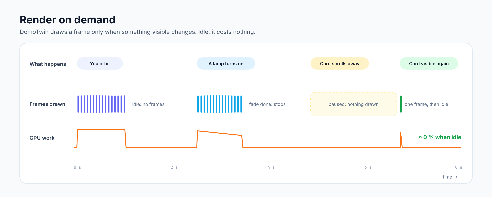

# Performance

DomoTwin must stay smooth on an old wall tablet and cost nothing when nobody looks at it. This page
lists the budgets, how they are measured, and the numbers measured at each milestone.

## Budgets

| Budget | Limit | Checked by |
| --- | --- | --- |
| First load (wasm + JS a view needs), gzipped | ≤ 1.2 MB, user textures and fonts excluded | `scripts/check-bundle-size.mjs`, CI job `bundle` (fails over budget) |
| Idle CPU | ≈ 0: no frame unless something changed | scheduler unit tests, E2E "no frames while idle" |
| Off-screen or hidden tab | no frame at all | scheduler unit tests |
| Layer animation (heatmap, alerts, power) | 24 fps only while a moving layer is visible, none with reduced motion | scheduler `setMinInterval`, E2E "24 frames per second" (M4) |
| Edit-mode drag | 60 fps on a mid-range phone, 500-element plan | M3, on devices |
| Textures | none so far: floors and tiles are procedural; user pictures capped at 1024 px | M3 |
| WebGL contexts | one per visible view, released on `disconnectedCallback` | E2E "releases the engine" |
| WebAssembly memory | no allocation spikes (it never shrinks) | frame-time smoke test reports it |

## How it is measured

- **Bundle.** `scripts/build.sh` builds the engine (`opt-level = "z"`, LTO, `wasm-opt -Oz`) and the
  frontend (esbuild, minified, split into chunks), then `node scripts/check-bundle-size.mjs` gzips
  (level 9) every file. "First load" follows the imports: the entry, the chunks it imports
  statically, the engine glue (every view starts it) and the wasm. Chunks imported only on demand
  (the card editor, the panels over the scene, the link editor) are listed apart. CI publishes the
  table in the job summary and the JSON as the `bundle-size` artifact.
- **Frame time.** `frontend/e2e/perf.spec.ts` loads the demo plan in headless Chromium with software
  WebGL2 (SwiftShader), forces 120 consecutive frames and reports the CPU time of a frame, the
  interval between frames and the WebAssembly memory. CI uploads it as the `frame-time` artifact.
  The software GPU's share of a frame is measured by reading a pixel of it back, which waits for
  it to be drawn. Software rendering is slow and stable, which makes regressions visible; real
  devices are measured by hand.
- **Scene.** `crates/domotwin-core/tests/scene.rs` builds the demo plan and fails above 120 000
  triangles; `stats()` reports the triangles and wall groups of any plan.

## Real devices

What DomoTwin does on the devices it is used on: a computer, a phone, a wall tablet, in a browser
or in Home Assistant's companion app. One row per device and look, as the panel's
**Measure performance** gives it (D-053).

| Device | Screen | Cores, memory | GPU | DomoTwin | Look | Quality, scale | First picture | Turning: fps, p95 interval | Turning: CPU median, p95 | Still: fps, p95 interval | Still: CPU median, p95 | Wasm memory | Triangles |
| --- | --- | --- | --- | --- | --- | --- | --- | --- | --- | --- | --- | --- | --- |

**How to measure.** In DomoTwin's panel, as an administrator: the **⋮** menu → **Measure
performance** → **Start**, and leave the screen alone. DomoTwin opens the demo house in the
evening, its lamps on, and draws it for five seconds while the camera turns around it, then for
five seconds still while a lamp dims, in the look shown (or in each of the five looks, an option
that takes about a minute). It then shows what it measured and the rows above, to copy with
**Copy** (or to select by hand where an app refuses the clipboard). The first picture counts from
opening the panel to the first frame of the home's own plan, when the home had one as the panel
opened and the page stayed shown until it was drawn, so open the panel afresh on the home before
measuring. Without a plan of the home yet, the menu shows once the demo house is open (**Try
the demo house**); the first picture is then not measured. Keep the screen on: a run during which
it was hidden is not counted. Nothing is sent or kept.

- **fps** is a second over the median interval between frames, and **p95 interval** the interval
  that 95 % of them stay under: the display's rate when the device keeps up (60 or 120).
- **CPU** is the processor's time to prepare a frame, its labels and badges read (median and p95);
  the graphics card's own time shows in the interval. The resolution adapts as in use.
- **Quality, scale** is what `auto` chose (eco, balanced, high) and the resolution scale it had
  then; **Wasm memory** the engine's WebAssembly memory; **Triangles** those of the scene drawn.

## Measurements

### M0 (scaffold: the engine only clears the view)

Bundle (Rust 1.97.0, wasm-bindgen 0.2.129, binaryen 133, esbuild 0.28.2):

| File | Raw | Gzipped |
| --- | ---: | ---: |
| `domotwin_web_bg.<hash>.wasm` | 102.4 kB | 49.1 kB |
| `chunks/chunk-<hash>.js` (Lit, shared) | 21.4 kB | 8.2 kB |
| `domotwin.js` (entry) | 23.5 kB | 7.8 kB |
| `chunks/domotwin_web-<hash>.js` (wasm glue) | 12.6 kB | 4.3 kB |
| `chunks/card-editor-<hash>.js` (on demand) | 1.4 kB | 0.8 kB |
| **First load** | | **≈ 69 kB of 1 200 kB** |

Frame-time smoke test (demo plan, SwiftShader, 120 frames): CPU time per frame < 0.1 ms (median
0.0 ms, p95 0.1 ms), frame interval 16.7 ms (median and p95, the display rate), WebAssembly memory
1.18 MB. These numbers only prove the pipeline: the scene arrives with M1.

Renderer candidates measured for [`DECISIONS.md`](DECISIONS.md) (D-002): three-d 83 kB gzipped with
PBR, shadows and post-processing; wgpu (WebGL2) 667 kB gzipped for a single triangle.

### M1 (render: the whole home in 3D and 2D)

Bundle (same toolchain as M0):

| File | Raw | Gzipped |
| --- | ---: | ---: |
| `domotwin_web_bg.<hash>.wasm` | 383.5 kB | 173.2 kB |
| `domotwin.js` (entry) | 35.0 kB | 11.1 kB |
| `chunks/chunk-<hash>.js` (Lit, shared) | 25.2 kB | 9.3 kB |
| `chunks/domotwin_web-<hash>.js` (wasm glue) | 25.7 kB | 6.9 kB |
| `chunks/card-editor-<hash>.js` (on demand) | 1.5 kB | 0.8 kB |
| **First load** | | **≈ 200 kB of 1 200 kB** |

The engine grew by 124 kB gzipped: the plan reader, the geometry, the 55 procedural models, the
renderer, the moods of the day and `serde_json`.

Scene of the demo apartment (54 elements): 24 560 + 272 vertices (opaque + glass and shadows),
18 411 triangles, 9 wall groups, 2 draw calls per frame plus the shadow map when walls move.

Frame-time smoke test (demo plan, SwiftShader, 1000 × 700, Eco as picked for software rendering,
120 forced frames): CPU time per frame 0.2 ms median, 1 ms p95; frame interval 66.6 ms median,
150 ms p95; WebAssembly memory 3.1 MB. The interval is the software rasteriser at work (the CPU
side stays under a millisecond); real GPUs draw this scene far within a 60 Hz frame, to be confirmed
by hand on devices.

### M2 (live control)

Bundle (same toolchain):

| File | Raw | Gzipped |
| --- | ---: | ---: |
| `domotwin_web_bg.<hash>.wasm` | 466.7 kB | 205.8 kB |
| `domotwin.js` (entry) | 41.7 kB | 12.4 kB |
| `chunks/chunk-<hash>.js` (Lit, shared) | 29.4 kB | 10.8 kB |
| `chunks/domotwin_web-<hash>.js` (wasm glue) | 26.8 kB | 7.0 kB |
| `chunks/chunk-<hash>.js` (bindings, actions) | 8.6 kB | 3.8 kB |
| `chunks/chunk-<hash>.js` (suggestions) | 2.2 kB | 1.1 kB |
| **First load** | | **≈ 241 kB of 1 200 kB** |
| On demand: controls and room panel, link editor, card editor | 19.7 kB | 7.0 kB |

The engine grew by 33 kB gzipped (bindings, states, targets and fades, the moving parts, lamps).
The panels over the scene load the first time one opens.

Scene of the demo apartment: the same 18 411 triangles, now in four meshes (static opaque and
glass, moving opaque and glass) plus the halos. A state change uploads one small texture (two
texels per element); only doors, windows, blinds and curtains that move rebuild their small mesh,
and only while they move. A `hass` update costs a comparison of the bound entities' state objects
(Home Assistant keeps the object of an entity that did not change).

Frame-time smoke test (demo plan, SwiftShader, 1000 × 700, Eco, 120 forced frames): CPU time per
frame 0.3 ms median, 1.9 ms p95; WebAssembly memory 3.2 MB. Frame interval 133 ms median, 283 ms
p95. To compare with M1 on the same machine at the same moment (software rendering depends on the
machine's load): M1 83 ms, M2 100 ms with no lamp lit and 117 ms with six. The extra time is per
pixel (the lamp lights of the pixel's room, glows, greyed-out entities), which the software
rasteriser runs on the CPU; on a GPU it is small, still to be confirmed on real devices by hand.
Frames are only drawn while something moves.

### M1b (IFC import)

Bundle: the first load is **242.6 kB gzipped** (+1.7 kB: the panel's import of `.ifc` files). The
IFC import is its own module, fetched only when an `.ifc` file is picked:

| File | Raw | Gzipped |
| --- | ---: | ---: |
| `domotwin_ifc_bg.<hash>.wasm` (on demand) | 241.6 kB | 112.2 kB |
| `chunks/domotwin_ifc-<hash>.js` (glue, on demand) | 5.3 kB | 2.0 kB |
| `chunks/ifc-<hash>.js` (wrapper, on demand) | 0.7 kB | 0.4 kB |

An E2E test checks that the page never requests the IFC module before a file is picked.

Import time in headless Chromium (reading the file, converting, the engine's check, saving and
showing the plan, the module's first download included): the fictional
`examples/demo-apartment.ifc` (53 kB, 6 rooms, 10 openings, 24 pieces) 0.5 s; a synthetic 9.8 MB
file with 20 000 extra pieces 2.1 s (the plan keeps 500 elements and says so). The reader keeps the
file's bytes and a small index; attributes are parsed only when needed. The module's memory is kept
until the page reloads (WebAssembly memory never shrinks).

### M3 (edit mode)

Bundle: the first load is **280.0 kB gzipped** of 1 200 kB (+37 kB):

| File | Raw | Gzipped |
| --- | ---: | ---: |
| `domotwin_web_bg.<hash>.wasm` | 537.0 kB | 235.7 kB |
| `domotwin.js` (entry) | 54.7 kB | 15.6 kB |
| `chunks/edit-bar-<hash>.js` (edit bar and catalogue, on demand) | 8.1 kB | 2.7 kB |

The engine grew by 30 kB gzipped (the overlay, snapping, stacking, collisions, the session and its
API); the entry by 3 kB (edit mode in the view, the panel's edit mode, the names of the kinds in
English and French). The edit bar and the catalogue load the first time edit mode opens.

Edit mode in headless Chromium (demo plan, SwiftShader, 1000 × 700): a pointer move while the sofa
is dragged (rebuilding the dragged pieces, snapping, guides, collisions) **1.2 ms median, 4.2 ms
p95**, then 0.2 ms to draw the frame; dropping it (the whole scene rebuilt) 6.6 ms. Pointer moves
are applied once per frame. Logged by `e2e/perf.spec.ts` with the frame-time smoke test, which is
unchanged (CPU time per frame 0.3 ms median, 1.6 ms p95; WebAssembly memory 3.5 MB).

### M3b (your own 3D models)

Bundle: the first load is **293.5 kB gzipped** of 1 200 kB (+13.5 kB). The 3D model readers are
their own module, fetched only when a plan shows a piece drawn from a 3D file or one is imported:

| File | Raw | Gzipped |
| --- | ---: | ---: |
| `domotwin_web_bg.<hash>.wasm` | 562.8 kB | 246.1 kB |
| `domotwin.js` (entry) | 60.2 kB | 17.1 kB |
| `domotwin_models_bg.<hash>.wasm` (on demand) | 186.2 kB | 94.0 kB |
| `chunks/domotwin_models-<hash>.js` (glue, on demand) | 5.7 kB | 2.2 kB |
| `chunks/edit-bar-<hash>.js` (edit bar, catalogue, model import, on demand) | 15.2 kB | 4.3 kB |

The engine grew by 10 kB gzipped (reading and fitting meshes, the overlay's models, the session's
model pieces and their API), the entry by 1.5 kB (fetching and reading a plan's files in the view).

A large model in headless Chromium (SwiftShader, `e2e/perf.spec.ts`): two pieces drawn from a
generated STL of **139 392 triangles** (7 MB, a little under the 150 000-triangle limit). Fetching
and reading the file took **315 ms**; drawing it (the whole scene rebuilt and uploaded once for
every mesh that came before the next frame, 297 199 triangles) **80 ms**; then the CPU time per
frame was 0.3 ms median, 0.8 ms p95, and the WebAssembly memory 21.7 MB (3.5 MB without it). The
demo plan's figures are unchanged: 0.3 ms median and 1.4 ms p95 per frame, a drag step 0.9 ms
median and 3.0 ms p95, a drop 5.0 ms.

The readers outside the browser (native, release build) on real files from public sample
collections, kept out of the repository: a 3 MB 3MF archive of 96 692 triangles in 0.37 s, a 0.4 MB
textured GLB of 3 624 triangles in 2 ms.

### M4 (layers)

Bundle: the first load is **314.8 kB gzipped** of 1 200 kB (+21.3 kB):

| File | Raw | Gzipped |
| --- | ---: | ---: |
| `domotwin_web_bg.<hash>.wasm` | 596.4 kB | 260.3 kB |
| `domotwin.js` (entry) | 73.8 kB | 20.6 kB |

The engine grew by 14 kB gzipped (the scales and their OKLab colours, the room and power texels,
the layers' shading, the real sun and its shadow pass, the labels and legends), the entry by 3.5 kB
(reading the rooms' sensors, the layer menu, legend, labels and alerts, the settings).

In headless Chromium (SwiftShader, High quality, the demo apartment with its fictional sensors),
the CPU time per frame stays at 0.2–0.4 ms median with the heatmap, the power layer or the real sun
(1–2 ms p95): the layers are read by the floors' shading, with no added draw call. A move of the
sun draws the shadow map again (0.5 ms of CPU that frame). Working out the layers from the `hass`
object on a state change takes 0.05–0.2 ms. A moving layer draws 24 frames per second while
nothing else moves (`frameInterval` in the view's debug state); SwiftShader itself draws only a
few per second, so the rate on real GPUs is checked through the scheduler's cap, not by counting.

### M5 (devices)

Bundle: the first load is **327.3 kB gzipped** of 1 200 kB (+12.5 kB):

| File | Raw | Gzipped |
| --- | ---: | ---: |
| `domotwin_web_bg.<hash>.wasm` | 613.0 kB | 267.4 kB |
| `domotwin.js` (entry) | 82.6 kB | 23.1 kB |

The engine grew by 7 kB gzipped (the camera role and settings, the cone and its clipping, the
cameras' and elements' points), the entry by 2.5 kB (the badges, their icons and the cones).

In headless Chromium with the demo apartment (three elements with badges, one camera): working
out the badges from the `hass` object takes 0.04 ms, the elements' points 0.02 ms and the cameras'
cones 0.07 ms, read only when the camera moves or a state changes; the CPU time per frame is
unchanged (0.3 ms median, 1.1 ms p95).

### M6 (plan editor)

Bundle: the first load is **334.8 kB gzipped** of 1 200 kB (+7.5 kB):

| File | Raw | Gzipped |
| --- | ---: | ---: |
| `domotwin_web_bg.<hash>.wasm` | 621.5 kB | 270.7 kB |
| `domotwin.js` (entry) | 90.4 kB | 23.8 kB |
| `domotwin_planner_bg.<hash>.wasm` (on demand) | 237.9 kB | 112.8 kB |
| The plan editor's JS: bar, tools and handles, glue (on demand) | 29.6 kB | 10.2 kB |

Inside the engine, the plan editor cost 20.5 kB gzipped (LTO inlined the whole engine
differently): it is its own module, loaded when the plan editor opens (D-025). The engine grew by
3.3 kB (showing a draft, marking the selection, the plan shown with its overlay, points both
ways), the first load's other chunks by 4.2 kB (the texts in English and French, the panel's and
the view's side of the plan editor).

In headless Chromium with the demo apartment, dragging a corner of the living room costs 4.7 ms
per pointer move (median; 12 ms p95): the change checked by the plan reader in the planner, the
draft passed as JSON to the engine, read again, the whole scene built and uploaded, and the
handles placed; drawing the frame then takes 0.2 ms. The view applies at most one move per frame;
a tap that only selects marks the element without building the scene again.

### M7 (storeys)

Bundle: the first load is **340.6 kB gzipped** of 1 200 kB (+5.8 kB):

| File | Raw | Gzipped |
| --- | ---: | ---: |
| `domotwin_web_bg.<hash>.wasm` | 625.6 kB | 272.1 kB |
| `domotwin.js` (entry) | 103.9 kB | 26.7 kB |

The engine grew by 1.4 kB (the stairs, the ids edit mode keeps for the other storeys), the rest by
4.4 kB (the switcher, the storeys dialog, the alerts of the other storeys, the texts in two
languages).

In headless Chromium with the demo apartment and its fictional upper floor, switching storeys takes
10 ms median from the tap to the new storey read (7–16 ms): the plan was already fetched for the
alerts, so it is read and its scene built, the camera kept. Every frame then costs what one storey
costs; nothing of the other storeys is drawn.

### M8 (looks)

Bundle: the first load is **359.2 kB gzipped** of 1 200 kB (+18.6 kB):

| File | Raw | Gzipped |
| --- | ---: | ---: |
| `domotwin_web_bg.<hash>.wasm` | 662.5 kB | 288.7 kB |
| `domotwin.js` (entry) | 106.8 kB | 27.1 kB |

The engine grew by 16.6 kB (the looks' shaders, the outlines of the home, the background, glass
walls and bloom passes, the rooms' label points), the rest by 2 kB (the options and settings,
the rooms' names, the texts).

Frame time in headless Chromium at the High preset, the demo apartment in the evening with its
lamps on (`e2e/perf.spec.ts`, "frame time of each look"):

| Look | CPU per frame (median, p95) | Software GPU per frame (median) |
| --- | ---: | ---: |
| Day (straight to the screen) | 0.8 ms, 5.1 ms | 317 ms |
| Neon (offscreen, 4× MSAA, bloom) | 0.6 ms, 1.6 ms | 283 ms |
| Blueprint (offscreen, 4× MSAA, bloom) | 0.5 ms, 2.9 ms | 267 ms |

The CPU's share does not change with the look. SwiftShader rasterises on the CPU, so its time is
no guide to a real GPU, only to the ratio: the offscreen picture with MSAA and the bloom cost
about what day's sun shadow map and soft shadows cost (night looks draw no shadow map), and the
glass walls draw the walls' mesh again, not the whole home. Eco draws every look straight to the
screen, as before.

### M9 (every storey at once)

Bundle: the first load is **381.2 kB gzipped** of 1 200 kB (+22.0 kB):

| File | Raw | Gzipped |
| --- | ---: | ---: |
| `domotwin_web_bg.<hash>.wasm` | 710.8 kB | 308.2 kB |
| `domotwin.js` (entry) | 113.7 kB | 28.7 kB |

The engine grew by 19.5 kB (the scene of every storey, the roof, where each storey is drawn and
its animations, the plan of storeys side by side, the pictures of the storeys, the labels), the
rest by 2.5 kB (the "every storey" button, the storeys' labels and pictures, the options, the
texts).

Frame time in headless Chromium at the High preset, neon, in the evening with the lamps on
(`e2e/perf.spec.ts`, "frame time of each look" and "frame time of the whole home", one run):

| Shown | CPU per frame (median, p95) | Software GPU per frame (median) |
| --- | ---: | ---: |
| The ground floor alone | 0.5 ms, 2.8 ms | 283 ms |
| Both storeys, spread apart, with the roof (27 776 triangles) | 0.7 ms, 3.1 ms | 250 ms |

The CPU's share grows a little with the draw calls (each storey's meshes, outlines and lamps), the
GPU's not measurably (software rendering times vary by a frame of the display from run to run):
the storeys are small and most of a frame is the offscreen picture and its bloom. The
pictures of the storeys are drawn once per home and per look (280 × 180 pixels each), not per
frame. Spreading the storeys apart redraws the sun's shadow map on each frame of the animation in
the day look (0.7 s), as a moving wall does.

### M10 (walking, kiosks and voice)

Bundle: the first load is **391.6 kB gzipped** of 1 200 kB (+10.4 kB):

| File | Raw | Gzipped |
| --- | ---: | ---: |
| `domotwin_web_bg.<hash>.wasm` | 725.1 kB | 314.9 kB |
| `domotwin.js` (entry) | 123.3 kB | 31.3 kB |

The engine grew by 6.7 kB (the walls and doors a walker meets, the way through the doors, the
widest view, the walking camera, the ceilings), the rest by 3.7 kB (the walk button, pad and keys,
the kiosk's wait, slow turn and dimming, `domotwin.show`, the options, the texts).

Frame time in headless Chromium at the High preset, in the day look in the evening with the lamps
on (`e2e/perf.spec.ts`, "frame time of each look" and "frame time walking", one run):

| Shown | CPU per frame (median, p95) | Software GPU per frame (median) |
| --- | ---: | ---: |
| The ground floor from above | 1.1 ms, 5.0 ms | 300 ms |
| Walking through it at eye level, ceilings on | 0.9 ms, 5.2 ms | 417 ms |

At eye level the walls are whole (no cut-away) and the ceilings are drawn, so more of the screen
is covered by near surfaces, each lit by the lamps of its room: the software GPU, which shades
every pixel, takes about a third longer; a real GPU does not notice. A walk step costs a few
segment distances (the walls of a storey) per frame while moving, and nothing once standing. The
kiosk's slow turn draws 20 frames per second, the dimmed screen none at all, and the wait for
idle is a check per second, not a frame.

### M10b (DomoTwin's own plan format)

Bundle: the first load is **389.5 kB gzipped** of 1 200 kB, 3.7 kB less than M10 as merged
(393.2 kB, measured again on the same build tools):

| File | Raw | Gzipped |
| --- | ---: | ---: |
| `domotwin_web_bg.<hash>.wasm` | 717.3 kB | 312.8 kB |
| `domotwin_planner_bg.<hash>.wasm` (on demand) | 207.5 kB | 95.2 kB |
| `domotwin_ifc_bg.<hash>.wasm` (on demand) | 245.1 kB | 114.1 kB |

The new reader has less to undo (corners relative to a frame, kinds turned sideways, names in two
languages, model kits): the engine lost 3.6 kB. The plan editor's module lost 19.4 kB: it edits the
file's lists as they are and keeps no second, read copy of the plan. The demo apartment is
8.3 kB instead of 13.9 kB (2.0 kB gzipped instead of 2.2 kB). Its scene is the same geometry
(13 843 triangles, 9 wall groups); only the colours of the pieces that named none changed.

### M9b (network map)

Bundle: the first load is **407.0 kB gzipped** of 1 200 kB (+17.5 kB). The map's own code is a
chunk loaded the first time the layer is shown:

| File | Raw | Gzipped |
| --- | ---: | ---: |
| `domotwin_web_bg.<hash>.wasm` | 756.6 kB | 328.0 kB |
| `domotwin.js` (entry) | 126.0 kB | 32.0 kB |
| `chunks/network-panel-<hash>.js` (on demand) | 15.1 kB | 5.2 kB |

The engine grew by 15.2 kB: the mesh's analysis (reading a snapshot, the widest routes, the
health, its JSON) and the wires (arcs, their pass and its shaders, the tap on a wire). The rest of
the first load grew by 2.3 kB (the layer in the menu, the device row of the link editor, the
texts). Moving the analysis out of the first load, into the map's chunk with a module of its own,
is left for the pass over size and speed (M12b).

Frame time at the High preset, 1280 × 720, in the evening with the lamps on, the mesh of the e2e
harness shown (5 devices placed, 5 links), *reduce motion* on so that both columns draw the same
number of frames; the steps of `e2e/perf.spec.ts` ("frame time with the network map"), in
Chromium with SwiftShader so that the GPU's time counts (one run):

| Look | Without the map (CPU median, software GPU) | With it |
| --- | ---: | ---: |
| Day | 0.8 ms, 300 ms | 0.7 ms, 300 ms |
| Neon | 1.1 ms, 267 ms | 0.5 ms, 250 ms |

The wires are one draw call over the picture (160 triangles here): they cost nothing
measurable. With motion on, the pulses keep frames coming at the layers' rate (24 a second), as an
animated heatmap does; the layer off, or the map closed, nothing runs.

Reading a mesh is done once per load and per rescan read, not per frame. A fictional mesh of 300
devices with 8 neighbours each (2 400 links, a 196 kB snapshot), every device placed on a piece of
the demo apartment: **32.5 ms** median in headless Chromium for `setNetwork` (the snapshot read,
the routes, the health, 38 400 wire pieces built and uploaded, the analysis written back). Homes
have tens of devices, rarely a hundred.

### M9c (automation wires)

Bundle: the first load is **428.5 kB gzipped** of 1 200 kB (+21.5 kB). The automations' section
and their wires are chunks loaded when first shown:

| File | Raw | Gzipped |
| --- | ---: | ---: |
| `domotwin_web_bg.<hash>.wasm` | 800.0 kB | 347.4 kB |
| `domotwin.js` (entry) | 126.8 kB | 32.0 kB |
| `chunks/automation-wires-<hash>.js` (on demand) | 7.3 kB | 2.9 kB |
| `chunks/sheets-<hash>.js` (on demand, with the section) | 6.7 kB | 2.4 kB |

The engine grew by 25.7 kB: the configuration reader (about 150 small functions, most of them
the reader's steps and their iterators), the wires' links and bundles, the placing of the ends,
a second wire set with its one-shot pulses, and the runs and the automation picked out kept
when the wires are built again. With the network map's analysis (M9b), the
reader is the first thing to move into a module of its own, loaded with the panels, in the pass
over size and speed (M12b).

Frame time at the High preset, 1280 × 720, in the evening with the lamps on, every automation of
the e2e harness shown from the layer menu, *reduce motion* on; Chromium with SwiftShader (one
run):

| Automations | Look | Without (CPU median, software GPU) | With them |
| --- | --- | ---: | ---: |
| 3 (each drawn) | Day | 0.6 ms, 300 ms | 0.6 ms, 267 ms |
| 3 | Neon | 0.6 ms, 233 ms | 0.9 ms, 233 ms |
| 50 (bundled by room) | Day | 0.7 ms, 283 ms | 0.6 ms, 250 ms |
| 50 | Neon | 0.7 ms, 250 ms | 0.6 ms, 250 ms |

The wires are one draw call: they cost nothing measurable. Showing 50 automations unbundled (their
ends placed, the links worked out, 100 wires built and uploaded) takes **2.1 ms** median in
headless Chromium (`e2e/perf.spec.ts`, "frame time with 50 automations"); reading their
configurations is one request each to Home Assistant, done once when the wires are shown. A run
draws frames for the length of its pulse (under 2 s), and nothing is watched while no wires are
shown.

### M9d (upkeep cards)

Bundle: the first load is **437.1 kB gzipped** of 1 200 kB (+8.6 kB). The upkeep list is a chunk
loaded when the layer is first shown; a piece's card comes with the sheets:

| File | Raw | Gzipped |
| --- | ---: | ---: |
| `domotwin_web_bg.<hash>.wasm` | 809.9 kB | 351.5 kB |
| `domotwin.js` (entry) | 132.1 kB | 33.6 kB |
| `chunks/upkeep-panel-<hash>.js` (on demand) | 6.9 kB | 2.5 kB |
| `chunks/sheets-<hash>.js` (on demand, with a piece's card) | 19.8 kB | 5.6 kB |
| `domotwin_ifc_bg.<hash>.wasm` (on demand, IFC import) | 260.9 kB | 120.4 kB |

The engine grew by 9.9 kB: the dates and the due arithmetic, and the reading of the cards into
one shade a piece. The entry grew by 5.3 kB: the badges and the standings, worked out on every
change of the cards and once a minute. The IFC importer, loaded on demand, also reads the
cards' property sets.

Frame time at the High preset, 1280 × 720, in the evening with the lamps on, the cards of the
e2e harness (5 pieces, a washing machine overdue, a fridge due), *reduce motion* on; Chromium
with SwiftShader (two runs, the second shown):

| Look | Without the layer (CPU median, software GPU) | With it |
| --- | ---: | ---: |
| Day | 0.6 ms, 267 ms | 0.6 ms, 267 ms |
| Neon | 0.6 ms, 233 ms | 0.7 ms, 250 ms |

The tint is a channel of the texel each element already has, read by the shader: no extra draw
call. Reading 1 000 cards of 5 tasks each into their standings, badges and shades takes **66 ms**
median in headless Chromium (`e2e/perf.spec.ts`, "frame time with the upkeep layer, and 1 000
cards"); it runs when a card changes and when the day does, not on each frame.

### M9e (people in their rooms)

Bundle: the first load is **452.4 kB gzipped** of 1 200 kB (+15.3 kB). The people's settings are a
chunk loaded when first opened; a person's sheet comes with the sheets:

| File | Raw | Gzipped |
| --- | ---: | ---: |
| `domotwin_web_bg.<hash>.wasm` | 834.5 kB | 362.5 kB |
| `domotwin.js` (entry) | 138.1 kB | 34.9 kB |
| `chunks/sheets-<hash>.js` (on demand, with a person's sheet) | 23.0 kB | 6.4 kB |
| `chunks/people-settings-<hash>.js` (on demand) | 9.9 kB | 3.0 kB |

The engine grew by 24.6 kB: the shapes of the figure, the pin and the shadow (built once, at the
first person), the walking (places in a room clear of the furniture, the ways through the doors,
fades between storeys) and the people's pass with its shaders. The entry grew by 6.0 kB: the
people shown from their sensors, their names over the picture, the counts on the storeys.

Frame time at the High preset, 1280 × 720, in the evening with the lamps on, *reduce motion* on;
Chromium with SwiftShader (two runs, the second shown):

| Look | Nobody (CPU median, software GPU) | Ten people standing |
| --- | ---: | ---: |
| Day | 0.6 ms, 250 ms | 0.7 ms, 250 ms |
| Neon | 0.6 ms, 233 ms | 0.6 ms, 233 ms |

A person is one draw call for their shadow and one for them, of a shared mesh: ten cost nothing
measurable. Ten people walking to other rooms take **0.6 ms** of CPU a frame (median, headless
Chromium, `e2e/perf.spec.ts`, "frame time with ten people walking"), with their names following;
frames are drawn only while someone walks or fades.

### M9f (Bluetooth locating)

Bundle: the first load is **455.8 kB gzipped** of 1 200 kB (+3.4 kB, mostly the English and French
words of the Bluetooth settings). The settings are a chunk loaded when first opened:

| File | Raw | Gzipped |
| --- | ---: | ---: |
| `domotwin.js` (entry) | 139.8 kB | 35.2 kB |
| `chunks/sheets-<hash>.js` (on demand, with a person's devices and a room's things) | 24.5 kB | 6.8 kB |
| `chunks/bluetooth-settings-<hash>.js` (on demand) | 14.6 kB | 4.1 kB |

The engine is as it was: the locating runs in the integration. Its costs there, on the two storeys
of the demo home (ten rooms), median of five runs:

| Work | When | Time |
| --- | --- | ---: |
| What each receiver should hear in each room, from the plan (4 receivers) | plans, bindings, registries or receivers change; in an executor | 5.5 ms |
| The same with 8 receivers | | 9.6 ms |
| A tick: 30 devices weighed against 8 receivers, filtered along the doors | every 2 s | 4.4 ms |

The sensors are written when a room changes, not at each tick, so the recorder gets a row per move.

### M8b (cartoon and clay)

Bundle: the first load is **459.0 kB gzipped** of 1 200 kB (+3.2 kB). The engine grew by 2.9 kB
(`domotwin_web_bg.<hash>.wasm`: 842.6 kB raw, 365.4 kB gzipped): the two looks' data, the
shading in steps and the composite pass's ink. The rest is the options, the overlays' colours and
the texts.

Frame time at 1280 × 720, the demo apartment in the evening with its lamps on, *reduce motion* on.
The CPU column is headless Chromium (`e2e/perf.spec.ts`, "frame time of each look", High). The
software GPU column is SwiftShader, the median of nine frames each read back:

| Look | CPU per frame, High (median, p95) | Software GPU, High | Software GPU, Balanced |
| --- | ---: | ---: | ---: |
| Day | 0.7 ms, 2.7 ms | 247 ms | 225 ms |
| Neon | 0.4 ms, 0.8 ms | 243 ms | 251 ms |
| Blueprint | 0.4 ms, 3.9 ms | 252 ms | 240 ms |
| Cartoon | 0.4 ms, 4.7 ms | 269 ms | 237 ms |
| Clay | 0.4 ms, 5.9 ms | 271 ms | 235 ms |

The CPU's share does not change with the look. On the software GPU, the cartoon costs 9 % more
than day on High (the depth resolve and the ink's pass, nine depth reads a pixel where the home
is) and 5 % more on
Balanced, where it is drawn offscreen for its ink alone while day goes straight to the screen;
there it makes no bloom textures. Clay costs what day costs: its matte shading changes uniforms,
not passes. Eco draws both straight to the screen, the cartoon without the ink from the depth.

### M5b (what cameras see, on the floor)

Bundle: the first load is **462.1 kB gzipped** of 1 200 kB (+3.1 kB). The engine grew by 3.2 kB
(`domotwin_web_bg.<hash>.wasm`: 850.8 kB raw, 368.6 kB gzipped): the fan's mesh, its shaders and
its pass. The JavaScript lost 0.1 kB: the SVG layer is gone.

Frame time at 1280 × 720, the demo apartment in the evening, High, *reduce motion* on. The CPU
time of a frame is unchanged (0.3 ms median, `e2e/perf.spec.ts`). The software GPU, the median of
nine frames each read back, with the views hidden, faint and whole:

| Look | Hidden | Faint | Whole |
| --- | ---: | ---: | ---: |
| Day, 3D | 260 ms | 250 ms | 248 ms |
| Day, 2D plan | 259 ms | 248 ms | 236 ms |
| Neon, 3D | 232 ms | 249 ms | 227 ms |
| Neon, 2D plan | 216 ms | 236 ms | 225 ms |

The fan's pass is lost in the noise of the measurement (about ±8 %): one draw call of a few dozen
triangles over a part of the floor. Its mesh is made again only when the views change (a camera's
state, a tap, the plan or the links), in 0.02 to 0.08 ms; other states do not touch it.

### M9g (private rooms)

Bundle: the first load is **470.7 kB gzipped** of 1 200 kB (+8.6 kB). The engine grew by 6.0 kB
(`domotwin_web_bg.<hash>.wasm`: 866.5 kB raw, 374.6 kB gzipped): the scene built without a closed
room's pieces, its doors' and windows' states and its 3D files, the walking floor closed, the
frosted cover in the floors' shader. The JavaScript loaded first grew by 2.6 kB (who may see which
room, what the views leave out); the panel's *Private rooms* is a chunk of its own, loaded when
opened (2.5 kB).

Closing or opening rooms builds the scene again, only when a room of the scene shown closes or
opens (headless Chromium, the median of nine, the living room and the bedroom closed then open):
**6.3 ms** for the demo apartment, 8.9 ms with its upper floor. The frame is unchanged: the cover
is one texel read on the floors, and a closed room draws fewer triangles.

### M11 (plans of other apps)

Bundle: the first load is **471.9 kB gzipped** of 1 200 kB (+1.2 kB: the panel picks Sweet Home 3D
homes, DXF drawings and scans). The import module, fetched only when such a
file or an IFC file is picked, reads four formats instead of one:

| File | Raw | Gzipped |
| --- | --- | --- |
| `domotwin_import_bg.<hash>.wasm` (on demand) | 490.1 kB | 217.6 kB (IFC alone: 120.4 kB) |
| `chunks/domotwin_import-<hash>.js` (glue, on demand) | 5.3 kB | 2.1 kB |
| `chunks/import-<hash>.js` (wrapper, scan rooms' names, on demand) | 1.0 kB | 0.6 kB |

Most of the growth is the readers' own code (Sweet Home 3D, DXF, the scans and USDA, the faces of
lines), the ZIP and XML readers of `domotwin-models` (its 3D formats and its wasm API left out) and
`serde_json`'s reading of RoomPlan's JSON. M12b looks at the copies of the standard library's sorts
and maps each reader brings.

Import time (Node 22, the median of seven runs: read, list the storeys, convert one), on the
fictional test files and on generated grids of 10 × 10 and 20 × 20 rooms with a door and furniture
in each (500 elements kept, the rest reported):

| File | Size | Time |
| --- | --- | --- |
| `cottage.sh3d` (4 rooms, 19 openings and pieces) | 1 kB | 3 ms |
| `studio.dxf` (2 rooms, 7 openings and pieces) | 2 kB | 1 ms |
| `scan.usdz` / `scan.json` (1 room, 9 elements) | 20 kB / 8 kB | 3 ms / 1 ms |
| Sweet Home 3D, 100 rooms, 400 doors and pieces | 9 kB | 21 ms |
| DXF, 100 rooms from wall lines, 100 pieces | 12 kB | 12 ms |
| RoomPlan structure, 100 rooms, 200 doors and objects | 140 kB | 12 ms |
| Sweet Home 3D, 400 rooms | 34 kB | 113 ms |
| DXF, 400 rooms from wall lines | 44 kB | 95 ms |
| RoomPlan structure, 400 rooms | 566 kB | 95 ms |
| DXF, a grid of 80 × 80 lines 70 cm apart (6 400 faces, 500 kept) | 7 kB | 1.1 s |

The last is the worst case found: the rooms past the 500-element limit are left out before the
gaps between rooms are measured two by two (it took 6 s before), and the segments are swept from
left to right to find where they cross. The fuzz target `plan_import` found two crashes, fixed:
an overflow in the grid of `faces`, and blocks that insert themselves (now counted in the
entities' budget). Once the readers were final, it ran 270 000 inputs in five minutes without a crash.

### M12 (polish and voice)

Bundle: the first load is **480.5 kB gzipped** of 1 200 kB (+8.6 kB). It holds the microphone
button and its pipeline choice, the room list, the menus' and dialogs' keyboard, and the font's
declaration. The rest comes on demand:

| File | Raw | Gzipped |
| --- | --- | --- |
| `chunks/voice-dialog-<hash>.js` (the voice dialog, on demand) | 9.8 kB | 3.0 kB |
| `fonts/inter-variable.<hash>.woff2` (fetched once a text uses it, cached by its hash) | 59.5 kB | 59.5 kB |

The font is a subset of Inter's variable font (every weight; Latin, punctuation, units, arrows),
cut from 880 kB. It is outside the budget, as the budget's script says of fonts, and it is
fetched once: its name changes only when the font does. A card set to another font does not
fetch it.

Nothing in the frame changes. Under *reduce motion* the camera's moves, the storeys and the walls
take one frame instead of 650 to 700 ms, so fewer frames are drawn.

### M12b (size and speed)

A pass that keeps the picture as it is (D-043), each number measured on the branch and on the
commit before it, the same way.

Bundle: the first load is **468.7 kB gzipped** of 1 200 kB, down from 480.5 kB (−11.8 kB). The
network map's analysis and the automation reader left the engine for a module of their own,
fetched the first time either is shown:

| File | Before (raw, gzipped) | After (raw, gzipped) |
| --- | ---: | ---: |
| `domotwin_web_bg.<hash>.wasm` | 866.6 kB, 374.7 kB | 836.4 kB, 362.6 kB |
| `domotwin_analysis_bg.<hash>.wasm` (on demand) | | 142.9 kB, 65.2 kB |
| `chunks/domotwin_analysis-<hash>.js` (glue, on demand) | | 5.0 kB, 2.0 kB |

The module is bigger than what left the engine: it has its own copy of `serde_json` and of what
it uses of the standard library. Two ways of making the engine smaller were tried and dropped:
`opt-level = "s"` (about 30 kB bigger gzipped) and more of `wasm-opt`'s passes (about 1 kB
smaller, for a slower build).

A large mesh, 300 devices with 8 neighbours each (2 400 links), each placed on a piece of the demo
apartment, shown by the network panel: read, analysed, drawn, and the panel's list made again
(`e2e/perf.spec.ts`, "frame time with the network map"; the engine's share is its `setNetwork`).
Headless Chromium, the median of five runs, each the median of 15:

| | Before | After |
| --- | ---: | ---: |
| The whole | 31.9 ms | 31.7 ms |
| The engine's share | 27.2 ms | 17.5 ms |

Handing the engine the mesh's drawing as JSON objects first cost about 10 ms more than the engine
doing it all. Two changes paid for it, measured natively (`cargo test --release`, the same mesh):

| Step | Before | After |
| --- | ---: | ---: |
| The drawing written (164 kB of objects, then 48 kB of numbers) | 5.5 ms | 0.3 ms |
| The drawing read by the engine | 2.7 ms | 0.7 ms |
| The analysis written (259 kB, the same JSON) | 8.2 ms | 0.9 ms |

Both are now written from what they borrow of the mesh, instead of being built as JSON values
first.

Frame time, the presets against each other (`e2e/perf.spec.ts`, "frame time of each quality
preset"): neon in the evening with the lamps on, a 640 × 700 canvas, SwiftShader. The CPU's share
is the median of 20 forced frames. The software GPU's is the median of nine frames, each read
back so that it is waited for. One run each:

| Preset | CPU, before | CPU, after | Software GPU, before | Software GPU, after |
| --- | ---: | ---: | ---: | ---: |
| Eco | 0.5 ms | 0.6 ms | 278 ms | 288 ms |
| Balanced | 0.5 ms | 0.8 ms | 296 ms | 279 ms |
| High | 0.4 ms | 0.4 ms | 323 ms | 279 ms |

The renderer did not change, and the differences are the runs' noise (about 10 %). A software
GPU counts pixels, not memory traffic. Neon has no sun shadows, so its three presets cost it about
the same, while day's do not: 228, 274 and 315 ms, from its shadow map's size and softness. On an
old tablet's GPU, Eco also saves the offscreen picture, its samples and its bloom, which a
software GPU barely notices; real devices are measured by hand (M13).

The integration's work in Home Assistant: the Bluetooth tick, every two seconds, on the demo
apartment heard by three receivers, ten packets per receiver and device between two ticks
(`tests/test_locator.py`'s set-up, Python 3.14, a 2.1 GHz Xeon; the median of 55 ticks):

| Devices followed | A tick | A packet of theirs | A packet of another device |
| ---: | ---: | ---: | ---: |
| 0 | 0.006 ms | | 2 µs |
| 1 | 0.08 ms | 3 µs | 2 µs |
| 10 | 0.78 ms | 3 µs | 2 µs |
| 30 | 2.7 ms | 3 µs | 2 µs |

The code did not change: keeping the packets by receiver, so that a tick does not sort them, made
no difference beyond the noise. Nothing else in the integration runs periodically, except the
upkeep sensors' check of the day, once an hour, and polling Bluetooth every second on Home
Assistant versions without its packet callbacks.

The CI's time: the browser tests took one runner 11 minutes of a 13-minute run (M12). In four
parts side by side, the first run of this pass took 3.5 to 5.7 minutes a part with its set-up,
their tests 2.1 to 4.9 minutes (the measurements the longest), so about 7 minutes for the run.
One part waited 10 minutes that time for the system packages Playwright installs (Ubuntu's mirror
was slow), which no split helps.

### M13 (release 0.2.0)

Bundle: the first load is **469.1 kB gzipped** of 1 200 kB (+0.4 kB): the engine refuses a lost
context and stops drawing on one, and the view starts again on a fresh canvas (D-044). A view
moved while it loads no longer builds a second engine for the canvas it left. The brand images
(81 kB of PNG in `brand/`) are served to Home Assistant's own pages, never to a view.

Tried in a real Home Assistant (2026.10, a fresh configuration, Chromium on a 1 280 × 800 window):
the panel takes the window's height under the sidebar's header, and a dashboard with the card
next to a Markdown card shows the demo apartment in the card's 492 × 370 px. Neither asks for
anything outside Home Assistant. Real devices are left to the maintainer
(`HACS_SUBMISSION.md`).

### M13b (phones and crowded names)

Bundle: the first load is **472.6 kB gzipped** of 1 200 kB (+3.5 kB): the icons of the kinds of
room, the placing of the names and the panel's narrow toolbar (D-045). Placing the names of a
hundred rooms takes 0.18 ms (Node 22); they are placed again only when they move, not every
frame.

### M14 (actions done later)

Bundle: the first load is **475.3 kB gzipped** of 1 200 kB (+2.7 kB): the client's commands, the
clock badge, the times in Home Assistant's time zone and the texts. The sheet's section comes with
the sheets, on demand (+1.6 kB). The view follows the list of actions on one subscription per
connection, and works out the clocks only when the list, the bindings or the states change.

The integration sets one timer per action waiting, for its next step, and none while nothing waits;
the store is written when an action is set, done or cancelled.

### M16 (taps that say what they do)

Bundle: the first load is **481.6 kB gzipped** of 1 200 kB (+6.3 kB): the framed room's buttons,
its devices, the bubble's place over the piece, and the words of the plain actions in both
languages. The bubble and the room panel's buttons come with the sheets, on demand (+1.1 kB); the
link editor's plain actions and advanced mode with the editor (+2.9 kB). A room's devices are
worked out once while the registries, the links and the pieces stay the same, not at every state
change; what the buttons offer (media off while one plays) is read from the states then.

### M15 (pieces that look made, and a neon of its own)

Bundle: the first load is **487.8 kB gzipped** of 1 200 kB (+6.2 kB). The engine grew by 5.9 kB
(`domotwin_web_bg.<hash>.wasm`: 849.1 kB raw, 368.6 kB gzipped, from 836.7 kB and 362.7 kB): the
leaves, the soft boxes, the three plants and the new neon. The rest is the settings' **Default**
and its texts.

The demo apartment has **12 551 triangles**, down from 13 843 (−9 %), and 14 480 + 3 612 + 104
vertices (`cargo test -p domotwin-core --test scene`): small spheres take fewer segments, pillows
are soft boxes instead of spheres, plants are drawn leaf by leaf instead of balls of leaves, and
stems have no ends hidden in a joint. A soft box is 48 vertices and 44 triangles where a box is 24
and 12; the leaves are drawn on both faces. The wasm memory after loading the demo is 2.69 MB, from
2.82 MB.

Frame time, the branch against `main` measured the same way one after the other
(`e2e/perf.spec.ts`, headless Chromium, SwiftShader). The CPU's share, the median of 120 frames
for the demo plan and of 20 for each look at High, evening, lamps on:

| | Before (median, p95) | After (median, p95) |
| --- | ---: | ---: |
| Demo plan | 0.4 ms, 1.3 ms | 0.4 ms, 2.3 ms |
| Day | 0.9 ms, 4.9 ms | 0.8 ms, 6.6 ms |
| Neon | 0.5 ms, 0.8 ms | 0.4 ms, 1.6 ms |
| Blueprint | 0.5 ms, 5.5 ms | 0.4 ms, 0.6 ms |
| Cartoon | 0.6 ms, 12.3 ms | 0.5 ms, 1.3 ms |
| Clay | 0.5 ms, 4.4 ms | 0.7 ms, 5.5 ms |

The medians are the same within the noise; the p95s move with whatever else the machine was
doing. The software GPU's share, neon in the evening with the lamps on (the median of nine frames,
each read back, "frame time of each quality preset"):

| Preset | Before | After |
| --- | ---: | ---: |
| Eco | 271 ms | 232 ms |
| Balanced | 319 ms | 273 ms |
| High | 298 ms | 235 ms |

Neon costs less than before: its walls are drawn once, opaque, instead of a pass of glass over
what is behind them, and the upright lines it leaves out are moved out of the view instead of
being drawn at no strength.

### M16b (robot vacuums and energy)

Bundle: the first load is **504.4 kB gzipped** of 1 200 kB (+16.6 kB). The engine grew by 11.9
kB (`domotwin_web_bg.<hash>.wasm`: 877.0 kB raw, 380.5 kB gzipped, from 849.1 kB and 368.6 kB):
the robots' rounds through the rooms (the rooms reached through the doors, the lanes of each room
in parts, the way back between them), the dock and the robot's shape. `domotwin.js` grew by 3.6
kB (183.9 kB raw, 48.7 kB gzipped): the energy card, the choice of its sensors in the settings
and their texts. The sheets are the same.

A home without a dock does no robot work at all: the robots are placed only when the pieces,
the links or the vacuums' states change, and only where a robot-vacuum piece is; the view hands
the engine its robots only when one of them changed, reading only the docks' vacuums at each
state change. A robot on its dock, docked or stopped there, needs no floor: the walls and doors
of the storeys are worked out only once a robot is away (or for the people, who share them). A
plan built again (3D models loaded, a room closed) keeps a robot on its way while no wall
stands in it, without planning its room again. A robot is about 400 triangles and its shadow 20, drawn
with the people's figures, which are handed to the renderer once a frame, and only while
someone or something moves. A robot cleaning or on its way keeps the view drawing at the
layers' pace (24 frames a second), not at the display's; a robot on its dock, stopped, or any
robot under reduced motion draws nothing more. Its round is planned once per room, when it gets
there: the room's lanes, and its way along them for its whole body, looked at every 4 cm for
the walls.

The energy card reads four sensors at each state change and draws one small picture (an SVG of
four ends and at most seven lines); its dots move by CSS, without the engine.

### M16c (the demo house)

Bundle: the first load is **506.4 kB gzipped** of 1 200 kB (+2.0 kB): the panel's and the card's
ways in (one controller for both), the bar's element name and the demo's texts. The demo house
comes on demand, the first time it is asked for (`chunks/demo-bar-<hash>.js`: 66.0 kB raw,
19.0 kB gzipped): its two plans, its entities, its day and its connection.

The demo's day goes on a minute a second: once a second it works out the minute's sensors and
what the day sets (a few dozen entities), and the panel or the card gets one new `hass`, as from
Home Assistant. The battery's planned day is worked out once, in steps of five minutes (288
steps), the first time the demo goes to a moment; going to another is then a lookup. The demo is held while its panel or card is away, and stopped when it is
left.

The house's ground floor is 19 460 triangles, its upper floor 18 106; the view draws one storey
at a time, as for any home.

### M16d (measured on real devices)

Bundle: the first load is **509.9 kB gzipped** of 1 200 kB (+3.5 kB): the menu item, the view's
timed run and first picture, and the texts in both languages. The measure itself comes on demand,
the first time its menu item is used (`chunks/measure-<hash>.js`: 14.6 kB raw, 4.9 kB gzipped).

Nothing of it runs until it is asked for. While it measures, the view's own frames are held
(`benchmark()` draws the measured ones); the lamp it dims is told ten times a second; the demo
house is put back as it was from a copy of its states.

### M23 (the practical home)

Bundle: the first load is **515.5 kB gzipped** of 1 200 kB (+5.6 kB): the tabs, Home Assistant's
address, the favourites' client and their few texts. What the tabs show comes on demand, the first
time *Home*, *Rooms* or the choices show (`chunks/practical-<hash>.js`: 39.4 kB raw, 11.3 kB
gzipped), with its texts in both languages.

Opened on *Home*, the panel no longer loads the engine: 135.0 kB gzipped (the JavaScript) and the
tab's 11.3 kB, the engine's 380.5 kB when the 3D tab first shows. The 3D view, once shown, stays on
the other tabs hidden: it draws nothing (its frames follow whether it is on screen) and Home
Assistant's changes do not update it until it shows again. Home Assistant's cards are made once
for each configuration and given each new `hass`; the rooms are sorted again when an entity comes,
goes or moves, not on every state; a search runs again when it or the home changes.

### M29 (the sandbox)

Bundle: the first load is **516.4 kB gzipped** of 1 200 kB (+0.9 kB): the menu entry, the switch
showing either home kept in the page, and the entry's few texts. The sandbox comes on demand, the
first time it opens (`chunks/sandbox-bar-<hash>.js`: 100.1 kB raw, 31.5 kB gzipped): the copy, the
engine, the templates' reader, the day's scenario, the report, the bar and their texts in both
languages.

Opening it reads the home once: its plan, links and settings, and one answer for each automation,
script and scene (eight of each kind asked at a time, the kinds side by side). The day is then
played at once and kept: a busy day, a hundred automations of every kind (times, states, templates
read each minute, a pattern every ten minutes, two lamps toggled a minute apart in each) set off
3 023 times and changing the home 12 698 times (each run's count of runs, the sun's next times), is
played in **171 ms** (median of seven, Node 22 on a 2.1 GHz Xeon core of the CI's kind), 663 ms
before the zone's offset was kept by quarter-hour rather than asked of `Intl` at each change. A day
is played again when it is changed or a tap is done in it. Showing a moment of it applies the day's
changes up to there (from midnight when going back); playing moves the moment on ten times a second
and gives the panel one new `hass` each time, as Home Assistant would.

### M38 (history as reports)

Bundle: the first load is **517.3 kB gzipped** of 1 200 kB (+0.9 kB): the **History** buttons'
labels, and the view's way to the report. The report comes on demand, the first time **History**
is pressed (`chunks/history-report-<hash>.js`: 32.5 kB raw, 9.4 kB gzipped), with its texts in
both languages; the reading of Home Assistant's answers (`src/live/history.ts`, 7.9 kB raw,
3.4 kB gzipped) is a chunk shared with the sheets, which offer a room's report only when it has
air sensors, and with the demo house.

Nothing of it runs until a report opens. A report asks Home Assistant once for what is chosen
(its history, or its statistics and then the history of the entities that have none, or its
logbook), again only when the entities, the period or the way to read them change, never at a
new state of the home, which does not draw it again either. The rows are filtered once for each
answer and filter; the table draws 500 rows at most, and the CSV is written when it is asked for.
Measured in Node on a computer, a week of a power sensor reporting every ten seconds (60 340
changes): read in about 35 ms, its rows in 50 ms, filtered by value and by how long in 35 ms, its
168 hours worked out in 30 ms, and its CSV (5.3 MB) written in 170 ms. The demo house works out
its day once, minute by minute, the first time its history is asked (about 70 ms), then answers
ten days of three entities in a few milliseconds.

### M32 ("Why?")

Bundle: the first load is **518.2 kB gzipped** of 1 200 kB (+0.9 kB): the view's part (the chain
asked for, shown and hidden, what a private room hides from it) and five icons. The section comes
with the sheets (`chunks/sheets-<hash>.js`: 44.1 kB raw, 11.0 kB gzipped, +1.3 kB) with its texts
in both languages, the chain drawn in the home on demand, the first time it is
(`chunks/why-wires-<hash>.js`: 3.6 kB raw, 1.7 kB gzipped); the spots and chip it shares with the
automation wires moved out of theirs (`chunks/automation-wires-<hash>.js`: 2.9 → 1.9 kB gzipped).
The demo house's logbook adds 1.5 kB gzipped to the demo house's code.

Nothing is asked of Home Assistant until **Who or what changed it?** is: a chain read by contexts
is two or three logbook questions, one through an automation's runs a few more (its last three of
the day before at most), the traces' contexts and the users once for an administrator. A device
that changes while its chain is read is asked about again once, when the read is done. The engine
draws the chain with the automations' wire set, as it does their wires (D-032): no new mesh, no
frame while nothing pulses. The demo house keeps its last 6 000 rows (a few hours of its day),
the measuring sensors left out as Home Assistant's logbook leaves them.

### M30 (the Wi-Fi for guests)

Bundle: the first load is **519.4 kB gzipped** of 1 200 kB (+1.2 kB): reading the network's answer,
the Wi-Fi button over the view, the ⋮ menu entry, the integration's three commands and their few
texts. The dialog comes on demand, the first time it opens (`chunks/wifi-dialog-<hash>.js`:
18.5 kB raw, 5.7 kB gzipped): the code drawn, the form and their texts in both languages.

The QR code is encoded by the analysis module, already loaded on demand for the network map and
the automations (`qrcodegen`, MIT): it grew from 142.8 kB to 156.7 kB raw, by about 7 kB gzipped
(72.0 kB). The code is encoded once each time the network changes and drawn as one SVG path (a few
hundred modules), so showing it again costs nothing; nothing is fetched. The network (without its
password) is asked of the integration when the panel or a card opens and again only when it
changes; its password once each time the dialog opens.

A long press acts on what was under the finger when it landed: the view picks it then (one pixel,
drawn in the pick pass), and a tap uses that same pick, so a tap or a long press costs one pick as
before and only the start of a drag one more.

### M23b (into Home Assistant's Overview)

Bundle: the first load is **521.3 kB gzipped** of 1 200 kB (+1.9 kB): the summary card's shell
(its config, its sizes, its editor's link), the area page's rule and the layer asked for in the
panel's address, their few texts. What a summary shows comes with the first one on the page
(`chunks/summary-body-<hash>.js`: 8.2 kB raw, 3.3 kB gzipped), its editor when it is edited
(0.7 kB gzipped). The network's summary loads the analysis module too, for administrators only,
and reads the mesh every ten minutes, not sooner when the card is shown again. A summary works out
its line at each new state of the home (a few passes over the states, as Home Assistant's own cards
do) and is drawn again only when the line changes.

The integration works out the room of every piece when a plan changes, not at each state: 0.3 ms
for the demo house's 49 pieces (median of 200, Python 3.14 on a 2.1 GHz Xeon core), about 3 ms for
a plan of 500. The tasks due are sorted into the rooms in one pass when the upkeep cards, the plans
or the day change. Who is in each room is counted when a person moves, from the places the people
tracker already keeps, and only the rooms whose count changed are written.

### M36 (the configuration history)

Bundle: the first load is **521.8 kB gzipped** of 1 200 kB (+0.5 kB): the menu item and its text,
and two error texts. The dialog, its texts in both languages and the comparison come on demand the
first time it opens (`chunks/config-history-dialog-<hash>.js`: 24.9 kB raw, 7.2 kB gzipped).

The integration reads a kind only after Home Assistant announces a change to it, a second later
(five for the scripts, whose reload announces nothing), one reading at a time, and once when it
starts; nothing runs in between. A version is kept as its JSON text, not as parsed objects, so
that the 4 MB the history may take are 4 MB in memory, and the store is written ten seconds after
a change, several changes at once. What changed is worked out in the page, only for the version
shown: a dashboard of 490 kB (40 views, 4 800 cards) with a card added and a view renamed is
compared in 47 ms (Node 22, the unit tests' happy-dom), the two changes found. Lists are matched by
their longest common part up to 40 000 pairs of items, compared item by item beyond; at most 200
changes are said.

### M39 (Hydro-Québec's peaks)

Bundle: the first load is **524.0 kB gzipped** of 1 200 kB (+2.3 kB): whether an integration reads
the peaks (`peak-sources.ts`, 0.6 kB gzipped), the layer's place in the view, its styles and its
name, and a few modules the sandbox now shares with the view, split into chunks of their own. The
peak, the rooms and the legend come on demand: `chunks/peak-layer-<hash>.js` (0.7 kB gzipped) the
first time the layer shows, and 2.4 kB shared with the Home tab's and the sandbox's chunks, with
their texts in both languages. The Home tab's chunk grows by its chip (11.9 kB gzipped, +1.0 kB),
the sandbox's by the peak's day and report (34.3 kB gzipped, +2.8 kB). The engine's wasm stays
the same size with the peak's tints (380.3 kB gzipped).

The integrations' entities are found once per entity registry, their peaks once per update of the
states, only where the peak is asked for (its layer shown, the Home tab open). The rooms' roles and
draws are worked out with the layers, only while the peak's layer is shown, and sent to the engine
only when they change; a timer works them out again when the peak's phase changes. Tinted, the
rooms are drawn like a heatmap: at the layers' pace (24 frames a second), still under *reduce
motion*; what they draw alone is written, not drawn, and needs no frame. In the sandbox, the
peak's day adds a few changes to the day played, and what each room did is read every five minutes
from the pre-heating to the peak's end when the report opens, once for each day played.

### M35 (automations in plain words)

Bundle: the first load is **524.9 kB gzipped** of 1 200 kB (+0.9 kB): whether Home Assistant has an
AI task (`ai-task.ts`), the menu item and its text, the view's way to draw a draft's wires, and
the shared reading of Home Assistant's refusals. The dialog, the plain words and the reading of
the AI task's answer come on demand, the first time the dialog opens
(`chunks/plain-dialog-<hash>.js`: 71.1 kB raw, 20.5 kB gzipped, of which 21.7 kB raw are its texts
in both languages). The sandbox's chunk grows by the draft's part (110.3 kB raw, +1.3 kB; the
same 34.3 kB gzipped, the configuration's reading and the time it shares with the dialog split out).

Nothing runs until the dialog opens, and nothing is asked of Home Assistant then but the AI task
it prefers. The home is told once for each question: for 2 000 entities in 40 areas, the 1 000
named (60 kB of text) are written in 8 ms (median of seven, Node 22 on a 2.1 GHz Xeon core); an
automation of 270 triggers, conditions and actions is said in words in 8 ms and its names looked
up in 3 ms, once for each draft, not at each state of the home, which does not draw the dialog
again. The AI task is asked once for each draft and Home Assistant's check once after it. In the
sandbox, the draft is one more automation of the day played; what it did is read from the day's
report, once for each day played.
