# Roadmap

DomoTwin is built milestone by milestone, with one pull request per milestone. Each milestone ends
with this file updated: what was done, what was measured and what was left for later.

Legend: ✅ done · 🚧 in progress · ⏳ planned · ❓ needs a decision from the maintainer

| Milestone | Scope                                                      | Status |
| --------- | ---------------------------------------------------------- | ------ |
| M0        | Scaffold: workspace, integration skeleton, CI, docs, demo  | ✅     |
| M1        | Render: plan, walls, openings, furniture, 2D/3D, cut-away  | ✅     |
| M2        | Live control: bindings, tap, long-press, room panel        | ✅     |
| M1b       | IFC import (ISO 16739), one storey → plan                  | ✅     |
| M3        | Edit mode: move, rotate, stack, undo, save, card editor    | ✅     |
| M3b       | Your own furniture and appliances with their 3D model      | ✅     |
| M4        | Layers: heatmap, alerts, presence, real sun, power         | ✅     |
| M5        | Devices: cameras and what they see, locks, appliances      | ✅     |
| M6        | Plan editor: draw rooms, walls, doors and windows          | ✅     |
| M7        | Storeys: several floors, stairs, a storey switcher         | ✅     |
| M8        | Looks: neon, blueprint and day, glowing outlines, bloom    | ✅     |
| M9        | Every storey at once: stacked, spread apart, with a roof   | ✅     |
| M10       | Kiosk: walk mode, idle and night modes, Assist voice       | ✅     |
| M10b      | DomoTwin's own plan format, `*.domotwin.json`              | ✅     |
| M9b       | Network map: the Zigbee mesh over the home (ZHA)           | ✅     |
| M9c       | Automation wires: what sets off what, drawn in 3D          | ✅     |
| M9d       | Upkeep cards: makes, warranties, recurring tasks           | ✅     |
| M9e       | People in their rooms, live                                | ✅     |
| M9f       | Bluetooth locating, without Bermuda or ESPresense          | ✅     |
| M8b       | Two more looks: cartoon and clay                           | ✅     |
| 0.1.0     | First release: all of the above, `domotwin.zip` for HACS   | ✅     |
| M5b       | What cameras see, drawn on the floor behind the furniture  | ✅     |
| M9g       | Private rooms: locked, or kept for some people             | ✅     |
| M11       | Imports: Sweet Home 3D, DXF, room scans                    | ✅     |
| M12       | Polish: design, fonts, accessibility, voice, README        | ✅     |
| M12b      | Size and speed: a pass that keeps the picture as it is     | ✅     |
| M13       | Release 0.2.0 and HACS submission checklist                | ✅     |
| M13b      | Phones and crowded names: icons, small rooms left out      | ✅     |
| M14       | Actions done later: sheet, automations, voice              | ✅     |
| M16       | Taps that say what they do: bubbles, plain actions, rooms  | ✅     |
| M15       | Pieces that look made, and a neon of its own               | ✅     |
| M16b      | Robot vacuums on the floor, the home's energy at a glance  | ✅     |
| M16c      | The demo house: a home, its automations and its day        | ✅     |
| 0.3.0     | Third release: actions later to the demo house             | ✅     |
| M16d      | Measured on real devices: a button in the panel            | ✅     |
| M23       | The practical home: Home, Rooms and 3D, favourites         | ✅     |
| 0.4.0     | Fourth release: the practical home, devices measured       | ✅     |
| M29       | Sandbox: the home's automations played on a copy of it     | ✅     |
| M38       | History as reports: tables, CSV, search by value           | ✅     |
| M32       | "Why?": who or what changed a device, drawn in 3D          | ✅     |
| M30       | The Wi-Fi QR code, for guests                              | ✅     |
| M23b      | Into Home Assistant's Overview, rather than a copy of it   | ✅     |
| M36       | Configuration history: differences, one item put back      | ✅     |
| M39       | Hydro-Québec's peaks, from the integrations that read them | ✅     |
| M20       | More imports: robot vacuum maps, Floorplanner, meshes      | ✅     |
| M31       | Placement advisor: where the next radio helps most         | ✅     |
| M33       | Guest access: chosen rooms, for a while                    | ✅     |
| M25       | Safety: cameras, the doorbell, the alarm, alerts           | ✅     |
| M24       | History and energy, with Home Assistant's own cards        | ✅     |
| M35       | Automations in plain words, played in the sandbox first    | ✅     |
| M34       | Per-person rights: what DomoTwin shows each one            | ✅     |
| M40       | The weather around the home, in 3D                         | ✅     |
| M41       | Locating measured, next to Bermuda's on the same days      | ✅     |
| M17       | A library of objects: many pieces, free and well made      | ✅     |
| M45       | An iPhone's key, without a Mac: the ways to get it         | ✅     |
| M26       | The wall screen: a screen saver, a layout per device       | ✅     |
| M18       | Outdoors: garden, terrace, lawn, pool, roofs               | ✅     |
| M22       | A first launch in five minutes                             | ⏳     |
| 0.5.0     | Fifth release: all of the above                            | ⏳     |
| M42       | Finer locating: a spot in the room, storeys by the stairs  | ⏳     |
| M43       | mmWave sensors merged into one picture of the home         | ⏳     |
| M37       | A weekly home report                                       | ⏳     |
| M44       | Split levels and walk-out basements                        | ⏳     |
| M21       | More languages, right to left too                          | ⏳     |
| 0.6.0     | Sixth release: all of the above                            | ⏳     |

M5 to M11 were added after M3b (`DECISIONS.md`, D-022): what people expect of a 3D home dashboard,
with no account and no network call outside Home Assistant. M8 became the looks alone, and the
storeys seen together their own milestone (M9), so that the picture comes first (D-027). M10b
replaced the plan format DomoTwin started from with its own (D-030); M9b to M9f and M8b were asked
for after M10, and come before the imports. The maintainer then moved the first release forward
(D-037): 0.1.0 is everything done up to M8b. What cameras see drawn on the floor (M5b), private
rooms (M9g), the imports (M11), the polish (M12) and a pass over size and speed that keeps the
picture as it is (M12b) come before a second release, 0.2.0, with the submission to HACS's default
list (M13). What a phone and a real home showed after it comes first (M13b, D-045). Taps that say
what they do (M16) come before the better-looking pieces (M15), so that the demo house shows them.
The demo house (M16b, M16c) closes a third release, 0.3.0 (D-051). A button that measures any device
comes right after it (M16d, D-053), for the measurements on real devices that HACS's list waits for.
The maintainer then asked for DomoTwin to be the only place for the home (D-051); used at home, the
3D view showed it is not practical every day, and the way there became a practical side next to it,
made of Home Assistant's own cards rather than rebuilt (D-054): the practical home (M23) closes a
fourth release, 0.4.0, used for two weeks before the rest; history and energy (M24), safety (M25)
and the wall screen (M26) follow, in the order those two weeks decide. The maintainer then asked for
DomoTwin to plug into Home Assistant's own Overview rather than copy it (M23b), and for ten new
ideas, planned after 0.4.0 (D-056): a sandbox for the home's automations first (M29), the Wi-Fi QR
code (M30) and a placement advisor for radios (M31) before a first launch in five minutes (M22),
kept where it was, and a fifth release, 0.5.0, right after it. "Why?" (M32), guest access (M33),
rights (M34), automations in plain words (M35), a configuration history (M36), a weekly report
(M37), history as reports (M38) and Hydro-Québec's peaks (M39) follow, among a library of objects
(M17), the outdoors (M18) and more languages (M21), before a sixth release, 0.6.0. After the
sandbox, the maintainer asked for history as reports (M38, D-058), "Why?" (M32, D-059) and the
configuration history (M36, D-062) before the rest, which keeps its order. The maintainer then moved
Hydro-Québec's peaks (M39) forward too (D-063): it plays its peak in the sandbox; its part in the
weekly report (M37) comes with it. More imports (M20, D-064) were moved before 0.5.0 too: robot
vacuum maps, Floorplanner plans and mesh scans, which the first launch in five minutes (M22) uses.
The placement advisor (M31, D-066) was asked for in the same way. Then the weather around the home
(M40), locating measured (M41) and an iPhone's key without a Mac (M45) were put before M24, and
finer locating (M42), mmWave sensors merged (M43) and split levels (M44) after 0.5.0 (D-065).
The maintainer then asked for guest access (M33, D-067) and per-person rights (M34) next, carried
through without waiting on D-056's questions: a guest pass opens DomoTwin's own page outside Home
Assistant's sign-in, which DomoTwin enforces. Of M24 to M26, the maintainer then asked for safety
(M25, D-068) first, and history and energy (M24, D-069) next, both ahead of M40, M41 and M45.
Automations in plain words (M35) came next, at the maintainer's request (D-070), on the sandbox it
plays its drafts in.
Per-person rights (M34, D-071) followed: what DomoTwin shows each person and lets them do, set in
one place, and said not to be Home Assistant's enforcement.
After the weather around the home (M40, D-072) and locating measured (M41, D-073), the library of
objects (M17) was moved forward as well (D-074). An iPhone's key without a Mac (M45, D-075) and the
wall screen (M26, D-076) closed M24 to M26 and D-065's order. The maintainer then asked for the
outdoors (M18, D-077) before the first launch in five minutes too.

## M0, scaffold

Goal: every piece exists, every check runs and is green, nothing is rendered yet.

- ✅ Cargo workspace (`domotwin-core`, `domotwin-render`, `domotwin-web`) with a pinned toolchain and
  exact dependency versions; `cargo fmt`, `clippy -D warnings`, unit tests, `wasm-bindgen-test` in
  headless Chromium, `cargo deny`.
- ✅ Fuzz target for the plan reader (`cargo-fuzz`, scheduled job).
- ✅ Home Assistant integration `custom_components/domotwin`: config flow (no YAML), options flow,
  versioned storage with migrations, websocket API (admin-only writes), static files, sidebar panel,
  dashboard card module, diagnostics, English and French translations.
- ✅ Frontend: `domotwin-card`, `domotwin-panel` and the card editor as Lit custom elements, wasm
  loading, render-on-demand loop skeleton with off-screen and hidden-tab pauses, i18n (en, fr).
- ✅ CI: Rust, frontend, Python (`ruff`, `mypy`, `pytest`, `hassfest`, HACS validation), E2E
  (Playwright with a mocked `hass`), bundle-size budget, frame-time smoke test, gitleaks, CodeQL,
  Dependabot, release-please, Conventional Commit PR titles. Every action is pinned by commit SHA and
  every workflow declares least-privilege `permissions:`.
- ✅ Secret scanning: gitleaks in CI (full history on `main`) and in `pre-commit`.
- ✅ Docs skeleton and a fictional demo apartment with bindings (`examples/`).

Measured at the end of M0: see [`PERFORMANCE.md`](PERFORMANCE.md).

## M1, render

- ✅ Core: strict-structure, lenient-field plan reader with stable error codes
  (and the element at fault) translated in English and French, the clean plan model, validation of
  every rule of `plan-format.md`. Fuzzed. The editing checks (overlaps, blocked doors) move to M3,
  where they are shown.
- ✅ Core geometry: room polygons, implicit walls (interior partitions centred on shared limits,
  façades outside the polygon, per-side thickness, open sides, filled outer corners), openings cut into walls, wall heights and finishes, door sweeps,
  wall groups for the cut-away, the furniture catalogue (55 kinds with defaults, light and soft
  flags).
- ✅ Render: three-d's core layer on WebGL2 with DomoTwin's own shaders (D-014). The whole home is
  two merged meshes (one draw call each), which beats instancing here. Procedural models for every
  kind, procedural floors (plain, planks, tiles),
  wall finishes (plain, wainscot, chair rail, tiles, paint), skirting boards and cornices,
  doors and windows with all their styles and their `open` fraction, lit lamps glowing in their
  colour, soft contact shadows, user models made from kits (file models as boxes until M3).
- ✅ Camera: orbit with mouse, touch and pinch, pan, zoom towards the pointer, keyboard; overview,
  top view, room focus on tap, saved viewpoints; every move animated.
- ✅ Automatic cut-away (auto, always, full walls), animated in the vertex shader.
- ✅ 2D view (top-down plan style) and an animated 2D ↔ 3D switch.
- ✅ Light through the day (asked by the maintainer during M1): four moods, morning, day, evening and
  night, blended from the sun's elevation (`sun.sun`) or the local clock; the card option
  `lighting` fixes one (D-015).

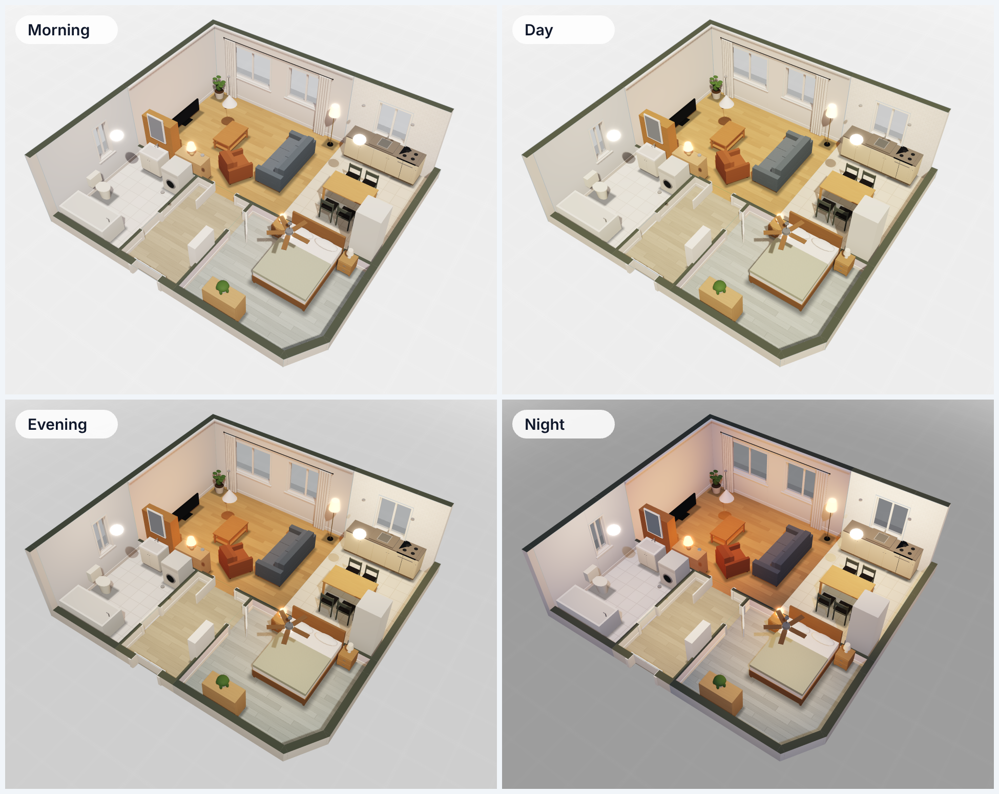
- ✅ Render on demand; quality presets (Eco, Balanced, High) picked from the GPU; adaptive
  resolution from the frame time.
- ✅ Panel: **Import plan** and **Export plan** (since M0).
- ✅ Tests: geometry and camera unit tests, golden tests on the demo plan, every kind at odd sizes,
  wasm tests in headless Chromium (load, pick, 2D switch), E2E for the gestures, toolbar, saved views
  and translated errors, visual-regression baselines of the 3D view and the 2D plan.

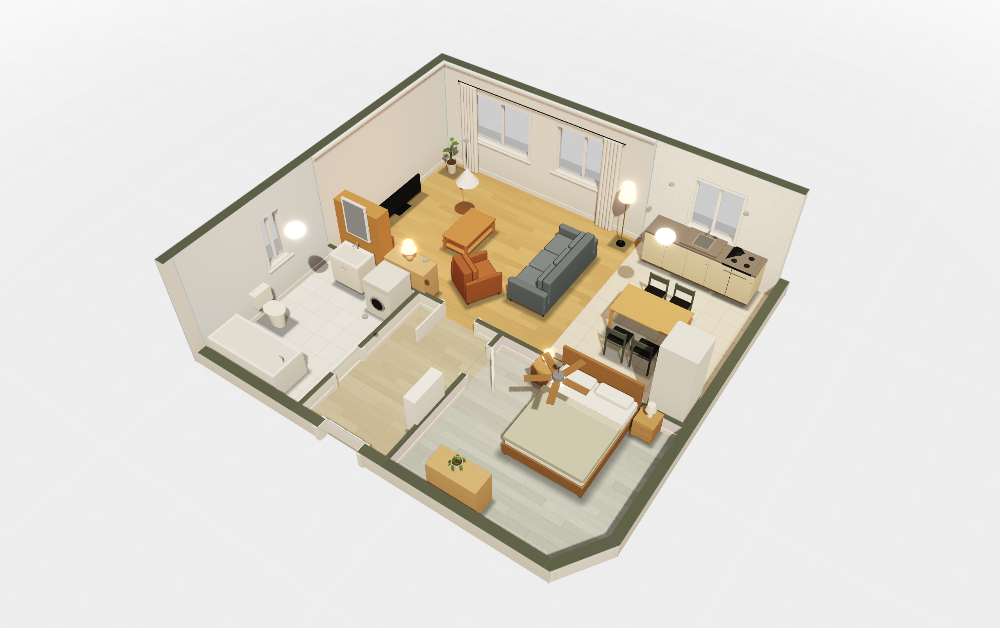

Measured at the end of M1: see [`PERFORMANCE.md`](PERFORMANCE.md). Not measured yet: real devices
(an old wall tablet, a mid-range phone), which need hardware CI does not have; to be done by hand
before the HACS submission (M13).

## M2, live control

- ✅ Core: the bindings reader (roles derived from the domain and device class, lenient like the
  plan reader), entity states, and the **targets** of every element: lamp colour and intensity from
  the light (`rgb_color`, else `color_temp_kelvin`, × brightness × the lamp's power) or a switch, the
  TV screen from the media player, curtains and doors from covers, window blinds from covers, doors
  and windows from contact sensors, unavailable entities greyed out. Lights fade (≈ 0.35 s),
  moving parts move (≈ 0.7 s). See D-016.
- ✅ Render: per-element looks in a small float texture read by the vertex shader (one upload per
  change, no rebuild); lamp shades and screens glow; up to 16 point lights, each limited to its own
  room, the strongest first, counting less in daylight; halos around bulbs (not on the ceiling);
  doors, windows, blinds and curtains as a second, small mesh rebuilt only while they move.
- ✅ Frontend: the card and the panel load the bindings and follow their changes; only bound
  entities whose state changed go to the engine. Tap actions (`toggle`, `more-info`,
  `perform-action`/`call-service`, `navigate`, `none`) with a short flash; long-press controls
  (switch, brightness, warmth, colours, cover position, media and volume, lock, climate, scenes);
  the room panel (lights, scenes, blinds and curtains, climate, media, devices, **All lights off**)
  from the room's area, or the area with the room's name; a tap on a room shows its name, which
  opens the panel. The panels are a separate chunk loaded the first time one opens.
- ✅ Linking in the panel (administrators): pick an element, link entities suggested from its room's
  area by what fits its kind, or searched; choose the tap action; link a room to an area. Each save
  is one change on top of the latest stored bindings, refused if another device saved first.
- ✅ Fixed on the way: in Eco quality, lamps and screens did not glow (a texture created mid-frame
  took the element texture's unit); halos of ceiling lights floated over the floor.
- ✅ Tests: core targets and fades, lamps and texels, the moving parts rebuild, wasm (states light
  lamps and move doors), unit tests of roles, actions, state sync and suggestions, E2E with a mocked
  demo home (tap toggles and the scene follows, more-info, long-press controls, room panel and
  **All lights off**, failed action, bindings saved elsewhere, linking a lamp and a room, admin
  only), a night baseline of live states and a check that a playing TV glows.

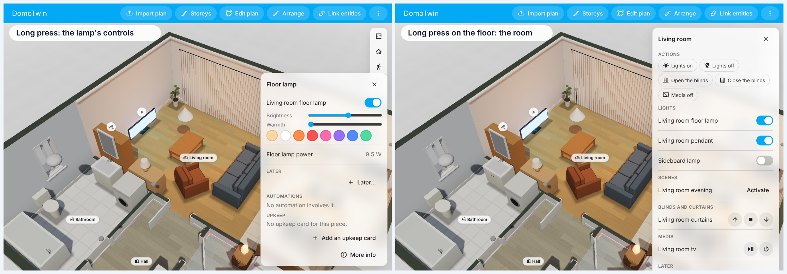

Measured at the end of M2: see [`PERFORMANCE.md`](PERFORMANCE.md).

Left for later: fan blades turning; locks and power shown on the scene (the alerts and power layers,
M4); the full bindings editor with every action (M3).

## M1b, IFC import (ISO 16739)

Suggested by the maintainer during M0 and accepted on condition that it never degrades the core
product (`DECISIONS.md`, D-009); done after M2 and before M3 as the maintainer confirmed. See
[`ifc-import.md`](ifc-import.md).

- ✅ A separate crate `domotwin-ifc` (`domotwin-import` since M11) built as its **own wasm module
  (112 kB gzipped), loaded only when an `.ifc` file is imported**: the first load does not change.
- ✅ A STEP (ISO 10303-21) reader that indexes a file in one pass and parses attributes on demand,
  never panics, and is fuzzed like the plan reader.
- ✅ IFC2x3, IFC4 and IFC4.3 subsets: units (SI prefixes, feet, inches), placements, the spatial
  structure, properties, material layers; geometry reduced to floor outlines and boxes
  (extrusions, profiles, breps, face sets, mapped items, boolean results).
- ✅ One storey → a plan: spaces become rooms (outside and gross-area spaces left out, rooms facing
  each other across a wall widened to its middle, the plan turned so that its walls run along the
  axes), wall thicknesses from the gaps and the walls, doors and windows put on the room side they
  sit in (width, hinge side, swing, style from the operation type), furniture, sanitary terminals,
  appliances and lights as pieces of the matching kind (names in English, French and German, then
  IFC types), GlobalIds as ids so that a re-import keeps the bindings.
- ✅ Panel: **Import plan** takes `.ifc` files, asks which storey when several have spaces, has the
  engine check the plan, and says what was left out.
- ✅ Tests: fictional fixtures written by `scripts/make-ifc-fixtures.py` (IFC4 in millimetres,
  IFC2x3 on two storeys turned by 30° far from the origin, a studio in feet, a shell without spaces)
  converted and read by the core with every opening on a wall; unit tests of the reader, the math
  and the kinds; E2E of the import, the storey picker, a refusal, and the module not loaded before.

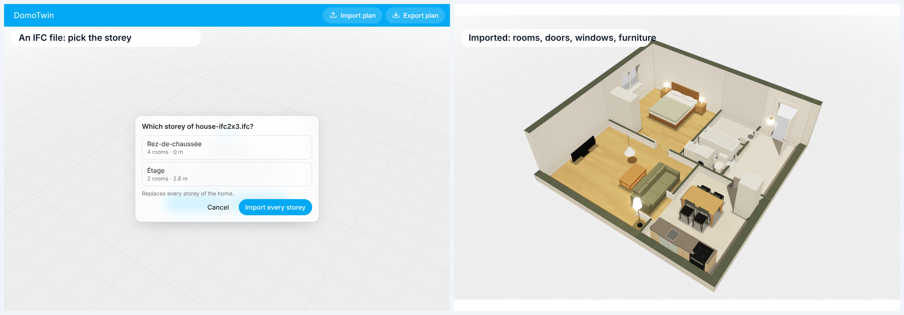

Measured at the end of M1b: see [`PERFORMANCE.md`](PERFORMANCE.md).

Left for later: window sills (the plan format fixes them at 90 cm), stairs and slabs, rooms from walls
when a model has no spaces, reading the 3D files of user models with the same module (M3).

## M3, edit mode

Goal: administrators rearrange the furniture from the panel, and link and configure everything from
the UI. See [`edit-mode.md`](edit-mode.md). The maintainer chose to split the milestone: the user's
own 3D models are M3b.

- ✅ The **edit overlay** (`layout`) applied to the plan's JSON before it is read, by the card and the
  panel; a plan made invalid by its overlay is shown without it and says so. **Export plan** writes
  the plan with the overlay applied.
- ✅ Edit mode in the panel (administrators): select and select several, **drag** with snapping onto
  wall faces, piece edges and a 5 cm grid, with dashed guides and the distances to the walls;
  **turn** by 15°; **stack** small objects on tables, chests and shelves, and move what stands on a
  piece with it; **conflicts** in red; **remove**; **add** from a catalogue of every kind, by room,
  with a search; **undo and redo** (100 steps); keyboard shortcuts.
- ✅ **Save** with the revision edit mode started from (refused if another device saved), **Cancel**
  with a question when there are changes, and a **draft** kept by the browser for that revision and
  offered again.
- ✅ The **link editor** completed: the role of each entity, the long-press action, **run an action**
  (`domain.action` on a linked entity) and **open a page**, checked before saving.
- ✅ The **card editor** completed: the room shown first, picked among the rooms of the stored plan,
  and the font.
- ✅ Tests: the overlay, snapping, stacking, collisions, the history and the session on the demo
  plan (core); the edit session through the wasm API in headless Chromium; the catalogue, the draft
  and the action fields (vitest); E2E of moving and saving, export with the overlay, turning,
  removing, adding, undo and discard, the conflict colours (visual regression), the draft restored,
  the full link editor, and non-administrators. A new fuzz target applies arbitrary overlays and
  edits the result.

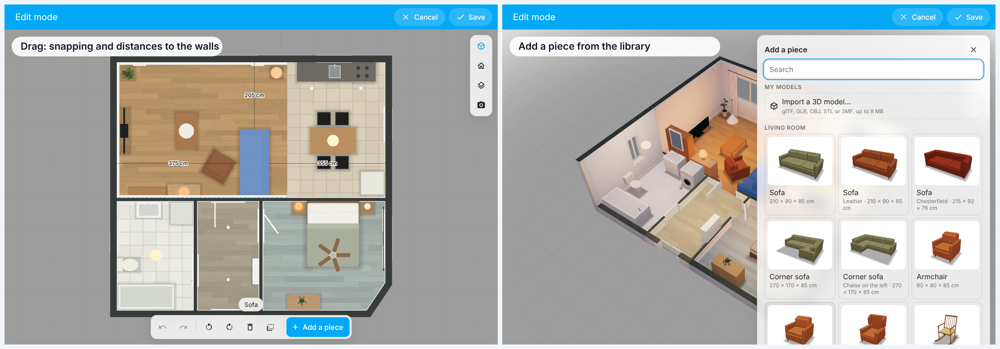

Measured at the end of M3: see [`PERFORMANCE.md`](PERFORMANCE.md).

Left for later: moving several pieces with the keyboard arrows; editing rooms, walls, doors and
windows (done in M6); refreshing the summary chip's counts while editing.

## M3b, your own furniture and appliances

**Your own furniture or appliance** (`DECISIONS.md`, D-013 and D-021).

- ✅ Readers for **glTF 2.0** (GLB, or glTF with embedded data), **OBJ**, **STL** (binary and ASCII)
  and **3MF** (base materials, colour groups, parts in other model files of the archive), in their
  own WebAssembly module, loaded only when a plan shows a 3D file or one is imported. The format's
  limits apply (8 MB, 150 000 triangles, 5 000 meshes, pictures up to 4 096 px, 32 MB unpacked),
  external files are refused. Fuzzed.
- ✅ The engine draws a file's mesh fitted into its piece (`up` axis and front), with the colours,
  metal, glass and glowing parts of its materials and the colours of its pictures sampled at the
  vertices; pieces are boxes until their file is read, or past 600 000 triangles of files in a plan.
- ✅ **Import a 3D model** in edit mode's catalogue: the name, the unit and up axis (guessed from the
  format and the file), the real size and, for files without colours, a colour; **My models** lists
  the plan's models to add more pieces of them, and forgets an imported model no piece shows.
  Imported models are overlay entries: undo, drafts and saving treat them like pieces.
- ✅ The integration keeps the files by SHA-256 in `<config>/domotwin/models/` (upload by
  administrators, reading by signed-in users), deletes the files nothing uses a day after their
  upload, and all of them when it is removed; the models of plans and overlays are checked (50 per
  plan, 20 MB of files).
- ✅ A user model linked to a light lights the room and its emissive parts glow; linked to a media
  player it lights like a screen.
- ✅ **Export plan** embeds the files as `data:` URLs; importing such a plan uploads them back.
- ✅ Tests: the four readers on fictional models in every format (`scripts/make-model-fixtures.py`),
  the fit, the overlay's models, the session; the upload, reading and clean-up views (pytest); the
  engine API in headless Chromium; the import, My models, export and import back, a refused file
  and a missing file (Playwright).

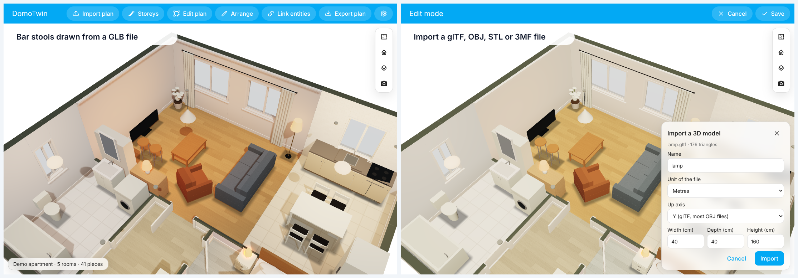

Measured at the end of M3b: see [`PERFORMANCE.md`](PERFORMANCE.md).

Left for later: textures drawn as textures, kits made in the app, resizing a piece in edit mode.

## M4, layers

The rooms show what their sensors say (`DECISIONS.md`, D-023). The layer menu of the view (or the
card's `layer` option) picks one layer at a time; alerts and presence show whatever the layer.

- ✅ **Heatmap** of temperature, humidity, CO₂ or fine particles (PM2.5): each room's value is the
  mean of the sensors of its Home Assistant area (°F and K converted; a thermostat when there is no
  sensor), drawn on its floor as a halo from the centre whose edge moves slowly, on perceptual
  scales interpolated in OKLab, with a legend and each room's value. The 2D plan shows it too.
- ✅ **Alerts**: smoke, gas, carbon monoxide, a water leak, a safety sensor or an alarm going off
  (dangers, red); a window open in the rain or the snow, CO₂ over 1 500 ppm (warnings, amber). The
  room's floor pulses and a banner lists them; tapping one frames the room. On unless the card
  sets `alerts: false`.
- ✅ **Presence**: the floor of a room whose occupancy, motion or presence sensor is on glows warm
  (`presence: false` turns it off).
- ✅ **Power**: pieces linked to power sensors are tinted from yellow (tens of watts) to red
  (kilowatts) and labelled; standby (3 W or less) is left out.
- ✅ **Real sun** (`sun: real`, or the layer menu): the sun lights the home from where it is
  (`sun.sun`) with the home's north, set by an administrator in the panel's settings; walls and
  ceilings cast shadows, so it comes in through the windows and open doors. Below the horizon the
  time of day dims it (D-015).
- ✅ The animation runs at 24 frames per second only while a layer that moves is shown and the
  view is visible, at the display's rate during gestures; reduced motion holds it still.
- ✅ Tests: the scales, the room texels, the power scale and the sun's direction (Rust); the
  engine's layer API in headless Chromium; the values from areas, units, alerts and presence
  (vitest); the settings commands (pytest); the heatmap, the power layer, alerts, the frame rate
  and reduced motion, the real sun and the north setting (Playwright).

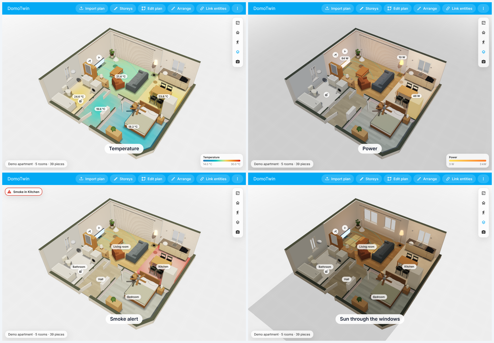

Measured at the end of M4: see [`PERFORMANCE.md`](PERFORMANCE.md).

Left for later: avatars of the people at home, picking a room's sensors one by one, more scales
(noise, light level, radon), the sun's position computed without `sun.sun`.

## M5, devices

Devices drawn as what they are (`DECISIONS.md`, D-024; `bindings.md`, Devices).

- ✅ **Badges** over linked elements, in 3D and 2D: a lock's state (locked, unlocked, moving,
  open, jammed), a camera (recording, unavailable), what plays, a battery at 20 % or less, an
  appliance running (washing machine, dryer, dishwasher, cooker, hood, printers: power over 10 W or
  a `running` sensor). At most two per element, the most urgent first; a tap does what a tap on
  the element does.
- ✅ **Cameras**: a new `camera` role; what a camera sees on the floor, from the piece it is
  linked to, in its room with its walls hiding what is behind them, red while recording; its angle of view and reach set in the link
  editor (`fov`, `range`); a tap opens Home Assistant's more-info with the live picture.
- ✅ Unavailable locks and cameras grey out their element, like lights.
- ✅ Card options `badges` and `cameras`, the layer menu turns both off; linking suggests
  cameras for shelves, picture frames, spots and models.
- ✅ Tests: what a camera sees and what walls hide, the camera's settings (Rust); the engine's camera and
  point API in headless Chromium; the badges' rules (vitest); `fov` and `range` validation
  (pytest); badges, a tap on them, cones, recording, and setting a camera when linking (Playwright).

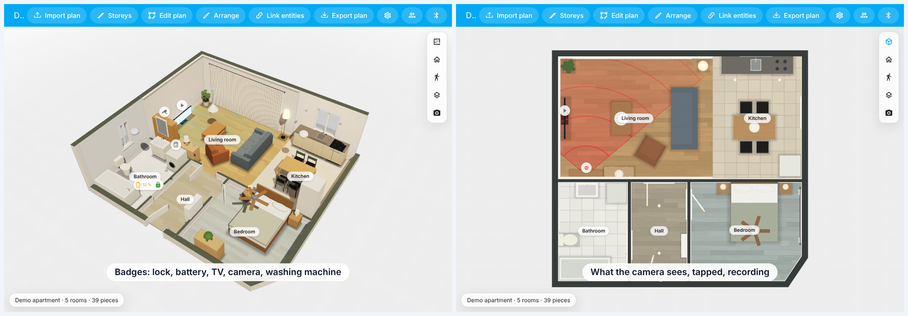

Left for later: cameras not on a piece (not drawn by the plan editor either), a camera's picture in the
view, cones cut by furniture, more device classes (vacuums with their position, irrigation).

## M6, plan editor

Draw a plan in the app (`DECISIONS.md`, D-025; [`plan-editor.md`](plan-editor.md)).

- ✅ **Edit plan** in the panel, **Draw a plan** when none is stored (a new plan with one room); the
  2D plan, Cancel and Save, a bar with the tools, Undo, Redo and Remove.
- ✅ **Rooms**: drawn as rectangles or dropped with a tap, moved with everything in them, reshaped
  by their corners (dragged, added in the middle of a side, removed), the length of each side
  shown; name and floor.
- ✅ **Partitions** drawn from end to end, with their thickness; **doors** and **windows** placed on
  the nearest side of a room, moved along the sides, kept on their side when the room is reshaped;
  width, kind and opening side of doors.
- ✅ **Snapping** onto the other rooms' corners, in line with them (with guides), else onto a 5 cm
  grid; every change checked by the plan reader, refused changes said.
- ✅ **Saved** with the overlay in the plan, refused if another device saved; a plan not saved kept
  by the browser and offered again. Edit mode's button is now **Arrange**.
- ✅ The draft in **its own wasm module**, loaded when the plan editor opens: the first load grew by
  7.5 kB gzipped.
- ✅ Tests: the draft's changes (Rust) and fuzzing (every change kept leaves a plan the reader
  accepts); the engine's drafts and points in headless Chromium; the fields, keys, labels and
  draft storage (vitest); editing, drawing from nothing, keys, the kept draft and cancelling
  (Playwright); the cost of a drag (4.7 ms).

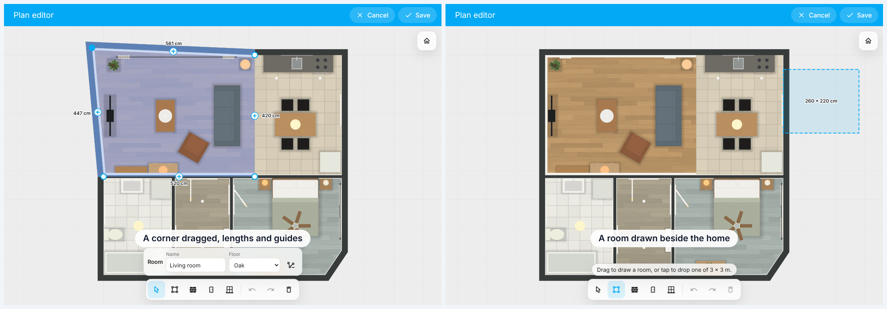

Left for later: sides without a wall, per-side thicknesses and finishes, typing a side's length,
a camera of its own (not on a piece).

## M7, storeys

Several storeys in one home (`DECISIONS.md`, D-026; [`storeys.md`](storeys.md)).

- ✅ **Storage 2.1**: storeys `{id, name, elevation, plan, layout}`, the home of 1.1 migrated as its
  first storey; `plan/get` and `plan/save` take a storey (the ground floor by default),
  `storey/save`, `storey/remove` and `storeys/replace` (all at once, or none); element ids, and
  pieces added in edit mode, unique in the whole home (`duplicate_id`); at most 20 storeys; 3D
  files kept while any storey uses them.
- ✅ **A storey switcher** in the view's tools, highest on top, numbered from the ground floor; the
  card's `storey` option, with a picker in the visual editor; **stairs**, a new furniture kind,
  lead to the next storey on a tap.
- ✅ **Storeys** in the panel: name, floor height, removal, a new storey imported or drawn in the
  plan editor; import, edit, arrange and export work on the storey shown; drafts kept per storey.
- ✅ **IFC**: **Import every storey** of a file in one save, with their names and elevations
  measured from the ground floor; ids renamed where two storeys share them (`freeIds`).
- ✅ **Alerts from every storey** in the banner, with their storey; the switcher marks a storey with
  an alert and a tap on the alert goes there.
- ✅ A fictional upper floor for the demo apartment (`examples/demo-upper-floor.domotwin.json`).
- ✅ Tests: migration, storey commands, unique ids, admin-only writes (pytest); stairs, the upper
  floor and renaming ids (Rust); levels, names, the card editor's picker, alerts elsewhere
  (vitest); the switcher, stairs, the card option, the dialog, a storey drawn, imported, a whole
  IFC file, an alert upstairs (Playwright).

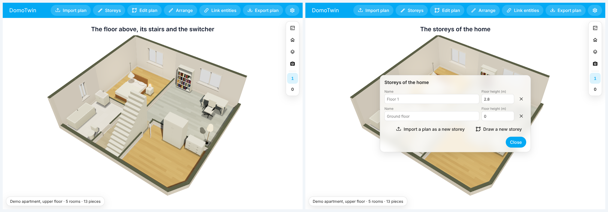

Left for later: the storeys stacked in one 3D view (the floors above see-through), stairs cut into
the floor above, the heatmap and presence of the other storeys.

## M8, looks

Three looks for the scene (`DECISIONS.md`, D-027; [`looks.md`](looks.md)).

- ✅ **Neon**: a night sky, a grid on the ground fading into the dark, walls of tinted glass, the
  outlines of the home glowing in an accent colour, the furniture in a palette of night blues,
  lamps and screens that shine.
- ✅ **Blueprint**: white lines on blue, an architect's drawing in 3D.
- ✅ **Day**: the home as it is, in the light of the time of day, now standing on a ground with
  its shadow, thin outlines, lamps that glow on desktop GPUs.
- ✅ **Outlines** of the home from the walls' layout: wall tops and corners, the frames of doors and
  windows, the floors' outlines, lowered with the cut-away; lines a few pixels wide whatever the
  zoom.
- ✅ **Bloom** of what glows (lamps, halos, screens, outlines, the grid), drawn offscreen with 4×
  MSAA; on old tablets (Eco) the looks are drawn straight to the screen, without it.
- ✅ **Automatic**: neon in Home Assistant's dark mode, day otherwise; the home's look and accent in
  the panel's settings (shown as they are chosen), the card's `theme` and `accent` options, the
  panel's header and the view's buttons and dialogs in the look's colours.
- ✅ **The rooms' names** on their floors (card option `names`).
- ✅ Tests: the outlines of the demo apartment, the looks (Rust); every look drawn with and without
  its bloom, without a WebGL error (headless Chromium); options and settings (vitest, pytest); the
  looks of a card and of the panel, automatic, the names (Playwright); the frame time of each look.

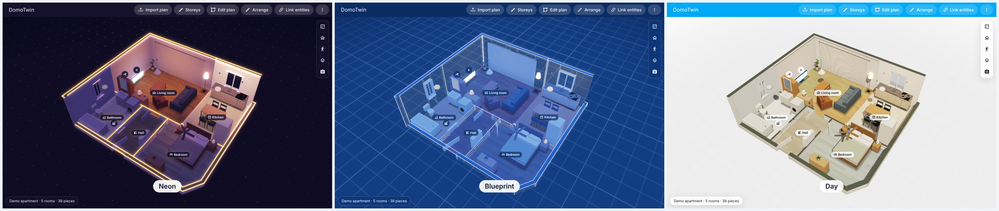

Left for later: every storey at once (M9), reflections on the floors, a sky that follows the
weather.

## M9, every storey at once

The whole home in one view (`DECISIONS.md`, D-028; [`storeys.md`](storeys.md)).

- ✅ **One scene of every storey**: each storey's meshes and outlines built apart with its height,
  its elements, rooms, walls and lamps numbered across the home, so that the live looks, the
  layers, the cut-away and taps work on every storey.
- ✅ **Spread apart or stacked**, animated, the camera framing the home as it will be; each storey
  drawn at its lift, lamps lighting their own storey, badges, cones and labels following it.
- ✅ **A roof** over the top storey: a gable over the smallest rectangle around its walls, of glass
  in the night looks, tiled in day, never in the way of a tap.
- ✅ **The 2D plan of every storey**, side by side, each with its label over it.
- ✅ **Each storey's label** (its name, rooms and lights on) and **a picture of each storey**, drawn
  offscreen in the look shown; a tap on either shows that storey alone.
- ✅ **Where**: an "every storey" button in the switcher, the card's `storey: all`, `spread` and
  `roof` options and buttons; in the panel, edit mode, linking and the plan editor work on one
  storey, and the home comes back after.
- ✅ Tests: the roof's rectangle and slopes, the demo home built storey by storey (Rust); the
  storeys spreading, stacking and lying side by side on the plan (view); the whole home drawn, a
  tap on the floor above, the plan of storeys side by side (headless Chromium); the options, the
  card editor, the counts on the labels, a storey without a plan (vitest); a card showing every
  storey, spreading, the roof, a lamp upstairs tapped, the 2D plan, edit mode on a storey alone
  (Playwright); the frame time of the whole home.

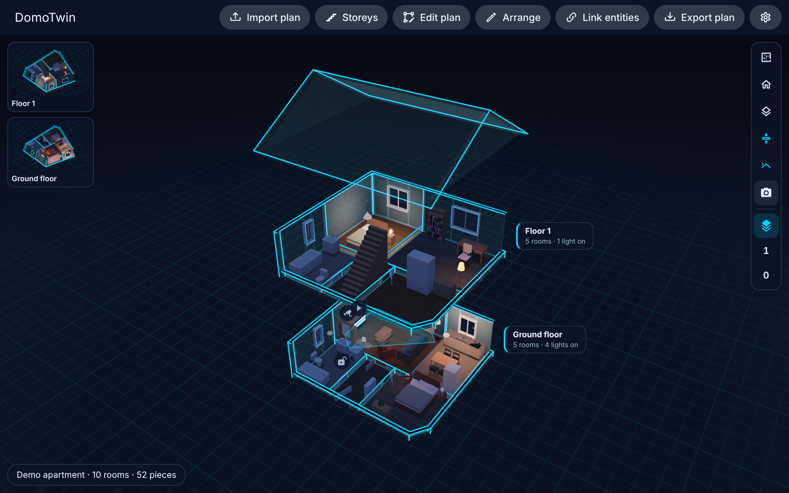

Left for later: stairs cut into the floor above, a roof read from an IFC file, several roofs over
a home of several wings.

## M10, kiosk

Walking, wall tablets and the voice (`DECISIONS.md`, D-029; [`kiosk.md`](kiosk.md)).

- ✅ **Walking at eye level**: the walk button, drag to look around, tap the floor to go there
  (through the doors and the open sides between rooms, the shortest way), the pad and the keys to
  walk, the wheel and a pinch to step; never through a wall, a partition or a window; a room shown
  is walked into, a piece walked up to; whole walls and lit ceilings; stairs still lead up.
- ✅ **The kiosk**: back to the card's view after `idle` seconds untouched, a slow turn (`orbit`),
  dimmed at night (`night_dim`, unless an alert shows), `tools: false`; a touch wakes it.
- ✅ **`domotwin.show`**: an action that shows a room, an element, a storey or a view on every
  screen or on one (`screen`), found by name as said, on any storey.
- ✅ **Assist**: a blueprint turning "show the kitchen" into `domotwin.show`, with Assist's answer.
- ✅ Tests: where a walker can go, the doors and the way between rooms, the widest view, the eyes'
  camera (Rust); walking, a tap on the floor, the walls stopping it (view, headless Chromium); the
  kiosk's options, the requests found by name (vitest); `domotwin.show` checked and sent, the
  blueprint answering a sentence (pytest); walking with the pad, the keys and a tap, the kiosk going
  back and dimming, requests for this screen and another (Playwright); the frame time walking.

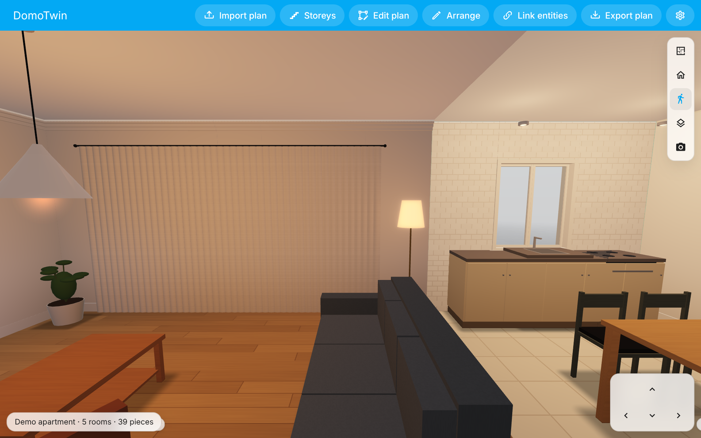

Left for later: furniture in a walker's way, walking up the stairs, a voice answer naming what was
not found.

## M10b, DomoTwin's own plan format

The plan format DomoTwin started from is dropped for one of its own (`DECISIONS.md`, D-030;
[`plan-format.md`](plan-format.md)).

- ✅ **`*.domotwin.json`**: `"format": "domotwin-plan"`, elements in lists by what they are, rooms
  as outlines, openings from one end to the other, items by their centre, size and rotation, every
  name in English; its JSON Schema, kept equal to the core's lists by a test.
- ✅ **Written everywhere**: the plan editor, the edit overlay (`at`, `rotation`, `lift`, `room`),
  the IFC import, **Export plan**; the demo apartment and its upper floor converted.
- ✅ **Stored plans of the earlier format are set aside** at start-up (storage 3.1, kept in the
  stored data, with a warning); no reader or converter of it ships.
- ✅ Tests: the reader's codes and defaults, the overlay, the editor, the IFC fixtures (Rust); the
  plan's lists (vitest); the envelope, the storage migration (pytest); every e2e test on the new
  files (Playwright).

## M9b, network map

The Zigbee mesh drawn over the home (`DECISIONS.md`, D-031; [`network.md`](network.md)).

- ✅ **The network layer**, for administrators with ZHA: each device at the piece linked to its
  device or entities, the links as arcs coloured by quality (good, fair, weak, in one place), a
  pulse towards the coordinator along the ways devices take, spare links lighter, links to a
  device not heard from for a day dashed; still under *reduce motion*.
- ✅ **Tap a device or a link** for its details: type, LQI, RSSI, last seen, hops and through
  which device, neighbours best first; a link's ends and quality.
- ✅ **Health**: devices, weak links, devices not seen for a day, and the rooms that reach the mesh
  only through weak links (*a router here would help*). **Rescan** asks ZHA for a new scan.
- ✅ **Not placed in the home**: the devices the map cannot place, with *Place* in the panel (tap
  the piece, the link editor opens filled in). Bindings gain `device`, for a coordinator without
  entities.
- ✅ **A source behind an interface** (ZHA now), the analysis in the core, wires as a scene
  primitive the automation wires will use; device ids and Zigbee addresses kept out of
  diagnostics.
- ✅ Tests: the mesh read, merged and routed, its health, its wires and arcs (Rust); the wires drawn
  and found under a tap (headless Chromium); ZHA's answer mapped, devices placed, the snapshot
  (vitest); the `device` field, diagnostics without ids (pytest); the layer offered to
  administrators with ZHA only, the sheet, a tap on a device and on a link, rescan, placing from
  the panel, markers on a dense screen, a picture per look (Playwright); the frame time with the
  map and the cost of a 300-device mesh.

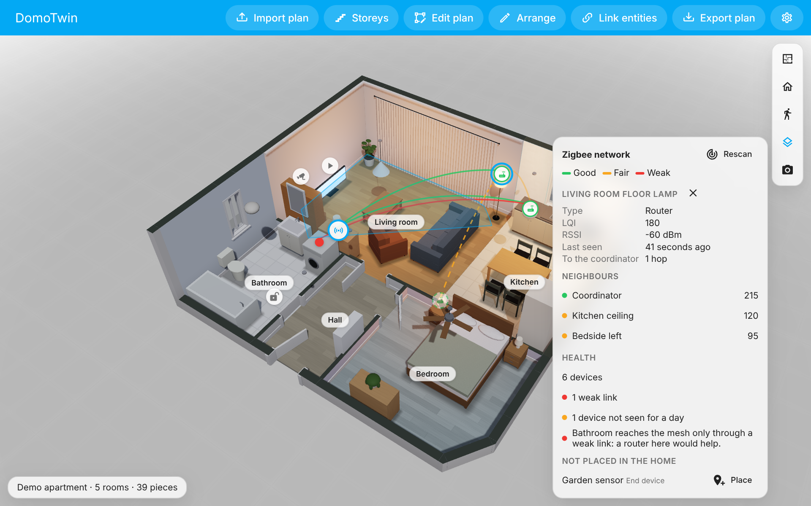

Left for later: Zigbee2MQTT and Thread as sources, a device's history of quality, a link's
neighbour table both ways.

## M9c, automation wires

What sets off what, drawn in the home, live (`DECISIONS.md`, D-032; [`automations.md`](automations.md)).

- ✅ **Automations in the panels**: those related to a piece's entities, its device and its room's
  area, with how the piece takes part, a switch, when it last ran and an editor link for
  administrators; the same in a room's panel.
- ✅ **Show wires**: from every trigger and condition to every action, one colour per automation,
  dashed from conditions and to what a template decides; ends marked by role; labels floating
  above a room or the home for what has no piece, lifted apart; a tap picks one out.
- ✅ **Live**: a pulse along an automation's wires when it runs, the pieces it acted on flashing;
  wires flashing under *reduce motion*.
- ✅ **Every automation of the home** from the layer menu, lighter, bundled by room above 30.
- ✅ **The reader in the core**, lenient and fuzzed; both spellings of Home Assistant's
  configuration; nested steps followed.
- ✅ Tests: reading fictional configurations (nested `choose`, `if`, `repeat`, device triggers,
  area targets, templates, unknown steps, depth), wires and bundles (Rust); wires drawn, found,
  pulsing (headless Chromium); related automations, placing, roles, runs, labels lifted
  (vitest); the panel section, the wires, a mocked run, others without wires, the layer, 50
  bundled, a picture per look (Playwright); the frame time with 50 automations.

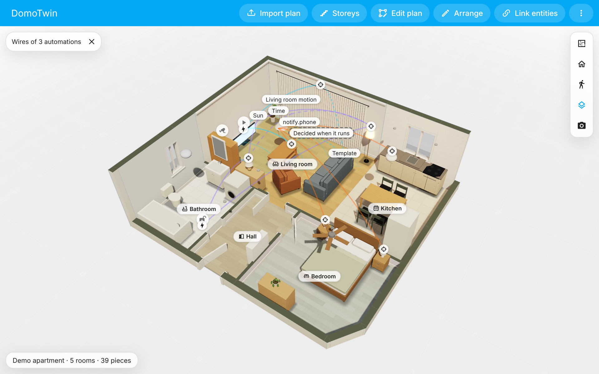

Left for later: scripts followed into, a run's trace (which branch it took), wires between
storeys shown apart.

## M9d, upkeep cards

What each piece needs to be looked after, and what is due (`DECISIONS.md`, D-033;
[`upkeep.md`](upkeep.md)).

- ✅ **A card per piece**: make, model, serial number, install date, warranty end, service life, a
  manual link and notes, recurring tasks; written by administrators in the piece's sheet (a sheet
  of its own for a piece linked to nothing), **Done** for everyone.
- ✅ **Kept by the integration** by piece id, out of the plan (storage 4.1); a plan's export offers
  its cards as a file of their own.
- ✅ **Due soon and overdue**: the date reckoning in the core (months ending at the end of shorter
  ones), the same in the integration, both tested on shared cases; badges joining the devices';
  a warranty ending within 30 days.
- ✅ **The upkeep layer**: the pieces tinted green, amber or red, the tasks listed by date with
  **Done**, the lead set by administrators.
- ✅ **From IFC files**: manufacturer, model, serial number, installation, warranty and service
  life from the standard property sets and the assets, IFC2x3 and IFC4.
- ✅ **One sensor**, `sensor.domotwin_upkeep_due`, the tasks in its attributes.
- ✅ Tests: dates, ends of months and of February, states (Rust and Python on the same cases);
  storage, migration, validation, commands, the sensor across days (pytest); the IFC reader on a
  new fictional fixture and IFC2x3 (Rust); the engine's states and layer (headless Chromium);
  badges, lists, merging (vitest); writing a card, a task falling due, Done, others, the layer's
  picture (Playwright); a fuzz target.

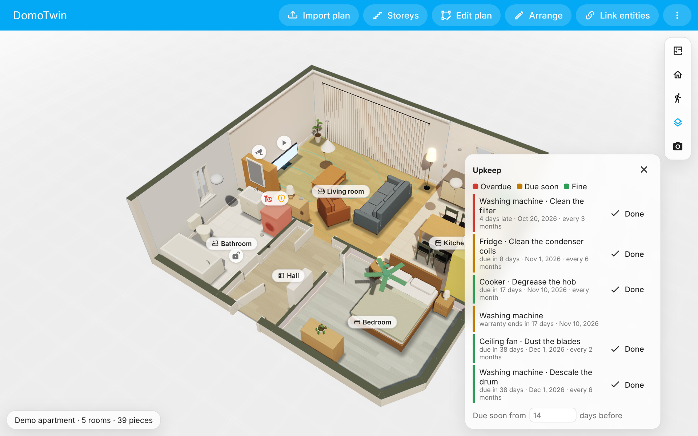

Left for later: reminders sent by DomoTwin itself (the sensor is there for automations), tasks
of a room rather than a piece, a history of what was done.

## M9e, people in their rooms

Who is home and in which room, live (`DECISIONS.md`, D-034; [`people.md`](people.md)).

- ✅ **Placed by the integration** from the entities that say where each person is (Bermuda's
  area sensors, ESPresense, any entity naming a room or an area): the last to change wins, only
  people at home; settings in a store of their own, chosen by administrators with suggestions.
- ✅ **A sensor per person**, `sensor.domotwin_<person>_room`, for automations.
- ✅ **Figures in the 3D view**: a person or a pin in their colour, glowing in the looks that glow,
  standing clear of the walls, the furniture and the room's name; walking through the doors when
  they change rooms (fading to another storey); still under *reduce motion*.
- ✅ **Names over them**, a sheet each (where, since when, what said so), who is there in the
  room's panel, how many on each storey's button; a card option `people`.
- ✅ **Hiding**: anyone hides themselves and shows themselves again; administrators anyone; people
  shown to administrators only.
- ✅ **Asking**: `domotwin.where` with a sentence in English or French, `domotwin.show` for a
  person, the `where_by_voice.yaml` blueprint for Assist.
- ✅ Tests: rooms found, people placed, likeness of names (pytest); the sensors, the commands, who
  may do what, renames, revisions, the voice blueprint (pytest); walking through the doors, places
  clear of the furniture, storeys, plan changes (Rust); the engine in headless Chromium; the shown
  people, colours, initials (vitest); names, sheets, walking, hiding, the settings, a picture per
  look (Playwright); a frame-time case with ten people walking.

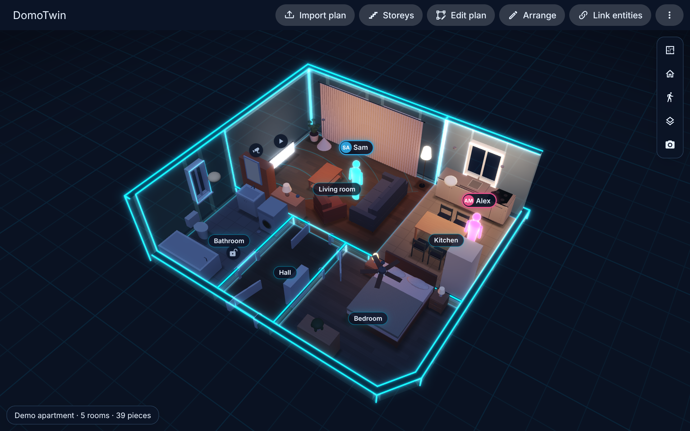

Left for later: a history of where people went.

## M9f, Bluetooth locating

DomoTwin's own room locating from Home Assistant's Bluetooth receivers, for homes without Bermuda
or ESPresense (`DECISIONS.md`, D-035; [`bluetooth.md`](bluetooth.md)).

- ✅ **Devices followed**: phones and watches by their Private BLE Device key (the key never leaves
  Home Assistant), Android phones by the companion app's iBeacon, tags by their address; chosen by
  administrators from what is heard.
- ✅ **Receivers placed** from their device (its area, the piece linked to it) or by hand.
- ✅ **A model from the plan**: distance, walls, doors, open sides, floors; it locates from the
  first minute, without a calibration walk; silence from a receiver counts.
- ✅ **Learned**: a room taught in half a minute, presence sensors agreeing as people live, each
  device's loudness.
- ✅ **Along the doors**: a filter over the rooms that follows the doors and stairs, slow to change
  its mind; presence sensors weigh in for what people carry.
- ✅ **Sensors**: `sensor.domotwin_<device>_bluetooth`, a source of its owner's room (D-034), and
  `binary_sensor.domotwin_<device>_left_behind` for things left at home.
- ✅ **In the views**: a person's devices in their sheet, the things in a room's panel; "where are
  my keys?" by voice.
- ✅ Tests: walls, ways and pieces of the demo home, the specification's key sample, iBeacons, the
  model, the filter, a simulated walk with noisy readings (pytest); the locator with a mocked
  Bluetooth (receivers placed, devices by address, key and beacon, teaching, presence, left
  behind, the commands, voice); the frontend's helpers (vitest); the settings, teaching, sheets
  and panels (Playwright).

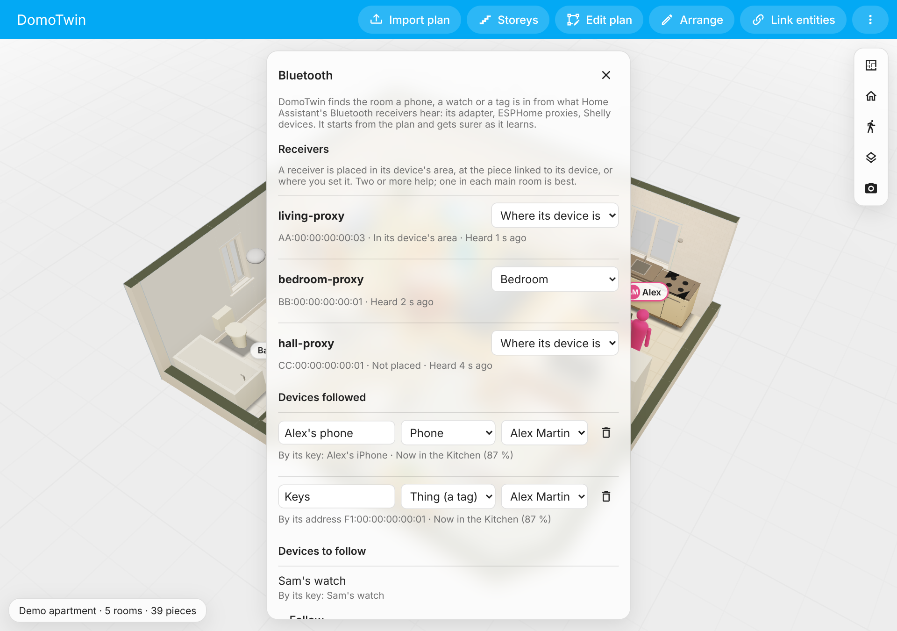

Left for later: a position inside the room (trilateration), a heat map of what each receiver
hears.

## M8b, two more looks

A cartoon and a clay model besides neon, blueprint and day (`DECISIONS.md`, D-036;
[`looks.md`](looks.md)).

- ✅ **Researched**: cel shading, flat colours and the three usual ways to ink a 3D scene (an
  inverted hull, edges found in the picture, lines from the geometry), and which second look.
- ✅ **Cartoon**: two steps of sunlight, vivid flat colours, thick ink on the home's outlines, a
  darker rim on curved pieces, and ink found in the picture's depth around the furniture, the
  people and the home (from the Balanced quality up), under a blue sky on a lawn; inked labels.
- ✅ **Clay model**: one warm matte clay, soft light and shadows, faint lines; lamps still glow.
- ✅ Both follow the time of day, in the 3D view and the 2D plan; a card's `theme: cartoon` or
  `clay`, and the panel's settings.
- ✅ Tests: the looks' data (Rust); every look drawn at each quality, the cartoon's ink alone on
  Balanced (wasm); the options (vitest, pytest); the sky, the ink by quality, the time of day, the
  settings and a picture of each (Playwright); the frame time of each look.

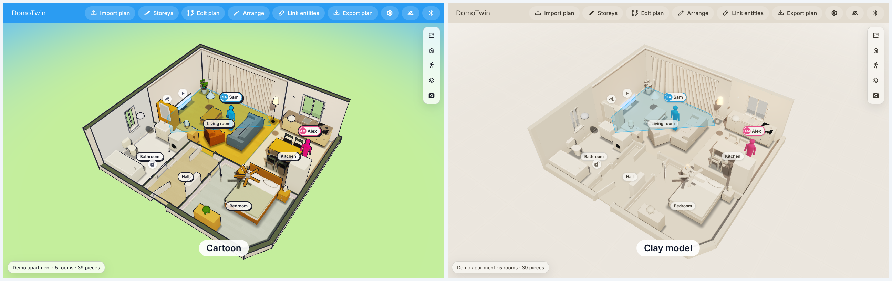

Left for later: ink on the creases of a piece (found in its normals), a watercolour look.

## 0.1.0, the first release

Moved forward by the maintainer, right after M8b (D-037): every milestone above, released as it is.

- ✅ release-please's pull request merged: the `v0.1.0` tag, the GitHub release with its changelog,
  and `domotwin.zip` (the integration with its built frontend) attached for HACS.
- HACS installs it as a custom repository (README, *Quick start*). The submission to HACS's default
  list waits for M13.
- Left for M13: the install test on a clean Home Assistant and the measurements on real devices.

## M5b, what cameras see, on the floor

Raised by the maintainer, twice: the view of a camera (D-024) was a flat shape laid over the
picture, over the sofa and the people, and was taken for the room's outline. The engine draws it
on the floor of its room instead (`DECISIONS.md`, D-038):

- ✅ **On the floor**, hidden by the furniture and the people standing on it; moved with its
  storey; not drawn while walking, nor in the storeys' pictures.
- ✅ **A look of its own**, not a room's highlight: a fan from the camera, fading out with
  distance, with a ring every metre from the camera and its two side rays as thin lines; never a
  line along the walls. Blue (the look's accent), red while recording, grey when unavailable.
- ✅ **Faint until the camera is tapped** (its piece or its badge), then whole for 15 seconds; a
  tap anywhere else makes it faint again.
- ✅ The card's `cameras: false` and the layer menu still leave the views out; editing and linking
  too.
- ✅ Tests: the fan's mesh and its states (wasm, no GL error, faint, whole, every tone, walking);
  the views drawn, faint and whole, their tones, hidden, and narrower when the angle is changed
  (Playwright, from the picture's pixels).

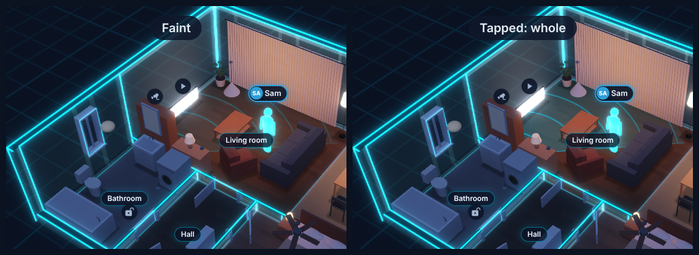

## M9g, private rooms

Asked by the maintainer: a room whose view and controls can be locked, or kept for some people
only (`DECISIONS.md`, D-039; [`privacy.md`](privacy.md)).

- ✅ **Per room**, in the panel's *Private rooms* (administrators):
  - **open** to everyone, as before (the default);
  - **private**, kept for the people chosen (none: for nobody), through the Home Assistant user
    of their `person`. A shared wall tablet's user is no one's, so the room stays private there;
  - **always, or while an entity is on** (an automation can then close the bedrooms when guests
    come); an entity unavailable or unknown keeps it private.
- ✅ **For whoever may not see it**:
  - the room is drawn closed: a frosted, hatched cover over its floor, its name with a lock;
    its walls follow the cut-away like the others', so the rooms behind it stay in sight;
  - no furniture, lamps, devices, badges, layers' values, camera views or people inside; its
    alerts still show (a smoke alarm matters more);
  - taps do nothing, and a long press opens its panel, which says it is private;
  - walking does not go through its doors, and people's figures go round it where they can;
  - the people's sheets and the voice answers say "in a private room"; `domotwin.show` and
    `domotwin.where` do not show it.
- ✅ **Administrators** see it whole in the edit and plan modes and while linking, to change the
  home.
- ✅ **The limit, said in the settings**: DomoTwin closes its own views, controls and answers.
  Home Assistant gives every user every entity in its other dashboards and its API (its
  permissions are by user, not by entity), so this keeps a room private on a shared screen, not
  behind a security barrier.
- ✅ Tests: the scene without the room's pieces, lamps or way in, the walking floor closed, the
  room's flag (Rust); the engine closing and opening a room, its camera's view gone (wasm); who
  may see which room, the settings checked, the voice answers (pytest, vitest); the room closed,
  its badges and people gone, taps, the panel, kept for the user viewing, the entity's switch,
  the settings and edit mode (Playwright).

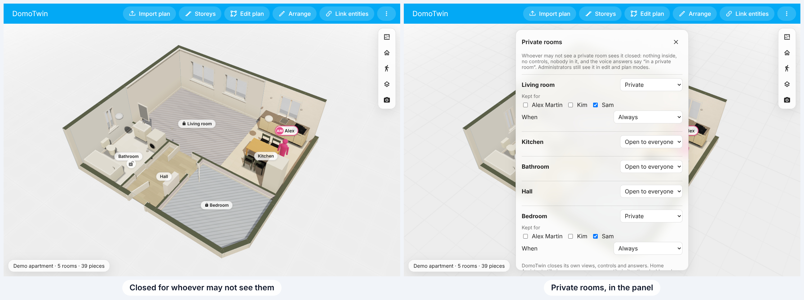

## M11, imports

Plans of other apps turned into DomoTwin plans (`DECISIONS.md`, D-040;
[`imports.md`](imports.md)). **Import plan** finds the format from the file's content.

- ✅ **One import** (`domotwin-import`, renamed from `domotwin-ifc`): each reader gives a draft to
  one plan builder, which closes the gaps between rooms, places the openings, turns the plan square
  and keeps 500 elements. The IFC plans did not change.
- ✅ **Sweet Home 3D** (`.sh3d`, 5.3 and later): levels as storeys, rooms with their names, wall
  thicknesses, doors and windows with their hinge and swing from their sash, pieces, lights and
  groups by name; the home's own ids kept, so importing it again keeps the links. A level drawn
  with walls only gets the rooms its walls enclose.
- ✅ **DXF drawings** (ASCII, R12 to 2018): walls, doors, windows, furniture and rooms from the
  names of layers and blocks (English, French, German, Spanish); units from `$INSUNITS` or the
  drawing's size; rooms from room outlines or from the faces the wall lines make, named by the
  text inside; doors from their swing.
- ✅ **Room scans** from Apple's RoomPlan, as USDZ (its text layers, one per element) or JSON (one
  room or a whole structure of rooms and stories): rooms from floors or walls, named by their
  sections in the user's language, doors, openings and windows, objects by category and
  attributes (a storage unit under a sink is a counter), turned square.
- ✅ **Said, not guessed**: old Sweet Home 3D homes, binary DXF, DWG, binary USD (`usdc`) and mesh
  scans (OBJ) are refused with what to do instead.
- ✅ Tests: each reader and the builder (Rust), the fictional files of
  `scripts/make-import-fixtures.py` converted end to end, refusals; the readers fuzzed together
  (`plan_import`); the panel importing each format, a level picked, French messages and names
  (Playwright).

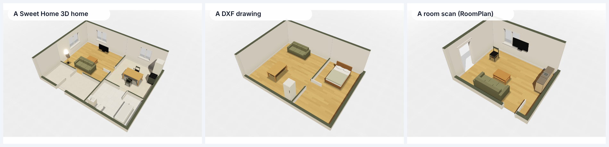

Measured at the end of M11: see [`PERFORMANCE.md`](PERFORMANCE.md).

Left for later: OBJ and other mesh scans, USD's binary layers, DWG.

## M12, polish

Design pass, bundled variable font and `font_family` option, accessibility (keyboard, focus rings,
screen-reader labels, reduced motion), README with real screenshots and a GIF made from the demo
plan, and voice (asked by the maintainer; Home Assistant's Assist does the listening, the
recognition and the speech, with whatever pipeline the user set up, local Whisper and Piper
included: DomoTwin embeds no voice engine; D-041, D-042):

- ✅ **A microphone button** in the card and the panel opens Home Assistant's Assist already
  listening (the dashboards' `assist` action), with the pipeline that hears, so a wall tablet
  without a voice satellite can speak to it. The browser gives the microphone to pages served
  over HTTPS only: over HTTP, a dialog says so and how to serve Home Assistant over HTTPS, and
  offers to type instead. The card's `voice` option hides it.
- ✅ **The voice blueprints at hand**: DomoTwin's voice settings add "show the kitchen" and
  "where is…" to Home Assistant's blueprints in one tap, from the copies the integration ships,
  say when one was edited there, and open the blueprint page to make an automation.
- ✅ **Voice set up when it is not**: when Assist has no speech-to-text, the microphone button
  offers to set it up, locally, with the administrator's consent and saying what is downloaded:
  - on Home Assistant OS and Supervised, DomoTwin installs and starts the Whisper app (or
    Speech-to-Phrase, faster on small hardware such as a Raspberry Pi) and Piper through the
    Supervisor, as the Z-Wave JS and Matter integrations install theirs. Then it adds them
    through the Wyoming integration and sets up an Assist pipeline in the user's language,
    preferred when the preferred one could not hear;
  - on Home Assistant Container and Core, which have no apps, the dialog gives the steps (the
    Wyoming containers to run) instead;
  - someone who is not an administrator is told to ask one.

  Nothing leaves the home: the models run in Home Assistant, and DomoTwin calls no other service.
- ✅ **A font of its own**: Inter, variable, cut down to about 60 kB and served by the
  integration under its content hash, fetched only when a text uses it. `font_family` puts
  another first (`theme`: the theme's). Buttons and fields use it too.
- ✅ **A calmer header**: the panel keeps its daily actions; the export and the settings go in a
  **More** menu, so the title stays readable on a laptop.
- ✅ **Accessibility**:
  - the 3D view is described by its keys; Tab reaches a list of the rooms, with the layer's
    values, which opens their controls;
  - menus follow the WAI-ARIA menu pattern;
  - dialogs and sheets take the focus, close with Escape and give it back;
  - switches and rows are named after their entity, and toggles no longer claim a state their
    label contradicts;
  - focus rings everywhere, contrast raised to 4.5:1 where it fell short, toasts read by a live
    region;
  - *reduce motion* also stills the camera's moves, the storeys and the walls.
- ✅ **README**: the screenshots of the demo plan in the bundled font, and a GIF of it from the
  demo plan.

Left for later (D-042): the keyboard for picking in link mode, arranging in edit mode and drawing
in the plan editor, and form errors tied to their field.

## M12b, size and speed

A pass over the whole of DomoTwin that keeps the picture as it is, measured before and after: the
first load (the network map's analysis and the automation reader in modules of their own, see
`PERFORMANCE.md`), the frame time on the Balanced and Eco presets against the budgets, the
integration's work in Home Assistant, and the CI's time.

- ✅ **The first load**: the network map's analysis and the automation reader in a module of their
  own (`domotwin-analysis`, D-043), loaded the first time they are shown. 480.5 kB → 468.7 kB
  gzipped.
- ✅ **A large mesh** (300 devices, 2 400 links): its drawing handed to the engine as numbers, its
  analysis written as it is made. As fast as before end to end, with the analysis out of the
  engine.
- ✅ **The frame time** of Eco, Balanced and High measured against each other
  (`e2e/perf.spec.ts`). The renderer did not change, nor did its times.
- ✅ **The integration's work** measured: the Bluetooth tick, every two seconds, takes about
  80 µs a device followed, and each packet heard about 3 µs.
- ✅ **The CI's time**: the browser tests in four parts, run side by side.

## M13, release 0.2.0

Tag and release 0.2.0 with the `domotwin.zip` asset, install test as a HACS custom repository on a
clean Home Assistant, measurements on real devices, and the checklist for the HACS default
repository list in `HACS_SUBMISSION.md` (D-044):

- ✅ **Brand images of its own**: the icon, the logo and the dark logo in the integration's
  `brand/` folder, which Home Assistant shows from 2026.3. They are rendered from one drawing by
  `scripts/render-brand.mjs`. The HACS check runs with nothing ignored.
- ✅ **Install test on a clean Home Assistant** (2026.10), from a zip made as the release makes
  it: the smoke test passes (it now also asks for the brand icon), then the panel and a dashboard
  with the card work in a browser, with no request outside Home Assistant. Two faults found and
  fixed:
  - the panel was 216 px high in Home Assistant, whose custom panel element is as high as its
    content: it now takes the window's height, less the phone's safe areas, and the browser
    tests lay it out the same way;
  - a card moved while its engine loaded, as dashboards place their cards, crashed that engine
    on a lost WebGL context: the view no longer builds an engine for a canvas it left, nor
    touches its context, and the engine refuses a lost context with a code;
  - a context lost later (a GPU reset, the browser's limit on contexts) left the view drawing on
    it: the engine now refuses calls on it, and the view starts again on a fresh canvas with
    the plan being drawn, once the page is shown and once a minute at most.
- ✅ **The release zip** keeps the build's manifest, so the smoke test runs on it as released.
- ✅ **The checklist** in `HACS_SUBMISSION.md`, filled in.
- **Release 0.2.0**: release-please's pull request, merged once this milestone is in `main`,
  tags `v0.2.0` and attaches `domotwin.zip`.
- Left to the maintainer: the install through HACS's own pages (it signs in to GitHub with the
  maintainer's account), measurements on real devices, and the pull request to HACS's default
  list.

## M13b, phones and crowded names

What a phone and a computer showed with a real home (D-045):

- ✅ **No sideways scroll on a phone**: the panel is never wider than the screen. When their
  names do not fit, in any language, its buttons keep their icons, their names as tooltips and
  for screen readers; narrower than 560 px the import and the storeys go in the More menu.
- ✅ **An icon for each kind of room** before its name (kitchen, bedroom, bathroom, office…), read
  from the name in English or French.
- ✅ **Small rooms left out** (closets, rooms under 2.5 m²), unless asked for: the layers menu's
  **Small rooms' names**, the card option `small_rooms`.
- ✅ **Names that give way**: the biggest rooms first, a name that would cover another keeps only
  its icon, an icon that would too is left out.
- ✅ Tests: kinds, widths, placing (vitest); the rooms' areas (Rust); a phone's toolbar without
  sideways scroll, the More menu, French names giving way, names that never cover one another,
  the dressing room shown on asking (Playwright).

## M14, actions done later

"Switch the lantern on tomorrow at 6:30 until 6:45", done by DomoTwin even across a restart
(D-046, `docs/later.md`):

- ✅ **The integration keeps the actions** and does them at their time: switch on (a light at a
  brightness) and off again after a while or at a time, or switch off; covers open and close. A
  restart does what is still worth doing and always switches off what was left on.
- ✅ **`domotwin.schedule` and `domotwin.unschedule`**, for automations and scripts, answering what
  will happen in Home Assistant's language.
- ✅ **Voice**: three tools for the assistants driven by a language model (set, list, cancel), on
  the devices exposed to them, with nothing to install.
- ✅ **The sheet's Later section**: what waits, with Cancel, and a form (on or off, a time of day,
  a duration, a brightness). A clock over the piece shows its next step.
- ✅ Tests: the store, the steps, covers, restarts (missed steps in order, switching off always,
  a device back after being unavailable), rights, the actions, the tools, the commands
  (pytest); reading, ordering, badges, times in Home Assistant's time zone and an unknown one
  (vitest); setting, showing and cancelling from a lamp's sheet, the clock that opens it, a
  refusal in French (Playwright).

## M16, taps that say what they do

A tap shows what it did and what else the piece does; linking says what a device does in words; a
room has buttons of its own (D-047, `docs/bindings.md`):

- ✅ **A bubble over the piece** after a tap: its device as it is now, its main control, a way to
  everything about it. A piece linked to nothing offers an administrator its room's devices that
  fit it, linked with one tap. A tip, once per device.
- ✅ **Plain actions per device** in the link editor (switch on, dimmer, volume up, mute, open,
  start cleaning…), stored as ordinary actions; an **advanced mode** for any action with its data,
  or a page.
- ✅ **A room's buttons**: its lights, blinds and media together, and up to eight actions of its
  own, on its chip when it is framed and in its panel; its lights or blinds **later**.
- ✅ Tests: plain actions, drafts and data, a room's devices and commands, lenient reading
  (vitest); the room's actions checked by the integration, an action on 25 devices (pytest); a
  lamp's bubble, a sensor's bubble, the tip, a room's chip and its panel's Later, a TV's plain
  and advanced actions in French, a room's own action (Playwright).

## M15, pieces that look made

Better plants and furniture at no cost in speed, and a neon look of DomoTwin's own (D-048,
`docs/looks.md`):

- ✅ **Plants leaf by leaf**: each leaf a folded blade with its outline (a heart, a long strap),
  seen from above and below; a monstera on curved stems, a pothos with trailing vines, a dracaena
  with its crowns, in a pot with a rim and soil.
- ✅ **Soft edges**: sofas, beds, cushions, chair pads and the tops of tables are boxes with round
  edges that catch the light.
- ✅ **Fewer triangles**: the demo apartment has 12 551, down from 13 843; no frame is slower, and
  neon is drawn faster than before (`docs/PERFORMANCE.md`).
- ✅ **Neon at dusk**: a deep violet home on a ground of dots, solid walls topped with lit strips
  in amber, the furniture keeping its colours; each look has its own default accent, and the
  settings can go back to it.
- ✅ Tests: the soft box closed and facing out, the leaf's two faces and pointed ends, the new neon
  (cargo); the accent of each look, chosen, saved and back to the look's own (Playwright); the
  screenshots of the looks made again.

## M16b, robot vacuums and energy

The first half of the demo house: what it shows, built for every home (D-049):

- ✅ **A robot vacuum on the plan**: a dock to place (`robot-vacuum`), linked to its vacuum; the
  robot leaves it to clean, sweeps the rooms its dock leads to one by one in lanes, goes home and
  stops where it is when paused, at a real robot's pace, drawn at the layers' pace.
- ✅ **The home's energy**: the sensors of the sun, the grid and the battery chosen in the
  settings, the likeliest first; shown with the power layer as the power flowing between them and
  the home.
- ✅ Tests: the lanes and the rooms a robot gets to, a room shaped like a U and a wall jutting in
  swept part by part clear of the walls, cleaning room by room without a room twice, going home
  and turning on the dock, the rooms asked, reduce motion and back, new floors (a room closed,
  another storey shown, no way home), a dock moved to another storey, a vacuum's states, the
  robot's shape (cargo); the robot drawn, at rest under reduce motion and sent home, without a
  dock (wasm); the docks told from the links and the robots from the states, the energy read,
  its flows and the sensors offered, a sign kept only with its sensor (vitest); the energy
  settings checked (pytest); a robot cleaning at the layers' pace and resting under reduce motion
  and while arranging, the energy shown, above the room chip on a phone, and chosen
  (Playwright).

## M16c, the demo house

The second half of the demo house: a home to try DomoTwin on (D-050):

- ✅ **The demo house**: a fictional family home of two storeys, thirteen rooms, its furniture,
  lamps, curtains and appliances, an example plan too.
- ✅ **Its Home Assistant, in the page**: its entities, areas, people, automations, upkeep cards
  and energy settings, in English or French; its connection answering DomoTwin's commands from
  memory; the panel and the card running on it unchanged, nothing reaching the home.
- ✅ **Its day**: the sun and the panels, the battery and the grid, the family coming and going,
  the appliances, the robot vacuum cleaning while the house is quiet, the automations acting and
  their wires pulsing; what the visitor changes kept until the day changes it.
- ✅ **In the panel and the card**: *Try the demo house* and *Demo house* in the menu, a bar with
  its time, held or going on, the morning, midday, the evening and the night, and the way out;
  `demo: true` on a card.
- ✅ **Kept apart from the home**: Home Assistant's own dialogs and pages kept out, its own
  clock read by the sheets and the schedules, its drafts its own, what runs on it ended on the
  way out, answers of the home before dropped.
- ✅ Tests: the two storeys read, their ids their own, every room reached (cargo, pytest); the
  sun, the family, the robot, the evening, the battery, the services, the links, the answers in
  the visitor's language, the visitor's changes kept, actions on the demo's clock and checked as
  the integration checks them, the automations credited, the day held while away, its drafts
  forgotten, the client reading the home again (vitest); the demo offered with no plan, living
  its day, nothing reaching the home, link mode ended on the way out, from the menu in French
  with its upper floor and back, on a card (Playwright).

## Release 0.3.0

Everything above, released (D-051): actions done later (M14), taps that say what they do (M16),
pieces that look made and a neon of its own (M15), robot vacuums and the home's energy (M16b),
and the demo house (M16c).

- ✅ Tried in a fresh Home Assistant (2026.10): the smoke test, then the panel in a browser, the
  demo house opened from its menu, living its day, its evening, and left for the home, with no
  error and no request outside Home Assistant.
- ✅ **Release 0.3.0**: release-please's pull request, merged once this is in `main`, tags
  `v0.3.0` and attaches `domotwin.zip`.

## M16d, measured on real devices

A device was measured only with the developer tools (`benchmark()` was the tests'), which a phone
does not have and an iPhone needs a Mac for. The measurements on real devices that HACS's list
waits for need a way any device has (D-053).

- ✅ **Measure performance**, in the panel's ⋮ menu, for administrators: the demo house opened
  (or kept), drawn in the evening, then five seconds with the camera turning around it and five
  seconds still while a lamp dims, in the look shown or, as an option, in each of the five looks.
- ✅ What it measures: the first picture (from opening the panel to the home's first frame), the
  frames a second with the median and p95 of the interval between frames, the CPU time of a
  frame (median, p95), the WebAssembly memory, the quality `auto` chose and the resolution scale,
  the triangles; and the device: its user agent, screen and pixel ratio, cores, memory where the
  browser says it, the GPU's name where WebGL gives it, browser or companion app, DomoTwin's
  version.
- ✅ The result in a sheet, and a row per look for the table of real devices in `PERFORMANCE.md`,
  copied with a button, or selected to copy by hand where the clipboard is refused. Nothing sent,
  nothing kept; a chunk loaded only when the menu item is used.
- ✅ Tests: the device's name from its user agent, what the browser does not give, the rows and
  the table's columns, a GPU's name kept in its cell (vitest); the item an administrator's, a
  measure of the demo house to its row with no request elsewhere, the copy and its fallback, in
  French (Playwright).

## M23, the practical home

The 3D view is the home as it is; to switch on a lamp or check the heating, a list or a tile is
faster (D-054). The panel gets a practical side next to it, made of Home Assistant's own cards
(D-055).

- ✅ **Tabs**: *Home*, *Rooms* and *3D*, on the side of a tablet or a computer and at the bottom
  of a phone, in Home Assistant's address (back, bookmarks and links work); they give way while a
  tool works on the 3D view.
- ✅ **Home**: who is in, the lamps on (all off at once), the doors and windows open, the alerts;
  the weather; the favourite scenes and scripts as big buttons, the other favourites as tiles; the
  user's agenda and lists.
- ✅ **Rooms**: Home Assistant's floors and areas, each room's entities as tile cards, what one
  acts on first; a search through the home.
- ✅ **3D**: the 3D view, drawn once its tab is shown; a room tapped in it opens its room, and
  back. `domotwin.show` shows it.
- ✅ **Home Assistant's cards**: tile, button, weather-forecast, calendar and todo-list, through its
  card helpers, loaded before any dashboard if needed; DomoTwin's own rows where there are none and
  in the demo house.
- ✅ **Favourites and choices**, kept by the integration for each user: a star on any entity; the
  tab DomoTwin opens on (a device may have its own); the Home tab's cards; DomoTwin opened first,
  with Home Assistant's own setting.
- ✅ Private rooms (D-039) keep what they hold, in every tab.
- ✅ Tests: the floors, rooms, search and what a private room holds; the choices, the address,
  the start tab, the tabs' texts in both languages (vitest); the users' choices kept each their
  own, refused when wrong, forgotten with their user (pytest); Home without the engine, the rooms,
  a favourite, a scene's button, the cards or plain rows, the address and back from 3D, a private
  room, the choices, a phone in French, `domotwin.show` (Playwright).

## Next: the practical home, to 0.4.0

The 3D view is the home as it is; to switch on a lamp or check the heating, a list or a tile is
faster. DomoTwin gets a practical side next to the 3D view, made of **Home Assistant's own
cards**, not rebuilt (D-054): an entity's controls are its **tile card** and its **more-info
dialog**; history and graphs its **history-graph** and **statistics-graph** cards and links to
its History, Logbook and Energy pages; cameras, the alarm, the weather, calendars and lists its
**picture-glance** and camera, **alarm-panel**, **weather-forecast**, **calendar** and
**todo-list** cards. DomoTwin's own controls stay on the 3D view. A card type, a helper or an
event is used only once checked in Home Assistant's frontend for the oldest version DomoTwin
supports (2025.1, `hacs.json`). Each tab is a chunk loaded the first time it opens: the first
load grows by the tabs alone. Home Assistant's settings, integrations, automation editor and add-ons stay
Home Assistant's.

- ✅ **M23, the practical home** (D-055, above).
- ✅ Tried in a fresh Home Assistant (2026.10.2), which opens on its own Overview: the smoke test,
  then the panel in a browser. DomoTwin opens on *Home*; an entity starred in *Rooms* is shown on
  *Home* as Home Assistant's own tile card, loaded with no dashboard opened before, and kept
  across a restart; the 3D tab draws the plan, and back returns to *Home*; *Open DomoTwin when
  Home Assistant opens* is offered as the user's own setting, and Home Assistant then opens on
  DomoTwin. No error, no request outside Home Assistant.
- ✅ **Release 0.4.0**: release-please's pull request, merged once this is in `main`, tags
  `v0.4.0` and attaches `domotwin.zip`, with M16d and M23.
- ⏳ **Two weeks of use** at home before the rest: what is missed then decides the order of M24 to
  M26.

## M29, the sandbox

The home's own automations, scripts and scenes played over a whole day on a copy of the home, in
the page: nothing reaches a device (D-057).

- ✅ **The copy**: the home's states and registries, DomoTwin's plan, links and settings, and the
  configurations of the automations, scripts and scenes, read once when an administrator opens
  the sandbox from the ⋮ menu; nothing written, no service called.
- ✅ **The day picked**: its date (the sun as it rises and sets there), its weather and outdoor
  temperatures, who is home at midnight and when each goes out and comes back.
- ✅ **Played as Home Assistant plays them**: the usual triggers, conditions, actions and modes,
  `for`, delays and waits, what one automation changes setting off another, and what the usual
  services do; Home Assistant's templates read for the usual. A day of a hundred automations in a
  fifth of a second.
- ✅ **Watched**: the 3D view at a moment of the day, played a minute, ten minutes or an hour a
  second, or gone through on the day's line, its runs and conflicts marked; a tap in the sandbox
  done at that moment, the day going on with it.
- ✅ **The report**: what each automation did and when, what never ran and why, the automations
  working against each other, what goes back and forth, what sets itself off over and over, and
  what could not be played, named, never guessed.
- ✅ Tests: the time zone, durations and the sun; templates; triggers, `for`, times, sunset,
  patterns, levels crossed, chains, modes, choices, repeats and waits, scripts, scenes, conflicts,
  loops, what cannot be played (vitest); opened from the menu, the day picked, played, gone
  through by keyboard, a tap kept and forgotten, the report, back to the home with nothing
  written, for administrators only, in French (Playwright).

## M38, history as reports

Home Assistant records what every device did; its History draws graphs and its Logbook lists the
changes, but neither says when the bedroom was above 24 °C for more than an hour, nor searches the
logbook by value. Asked for by the maintainer right after the sandbox, ahead of the rest
(D-058).

- ✅ **History**, in a device's controls (a long press: its entities) and in a room's panel (its
  air sensors, temperature first); entities added by a search (eight at most, nothing of a
  private room the viewer may not see) and taken away.
- ✅ **The period**: the last 24 hours, 7 days, 30 days or year, or two dates and times where the
  home is; changes and the logbook read 31 days at most, and a note when the period goes further
  back than the 10 days Home Assistant keeps each change by default.
- ✅ **Each change** (Home Assistant's history, the states alone, with how long each lasted),
  **each hour** (its statistics: mean, lowest, highest, a meter's change; worked out from 31 days
  of history at most for an entity without them: a mean weighted by time, or the state held
  longest), and **the logbook** with what caused each change (an automation, a person, an
  action), searched by every word, accents and case aside.
- ✅ **Filters**: above, below, equal to or not equal to a value, of one entity or all of them, for
  at least some minutes or hours. Rows in a row that match make one period, with its lowest and
  highest: "the bedroom above 24 °C for more than an hour" is one setting.
- ✅ **CSV**: every row kept, oldest first, columns that stay the same in every language, times in
  UTC, formulas kept from running; downloaded as Home Assistant's History does, or copied (by hand
  where the clipboard is refused). Home Assistant's own History or Logbook on the same entities
  and period, a tap away.
- ✅ Read only, for every user, from Home Assistant's own commands (checked in 2025.1); nothing in
  the integration, nothing kept. States as Home Assistant shows them (`formatEntityState`).
- ✅ **The demo house** answers from its day: its history ten days back, its logbook with the
  automations that made each change, no statistics. Not in the sandbox, whose day has its own
  report (D-057).
- ✅ Tests: periods and dates where the home is across a change of time, the answers read (the
  history's compressed states, the statistics, the logbook and its causes), rows for each change
  and each hour, filters by value and by how long and the periods they make, the search, the CSV
  and its formulas, a room's sensors, the demo's history and logbook, the texts in both languages
  (vitest); a device's changes, a filter, its hours and its logbook, the bedroom above 24 °C for
  more than an hour as CSV and copied by hand, entities added and taken away with a private room
  left out and one that turns private while open, the period's limits and a refusal in French,
  the notes on what is kept, the demo house (Playwright).
- Left for later: a report opened from the panel's menu or the Rooms tab, reports kept to open
  again, and rows for each day, week or month (Home Assistant's statistics have them).

## M32, "Why?"

Who or what last changed a device, as Home Assistant recorded it, followed back to what started
it and drawn in the home (D-059, `docs/why.md`). Asked by the maintainer next to the sandbox
(M29), right after 0.4.0.

- ✅ **From the device's sheet**: **Why**, under the controls, and **Who or what changed it?**;
  the chain from what started it to the device, each step with when it happened: someone signed
  in and the action they asked for, an action with nobody signed in, a change of state, an
  automation or a script that ran, what set it off (a time, the sun, a start, an event, a
  trigger in Home Assistant's words), "nobody, as far as Home Assistant knows" (the device itself
  or its integration), "not in the logbook". Asked again when the device changes while it shows;
  not offered for a sensor that measures.
- ✅ **Read as Home Assistant reads it**: the state's context, the logbook's rows of that context
  (`logbook/get_events`, every user), the run found as Home Assistant 2026.9 finds it when the
  state was written again since, and the trigger's change followed back the same way, up to six
  changes; the same on 2025.1. Not offered without Home Assistant's logbook (nor in the sandbox);
  when it cannot be read, what the state's context says.
- ✅ **Drawn in 3D** with the wires of M9c: a wire from each step to the next, through the runs
  between them, pulses one after the other from the start to the device; a tap names the runs.
- ✅ **Home Assistant's pages**: the run's trace for administrators (`trace/contexts`), the
  Activity on the chain's entities around it for everyone; not in the demo house.
- ✅ **Names and private rooms**: users by their `person` (by Home Assistant's users for an
  administrator); what a private room the viewer may not see holds (D-039) is "in a private
  room", left out of the Activity's address and not drawn.
- ✅ **The demo house** records as Home Assistant does: the visitor's actions, its automations'
  runs and their triggers, the moment the visitor goes to; its logbook answers as Home
  Assistant's.
- ✅ Tests: Home Assistant's words for triggers in both versions, a lamp followed back through
  its automation to the motion (by context, and by the automation's runs when written again
  since), someone, an action with nobody, a script, the device itself, not in the logbook, two
  automations back to a time, an automation another ran, a run by hand (2026), a thermostat's
  heater, what ran after left out, six changes and no more, without the logbook, the traces for
  administrators only, the Activity's address, the users' names, the wires and no end in a
  private room, the words in both languages, the demo house's logbook as it opens (vitest); a
  lamp lit by an automation the door set off with its trace, its Activity and its wire, someone
  in the app and nobody's doing in French for a user, no Why for a sensor that measures, the demo
  house's lamp as it opens and switched on by the visitor (Playwright).

## M30, the Wi-Fi QR code

The QR code a phone's camera joins the home's Wi-Fi with, drawn in the page (D-060).

- ✅ **Given once**: by an administrator, from the ⋮ menu: the network's name, its password
  (checked against its kind, WPA, WEP or open), whether it is hidden; or the router's own code, an
  image entity (FRITZ!Box, UniFi), shown as it is. Kept in a private store of its own: never in
  the plan, the logs, the diagnostics or an export.
- ✅ **Drawn in the page**: the code a phone reads (`WIFI:T:WPA;S:<name>;P:<password>;;`, its
  characters escaped), encoded by `qrcodegen` (MIT, checked by `cargo deny`) in the analysis
  module, loaded the first time; no network.
- ✅ **Shown where chosen**: to administrators, and on the screens an administrator chose (a
  card's `screen`), a Wi-Fi button among the view's; the password hidden until asked for.
- ✅ Tests: the payload and its escapes, the code's modules (Rust); kept apart, shown where
  chosen, refused when it cannot be joined, read again after a restart, deleted with DomoTwin,
  never in the diagnostics (pytest); given, drawn, changed, forgotten, a chosen screen and
  others, a router's code, in French (Playwright).

## M23b, into Home Assistant's Overview

DomoTwin joined to Home Assistant's own Overview rather than copying it (D-061).

- ✅ **Area pages**: in the panel, a room tapped in 3D opens its area's page of the Overview
  (`/home/areas-<area>`, Home Assistant 2026.2 and later); before, and in the demo house and the
  sandbox, its page in *Rooms*. The room's own actions stay in its 3D panel.
- ✅ **What DomoTwin knows, on them**: a device for each room, in its area, with the people at home
  in it (unknown while private) and the upkeep due for its pieces; it follows the room's area,
  goes with the room. The mesh and the robots have summaries instead (worked out in the browser,
  drawn by the engine).
- ✅ **Summaries**: `custom:domotwin-summary-card` for the people, the network, the automations,
  the upkeep and the robots, each opening the 3D view on what it sums up (`?layer=`); in one's
  dashboards and the Home tab. Loaded on demand.
- ✅ **Shortcuts**: the guide shows how to put DomoTwin among the Overview's (2026.5 and later).
- ❓ **Asked**: the 3D view at the top of the Overview or of an area's page, and an area's page
  opening DomoTwin, need Home Assistant; the Home and Rooms tabs stay until it is said whether
  they should where the Overview is.
- ✅ Tests: pieces in their rooms, each room's device in its area, who is there, a private room,
  the upkeep due in it, a room renamed, given another area, removed (pytest); versions, area
  pages, summaries, the layers a user may see (Vitest); a room tapped opening its area's page and
  back, the Rooms tab before the Overview, a layer from the address, the summaries in English and
  French, the network's read, a summary on the Home tab (Playwright).

## M36, configuration history

Home Assistant keeps no history of its own configuration: its editors' undo lasts one session, a
backup puts back a whole part, and what exists needs an add-on and Git (D-056). Asked for by the
maintainer right after 0.4.0, done once the sandbox, history as reports, "Why?", the Wi-Fi for
guests and Home Assistant's Overview were in (D-062).

- ✅ **Each change kept**: the automations, scripts and scenes of Home Assistant's editors and of
  one's own YAML files, and the dashboards; read once Home Assistant has started, after it
  reloads them, when one is deleted in its editor, when a dashboard is saved or its configuration
  deleted. Only real changes (the same keys in another order are the same); an item gone kept as
  removed; a file Home Assistant cannot read left alone.
- ✅ **In Home Assistant's storage**, a store of its own: 4 MB in all, 50 versions an item, 1 MB a
  version, the oldest versions first to go; for administrators; never in the diagnostics; deleted
  with the integration, written at once when it is unloaded.
- ✅ **What changed, in words**, between a version and the one before it, or the current one:
  the triggers, conditions, actions and steps numbered, a scene's entities by their names, a
  dashboard's views by their titles and their cards; a list's items matched first, so that one
  added reads as one added; the whole configuration of a version to read.
- ✅ **One item put back** through Home Assistant's own configuration API, or
  `lovelace/config/save` for a dashboard; a deleted automation, script or scene too; Home
  Assistant's refusal shown as it gives it; what is in one's own YAML files shown, not put back.
- ✅ **The dialog**: *Configuration history* in the panel's ⋮ menu, by kind and with a search, a
  link to Home Assistant's editor; a chunk loaded when it opens. The demo house has a history of
  its own, put back in the page.
- ✅ Tests: kept on each change and not for the same configuration, removed and put back, a file
  that cannot be read left alone, scripts read after their reload, one's own YAML shown,
  dashboards, the limits, the store read leniently, administrators only, put back through Home
  Assistant's own command, never in the diagnostics, deleted with the integration (pytest); the
  changes and their words in both languages, lists matched, values in short, the filters, what can
  be put back and the commands used, the demo house's history (vitest); the list, the words,
  putting back, Home Assistant's refusal, what was removed and what is in one's own YAML, French,
  the demo house (Playwright).
- Measured: the first load grows by 0.5 kB; the dialog is 7.2 kB gzipped, on demand
  ([`PERFORMANCE.md`](PERFORMANCE.md), M36).
- Left for later: who made a change (Home Assistant's editors do not say it); helpers, blueprints
  and Home Assistant's other settings; the changes of a dashboard shown on the dashboard itself.

## M39, Hydro-Québec's peaks

For a home on one of Hydro-Québec's offers with peak events (Flex D, the winter credit kept by
those who had it), moved forward by the maintainer (D-063). Read from the integrations that read
the peaks, by their kind, never their entities' ids; nothing scraped, no account asked, nothing
stored; nothing shown without them.

- ✅ **Where the peak is read**: hydroqc's sensors (Flex D, the winter credit's announced peaks),
  HydroPeak's, or the calendar hydroqc writes its peaks in, as a wall clock in Home Assistant's
  time zone (hydroqc's button saying it reads them while none is announced). The peak under way,
  else the soonest; its pre-heating where the integration says it, else the integration's own.
- ✅ **What the rooms do**, from the thermostats of each room's area: pre-heating before the peak;
  shed (set back) or still heating during it, neither while a thermostat holds its room; what
  each room draws, the home's own meters left out; nothing of a private room the viewer may not
  see, of its area or of what its pieces link.
- ✅ **In 3D**: a layer, *Hydro-Québec peaks*, offered only where an integration reads them: the
  rooms tinted (pre-heating amber, shed blue, still heating red), what each draws at its centre,
  a legend with when, how many rooms do what and what they draw; worked out again when the peak
  starts or ends. A card can be set to it.
- ✅ **On the Home tab**: a chip while a peak is announced (the next one, the pre-heating, the peak
  under way), opening when, the rooms and what they draw, the layer in 3D and, for an
  administrator, the peak's day in the sandbox.
- ✅ **Tomorrow's announced peak played in the sandbox**: on its day the integrations' sensors go
  through the pre-heating and the peak, the automations they set off run on the copy, the peak's
  layer shows the rooms at the sandbox's time; *The day* leads to it, the day's line shows it, the
  report says what each room did.
- ✅ Only whether an integration is there is in the first load; the rest is a chunk shared by the
  layer, the Home tab and the sandbox.
- ✅ Tests: the integrations' entities found by their kind, hydroqc's button, the pre-heating said
  or the integration's own, the winter credit's, several contracts, hydroqc's calendar and its
  time zone across a change of time, the phases and their words in both languages, what a
  thermostat does (in the sandbox too), the rooms' roles and draws, an area shared, a private
  room, the peak's day in the sandbox and what each room did (vitest); the peak's tints and labels
  (Rust, wasm); nothing without an integration, a peak's rooms and legend, the pre-heating, the
  Home tab's chip and the way to 3D, hydroqc's calendar in French, the peak's day in the sandbox
  from *The day* and from the Home tab (Playwright).
- ⏳ The week's peaks in the weekly report, with **M37**.

## M20, more imports

Homes already mapped by something else: the robot vacuum, Floorplanner, a phone or a camera that
scans in 3D (`DECISIONS.md`, D-064; [`imports.md`](imports.md)). Moved forward by the maintainer,
before 0.5.0, after Hydro-Québec's peaks (M39).

- ✅ **Robot vacuum maps**: Valetudo's, as its REST API gives it (JSON), as it publishes it over
  MQTT (deflated) or as Home Assistant's camera receives it (a PNG holding it), and Roborock's own
  (`rr`), gzipped as Valetudo RE serves it. Each segment a room, kept by its id and named as in
  Valetudo; its pixels closed over what the robot went round, squared to the walls, the map turned
  square; a door where two rooms touch with no wall between them (an opening past 1.6 m), opening
  into the room with fewer doors; the floors the robot knows (tiles, wood and its direction); the
  dock a robot vacuum's dock, its back to the nearest wall.
- ✅ **Straight from Home Assistant**: *Import a robot's map*, for administrators, in the panel's
  ⋮ menu and beside *Import plan* on a home without a plan, reads the *Map data* camera of
  Valetudo's MQTT discovery through Home Assistant, asks which robot when there are several, and
  links the dock to the robot's vacuum. Nothing reaches the robot.
- ✅ **Floorplanner** (FML 3.0): its floors as storeys by level and height, the first design of
  each; its areas the rooms, named by their name or a label inside them, else the rooms its walls
  enclose; its walls' thicknesses and openings (centred at `t`, the hinge and swing from their
  mirroring); its items the furniture, a box of their size unless their name says a kind. The
  older XML FML is refused with what to do.
- ✅ **Mesh scans** (OBJ, PLY, GLB, STL), amending D-040: the axis up and the unit found, the
  storeys from the floors, the mesh turned square by its walls; the rooms the spaces the walls
  enclose above the doors under the ceiling, where furniture does not reach (a wardrobe, wall
  cabinets left in their room), 60 cm wide at least; the doors and windows from the gaps of cuts
  at 0.4, 1.0 and 1.5 m. No furniture and no names: a mesh does not say them. Point clouds, FBX,
  glTF in several files and compressed GLB are refused with what to do.
- ✅ **Within budget**: 4 million pixels and cells for a map (16 million with its rooms' grids, a
  million two rooms share) and 100 rooms, 5 million triangles and the cells they cover for a mesh,
  64 MB unpacked: a few seconds at worst; the readers fuzzed with the others.
- ✅ Tests: the cells (distances, closing, parts, outlines, simplifying, squaring, walls on shared
  lines), each reader (Valetudo, Roborock, FML, OBJ, PLY, GLB, STL, a mesh cut into a plan:
  turned, in centimetres with `z` up, two storeys), the fictional files of
  `make-import-fixtures.py` end to end (a flat as Valetudo's map, its PNG, deflated, and as
  Roborock's, not mirrored; an apartment of Floorplanner; a house scanned as OBJ, GLB and PLY),
  refusals, files cut short anywhere, hostile maps and meshes (cargo); the robots' maps found in
  Home Assistant, the files sent to the import (vitest); a Valetudo map imported, a robot's map
  from Home Assistant with its dock linked (and the link failing, the plan kept), two robots in
  French, none offered to those who cannot import, a Floorplanner floor, a mesh's every storey, a
  point cloud refused (Playwright).

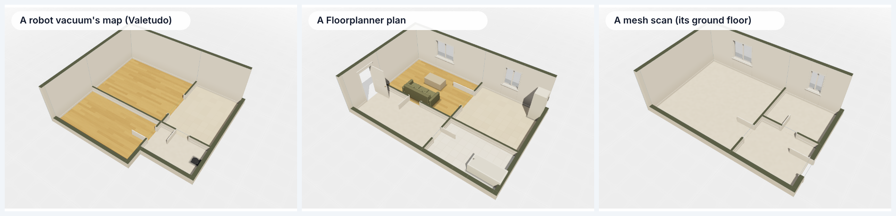

Measured at the end of M20: see [`PERFORMANCE.md`](PERFORMANCE.md).

Left for later: the robot drawn where Valetudo says it is, rather than along the plan (D-049);
rooms' names of a Roborock map (they are in Roborock's cloud); the maps of robots that keep them
in their maker's cloud (pictures, with no rooms to read); kinds of Floorplanner's catalogue
pieces; furniture and names in a mesh scan; DWG and USD's binary layers, as in M11.

## M31, the placement advisor

Asked for after the sandbox, history as reports and "Why?", before the rest (D-066): where the next
Bluetooth proxy, Zigbee router or Wi-Fi access point helps most ([`placement.md`](placement.md)).

- ✅ **Radio coverage**, a layer for administrators: each room coloured for the radio chosen
  (Bluetooth, Zigbee with ZHA, Wi-Fi), good, fair, weak or out of reach, with the heatmap's halo
  on a scale of its own; the radios placed and the spots advised as markers; the sheet lists the
  spots, then the rooms worst covered first.
- ✅ **What was measured first**: a Bluetooth room a receiver learned (from eight readings), a
  Zigbee end device's best link to the coordinator or a router heard from in the last day, a
  device's Wi-Fi signal (ESPHome, Shelly, Tasmota, WLED; never ZHA's, Z-Wave's, Bluetooth's nor a
  phone's); each room says what measured it, the others what is predicted. A private room the
  viewer may not see shows nothing of it.
- ✅ **The locating's model (D-035)** for each radio, from the plan's walls, doors, sides left open
  and floors, each radio with its loudness at a metre and its thresholds; written again in the
  core, and checked against the integration's on the demo apartment
  (`tests/fixtures/coverage-walls.json`, read by both sides' tests). **Checked against what was
  measured**: moved by the median error from two measurements (12 dB at most), Zigbee's levels
  compared room by room.
- ✅ **The spots**: each room's middle and up to four of its points, for the next radio alone,
  worth the levels it raises (a measured room's counting double), then the signal it adds where a
  room is not covered well; a router, and an access point, only where one already there reaches
  it fairly; three at most, each with what it changes and the piece it stands by. A spot tapped
  shows the rooms as they would be.
- ✅ **The radios**: the receivers where the locating places them (`domotwin/locating/get` gives
  their places and what each learned, to administrators only); the coordinator and the routers at
  their pieces; the Wi-Fi access points placed with a tap on the floor in the panel and kept in
  the settings (`access_points`, 16 at most). Those placed nowhere are listed, the Bluetooth
  settings a tap away.
- ✅ **In the page**: in the analysis module (D-043), loaded with the layer; the sheet a chunk of its
  own with its texts in both languages. Nothing sent outside Home Assistant. An open menu now stands
  over the layers' sheets (the network map's too).
- ✅ Tests: the walls the integration counts, the signal, the levels, what was measured first, the
  model checked, the spots, a router's reach, a large home (Rust); the same walls from the
  integration's side, the receivers' places and what they learned, the access points kept or
  refused (pytest); each radio's readings, Wi-Fi signals told from other radios', the rooms'
  colours, the texts in both languages (vitest); the layer for administrators only, each radio's
  sheet, the markers, a spot shown, an access point placed and removed, the card without placing,
  in French (Playwright).

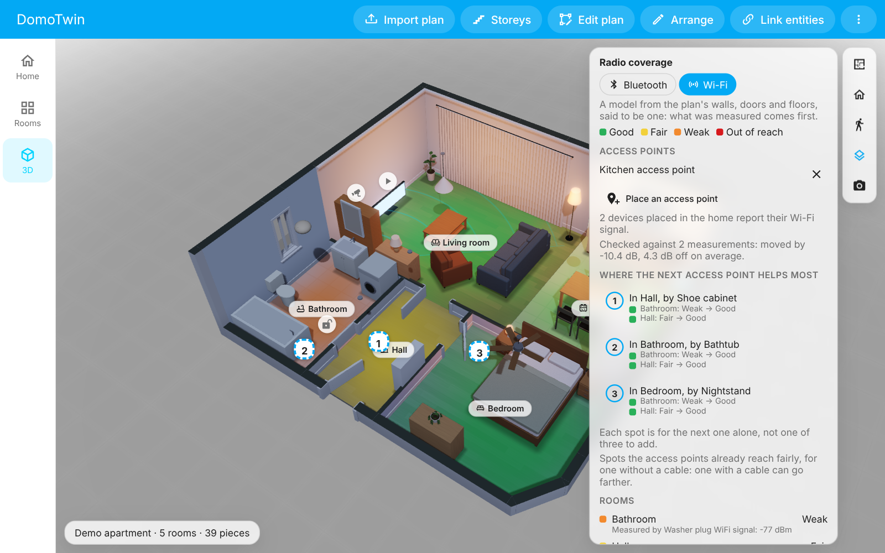

Measured at the end of M31: see [`PERFORMANCE.md`](PERFORMANCE.md).

Left for later: Thread and Matter, Zigbee2MQTT and Z-Wave as sources; Wi-Fi at 5 and 6 GHz; a
heat map inside a room; the weak spots in the weekly report (M37).

## M33, guest access

A pass that opens chosen rooms and devices to guests for a while, through DomoTwin's own page
outside Home Assistant's sign-in (`DECISIONS.md`, D-067; [`guests.md`](guests.md)). Moved forward by
the maintainer, after the placement advisor (M31); D-056's question (❓4) answered so.

- ✅ **A pass**: who it is for, the rooms it opens, the devices it gives (never a person, a tracker,
  a camera, an alarm panel or an automation), from and until when (31 days at most), to use or only
  to look, with the home's Wi-Fi (M30) or not, on the home's network only (the default) or from
  anywhere. Kept in a private store of its own, never in the plan, the diagnostics or an export;
  made, changed, renewed and removed by administrators.
- ✅ **Its link and QR code**: a secret of 32 random bytes, Home Assistant's own address on the
  home's network; the code drawn in the page by the analysis module. A new link stops the old one.
- ✅ **DomoTwin's own page**, outside Home Assistant's sign-in, each request checked: the pass,
  its time, where it comes from (a local address, not through Home Assistant Cloud, as Home
  Assistant's local-only users), under a policy that loads nothing from elsewhere, never kept.
- ✅ **What a guest sees**: the home in 3D, the rooms the pass opens and the others closed, emptied
  and unnamed as private rooms are (M9g); their devices, room by room, with DomoTwin's own
  controls; the Wi-Fi. Their states followed live (server-sent events), the home read again when
  it or the pass changes, the end said. Nothing of Home Assistant's pages, history, automations or
  schedules.
- ✅ **What a guest does**: only on the pass's devices, only what a guest may do with each (a lock
  locked and unlocked, never with a code; a script run without variables), 20 actions in 5
  seconds at most; each said in Home Assistant's logbook under the pass's name, and by "Why?"
  (M32).
- ✅ **Enforced by DomoTwin, said plainly**: whoever has the link uses what it gives until it ends;
  Home Assistant's permissions do not apply to a guest, who has no user.
- ✅ Tests: passes made, changed, renewed and removed by administrators only, kept apart and never
  in the diagnostics, what cannot be made, at most 20, the page and its policy, the home as a pass
  shows it (the rooms closed and unnamed, the pieces and 3D files of those it opens, the links and
  states of its devices only, no context, the Wi-Fi or not), the home's network only or anywhere,
  Home Assistant Cloud, before its start and after its end, forgotten a month later, the actions
  a guest may and may not do, data refused, a lock's code, the logbook's event in the action's
  context, Home Assistant's refusal, too many actions, the page following its devices until the
  home or the pass changes and told when it ends, removed with DomoTwin (pytest); the link's QR
  code (Rust); the passes read, the devices of each room (a piece moved in edit mode, its area's,
  never a camera), locks and garage doors left to a tick, a new pass's times, the page's home read
  leniently, its connection answering DomoTwin's commands and refusing the rest, the card told
  when the home is read again (vitest); an administrator's pass from the plan with its link and
  code, changed to look only, renewed and removed; a guest's page with its rooms in 3D and its
  devices, used through the pass and followed live, under its policy, nothing from elsewhere; a
  pass to look only; not open from here, ended, removed; the Wi-Fi on a pass that opens no room;
  French (Playwright).
- Measured: the first load grows by 1.0 kB; the dialog is 8.8 kB gzipped, on demand; the guests'
  page loads 508.0 kB gzipped with the engine ([`PERFORMANCE.md`](PERFORMANCE.md), M33).
- Left for later: a pass for a Home Assistant user (Guest Mode's sign-in links), which would see
  every device; a guest's page drawn as the rooms' list only on a slow phone; a pass's use over
  its days (who did what is in Home Assistant's logbook).

## M25, safety

The cameras side by side, the doorbell full screen when it rings, the alarm, and the alerts of the
3D view on every tab (D-054), Home Assistant's own Security page opened rather than copied where
it has one (D-056); asked for by the maintainer after more imports (M20), the placement advisor
(M31) and guest access (M33), ahead of the weather (M40), locating measured (M41), an iPhone's key
(M45) and the rest of M24 to M26 (D-068, `docs/safety.md`).

- ✅ **The alerts on every tab**: above *Home* and *Rooms*, the alerts the 3D view says, of every
  storey, dangers first, two and then *and N more*; a room's opens the 3D view framing it (its
  storey first), or its room's page where the 3D view cannot draw. The Home tab's alerts chip
  gives way to them. A private room's warnings are no longer said from another storey either.
- ✅ **Home Assistant's alerts**: those an administrator chose on its Security page (2026.9 and
  later), followed as they change, said in the same bar, the 3D view's banner and the Safety tab
  with Home Assistant's colours, opening its page; a sensor that raised a room's alert said once;
  only the dangers of a private room.
- ✅ **A Safety tab**: every alert; the alarm as Home Assistant's alarm-panel card; the doorbells
  and when they rang; every camera side by side as Home Assistant's picture card, the doorbells'
  first; the locks where Home Assistant has no Security page, else a way to it. Nothing hidden,
  nothing of a private room the viewer may not see. A tab to open on, on a wall tablet by the
  door.
- ✅ **The doorbell full screen** when one rings (an `event` of the `doorbell` class), on every tab:
  its camera live, its door's lock with its buttons, *Close*; for two minutes, closed by hand or
  Escape; not for a ring Home Assistant gives back as it starts, nor one heard while the page
  slept; not over the demo house or the sandbox. A chunk loaded at the first ring.
- ✅ Tests: Home Assistant's Security page and its alerts by version, the alerts read and on as
  Home Assistant says, their levels and words, a private room's, said once beside the rooms', the
  warnings of a private room on another storey, the doorbells found, a ring and what does not
  ring (as DomoTwin opens, given back as Home Assistant starts, old, two at once, a doorbell
  added), the Safety tab's cameras, alarms and locks in order, a doorbell's camera and lock, the
  tab in the address and the choices, the texts in both languages (vitest); the Safety tab
  start tab (pytest); the Safety tab with Home Assistant's cards and its Security page, the locks
  before it, plain rows, a home without any, the alerts on Home and Rooms and the way to 3D and
  to Safety, Home Assistant's alerts in the bar and in 3D, followed as they change and opening its
  page, a private room's, the doorbell over Home and 3D with its camera and lock, closed by
  Escape and by hand, not over the demo house, gone after two minutes, a phone in French
  (Playwright).
- Measured: the first load grows by 3.0 kB; the Safety tab and a chunk it shares with the
  doorbell's full screen come with the tabs, the full screen at the first ring
  ([`PERFORMANCE.md`](PERFORMANCE.md), M25).
- Left for later: the doorbell on a dashboard's card, a wall screen's (**M26**); a doorbell Home
  Assistant gives only as a binary sensor; cameras and an alarm in the demo house; a sound when
  the doorbell rings (a browser plays none unasked).

## M24, history and energy

What a room measured, as Home Assistant's own graphs, and the home's energy as Home Assistant's
own Energy page shows it: its cards and its pages reused, nothing drawn by DomoTwin (D-054,
D-069). After safety (M25), ahead of M40, M41 and M45 (D-065's order), at the maintainer's request.

- ✅ **A room's graphs**, a page of the Rooms tab (`/domotwin/rooms/<area>/graphs`): *Graphs* on
  the room's page, and on its panel in 3D beside its history report; opened from 3D, the room's
  way back still leads there. Home Assistant's history-graph card for each kind of measure of the
  room's area (temperature, humidity, CO₂ and particles first, the thermostats with the
  temperatures), its statistics-graph card for the meters (what each hour or day added), the
  doors and windows and the presence as timelines; eight entities a card, ten cards a room.
- ✅ **The last 24 hours or 7 days**, which Home Assistant keeps of each change by default (2025.1
  draws them too); the same as a table (the history report of M38, over the Rooms tab) and in
  Home Assistant's History, a tap away.
- ✅ **The Energy tab**: Home Assistant's own Energy page, opened rather than copied (its energy
  integration makes it for every user, 2025.1 and since; its cards read the same integration, so
  no tab of them), once something is set up on it, its back arrow leading back to the page of
  DomoTwin it was left from (2025.10 and later).
- ✅ **Private rooms (D-039)**: no graphs for a private room the viewer may not see, nor for what
  is linked to it.
- ✅ **The demo house**: its graphs as DomoTwin's own rows (what each sensor says now), its table
  from its own day, its Energy tab the 3D view on the power layer with the energy at a glance
  (D-049). Nothing in the sandbox, whose day has its report.
- ✅ Tests: the kinds of measure and their order, the thermostats with the temperatures, what is
  left out (words, dates, diagnostics, other rooms, a private room's), the limits, Home
  Assistant's cards over a day and a week, the titles in both languages, the period read by Home
  Assistant's History, the graphs' address, the Energy page's address, what is set up and where
  there is none (vitest); a room's graphs and their week, the table and Home Assistant's History,
  back to the room, the graphs from a room's panel in 3D and back there, a private room, the
  Energy tab and back, none without an Energy page or with nothing set up, the demo house's power
  layer and plain rows, a phone in French (Playwright).
- Left for later: a room's energy over the week on the plan, with the weekly report (**M37**);
  graphs of a device from its controls in 3D (its history report is there, M38).

## M35, automations in plain words

One says what should happen; Home Assistant's own AI task, the one the user set up, writes the
automation; DomoTwin says it back, has Home Assistant check it, plays it in the sandbox (M29) on
the days one picks, and only then saves it (D-070). Moved forward by the maintainer, once the
sandbox was in. DomoTwin calls no model itself.

- ✅ **The way in**: *An automation in plain words* in the panel's ⋮ menu, for administrators,
  only where Home Assistant (2025.8 and later) has an AI task that generates data, the one it
  prefers first; not in the demo house nor in the sandbox. A chunk loaded when it opens.
- ✅ **What goes to the AI task**, said before it is sent: the request, what an automation is, the
  home's areas, entities (id, name, area, a sensor's kind and unit, a select's options, a
  thermostat's modes) and actions; never their states; hidden, configuration and diagnostic
  entities and a private room the viewer may not see left out; 1 000 entities at most, those in
  an area first.
- ✅ **Its answer read**: a name, the automation as JSON and the model's notes, read leniently
  (code fences, words around it, an object as such), refused when it has no trigger or no action;
  written as Home Assistant's editor writes it today (`triggers`, `conditions`, `actions`,
  `mode`), the request as its description.
- ✅ **Said back in plain words**, from the configuration alone, in English and French: *When*,
  *Only if*, *Then*, nested; entities, areas and devices by their names, states as Home Assistant
  says them, times, the sun, durations, a zone left empty; what Home Assistant does not have
  marked, a step switched off said so.
- ✅ **Checked with Home Assistant** (`validate_config`), and every entity, area, device, floor and
  action it names looked up, since Home Assistant's check does not.
- ✅ **Changed by asking** (the request, the draft and the change sent again), its name by hand;
  *Copy* and Home Assistant's editor a tap away.
- ✅ **Played in the sandbox**: added to the copy beside the home's automations, its wires on the
  plan; the bar says what it did that day, the report puts it first; each day played kept (the
  latest ten), listed back in the dialog.
- ✅ **Only then saved**, as Home Assistant's editor saves (its configuration API, a new id),
  Home Assistant's refusal shown as it gives it; then Home Assistant's editor of it.
- ✅ **The sandbox's home zone** counts who is in it as people go out and come back, as Home
  Assistant's zones do, so that "when the last person leaves" plays.
- ✅ Nothing in the integration; the draft is kept in the page, across the sandbox and back.
- ✅ Tests: the AI tasks offered, what the AI task is told and never told, the request and a
  change, the answer read in its forms, the names Home Assistant lacks, its check, the save, the
  entity in the sandbox, the words in both languages (times, the sun, durations, choices, ifs,
  repeats, what runs at once, notifications, what is missing), the draft played beside the home's
  automations and what it did each day, the home zone, the session's gates (vitest); offered or
  not, written, said back, played in the sandbox and back, saved through Home Assistant's
  configuration API, changed and played again, what Home Assistant lacks or refuses, an answer
  that is no automation, an AI task that refuses, an answer cancelled, the draft kept, French
  (Playwright).
- Measured: the first load grows by 1.2 kB; the dialog is 21.2 kB gzipped, on demand
  ([`PERFORMANCE.md`](PERFORMANCE.md), M35).
- Left for later: a draft opened in Home Assistant's own editor before it is saved (its editor
  takes one only from inside its frontend); an automation of the home changed in plain words; the
  sandbox playing several days at once.

## M34, per-person rights

What DomoTwin shows each person and lets them do, room by room and device by device, set in one
place (`DECISIONS.md`, D-071; [`rights.md`](rights.md)). Moved forward with guest access (M33);
D-056's question (❓5) answered: DomoTwin's own, said plainly not to be enforcement.

- ✅ **Levels**: a room or a device used (the default), only seen, or not seen; everyone's, and
  each person's own through the Home Assistant user of their `person`; a device's own level, else
  the strictest of its rooms'. Not for administrators. Kept with the home's settings, checked by
  the integration.
- ✅ **In one place**: *Rights* in the panel's ⋮ menu, for administrators: everyone's, then each
  person's, every storey's rooms with their devices, and devices in no room; what the person uses,
  only sees and does not see, in a sentence; an administrator, or a person without a user, said.
- ✅ **What is not seen**: a room closed as a private one (M9g), everywhere private rooms are; a
  device unlinked on the plan and left out of the tabs, the panels, "Why?" and the reports' search.
- ✅ **What is only seen**: its state and values; a tap opens DomoTwin's own panel, its controls
  disabled; Home Assistant's cards on the tabs do nothing on a tap; the room's commands and own
  actions, and the Home tab's lights off, leave it out; nothing set or cancelled for later.
- ✅ **DomoTwin's own services checked**: actions set or cancelled for later (the sheets,
  `domotwin.schedule`, the voice assistants) refused on what someone may not use; the actions
  waiting on what they do not see not listed; `domotwin.where` and `domotwin.show` as for a
  private room; the rooms' people sensors silent on a room hidden from everyone.
- ✅ **Said where they are set**: Home Assistant still lets every user use every entity elsewhere;
  real enforcement needs Home Assistant ❓.
- ✅ Tests: the levels (a person's own, everyone's, a device's own, a room's, its area's, a room
  closed), the rights checked and kept without what is empty, what is refused and why, actions for
  later set and refused, listed and cancelled, by the assistants too, a private room closed to a
  user, administrators and Home Assistant itself left alone, a room hidden not told and its sensor
  silent (pytest); whose rights apply, the rooms closed with the private ones, a device's level, a
  call's entities (by area, by device, a script by its name, floors and labels refused), a call
  refused before Home Assistant, the devices unlinked, the gate worked out once, Home Assistant's
  cards to look at, the rows disabled, a tap opening DomoTwin's panel, a room's commands and
  actions, every device of each room (vitest); someone who only looks, their controls disabled, a
  device unlinked, a room closed, the Rooms tab's cards; an administrator setting them in one
  place; French; a dashboard card (Playwright).
- Measured: the first load grows by 3.1 kB, the gate and the controls' checks; the dialog is 6.3 kB
  gzipped, on demand; the gate is worked out in 1.0 ms for 500 elements and 1 000 entities, and
  once for the home as it is ([`PERFORMANCE.md`](PERFORMANCE.md), M34).
- Left for later: a preview of the home as someone sees it; rights by time of day (a private room
  while an entity is on already does it for a room); enforcement, which needs Home Assistant.

## M40, the weather around the home

Asked for by the maintainer after 0.4.0: a beautiful animation of the weather around the house or
the apartment, the rain outside an apartment, on the roof of a house (D-065, D-072).

- ✅ **Read from Home Assistant**: the `weather` entity the Home tab shows (`weather.home` first),
  or one chosen in the settings, or none; its condition, its wind (any of Home Assistant's units,
  Beaufort too) and where it comes from (degrees or a point of the compass), turned with the
  home's north. A card turns it off with `weather: false`.
- ✅ **Drawn by the engine**: rain in streaks that splash, snow in soft flakes that sway, hail,
  sleet; a greyer, dimmer light under clouds, the sun's shadow on the ground fading with it; fog
  thickening around the home; a storm's flashes. Around an apartment and never in it, on the roof
  of a house and off its eaves; seen from inside, through the windows. Nothing on the 2D plan nor
  on a storey's picture.
- ✅ **Light**: one instanced draw worked out by the graphics card, a few thousand particles at
  most, fewer in Eco; frames at the layers' pace while something falls, none for clouds and fog;
  still with reduced motion.
- ✅ **The demo house** has its weather: a fine day, a shower and a storm around three.
- ✅ Tests: conditions, wind and flashes (cargo); the footprint, the counts, the light under clouds
  (cargo); rain, snow, storms and the plan in the engine (wasm); the wind's units and bearings, the
  entity chosen or the usual one, the demo's day (vitest); the settings' `weather` validated
  (pytest); rain, snow, hail and fog drawn and still, an entity that says nothing, the card's
  option, the settings' choice shown as it is chosen and saved, in French (Playwright).

## M41, locating measured

Before any new locating feature (D-065): how well DomoTwin finds rooms, in figures, with Bermuda's
beside (D-073, [`bluetooth.md`](bluetooth.md)).

- ✅ **Counted every two seconds** by the integration, for each device followed: hours followed,
  room changes and storey changes per hour, stays shorter than 30 seconds, the share of the time
  in no room. Counters only; kept with what is learned, across restarts, until started again.
- ✅ **Bermuda beside**: each device paired by hand with Bermuda's area sensor of the same device,
  counted the same way on the same ticks, DomoTwin's rooms counted by area beside it to compare
  alike, and how often the two say the same area.
- ✅ **A witness**: while one person alone is home and one room alone has its presence sensor on,
  their phones and watches are taken to be there; the share of that time each way was right.
- ✅ **Shown as figures only**: a small table per device in the Bluetooth settings, DomoTwin's and
  Bermuda's columns; *Copy as a table* gives a Markdown table, the devices numbered, for the
  guide; the diagnostics carry the same, without the devices' ids.
- ✅ Tests: the tallies (changes between known rooms only, storeys, flickers, time in no room, the
  rooms settling, by area, pauses, devices forgotten, kept and read back, what is wrong read as
  nothing), the witness and Bermuda side by side, the pairing checked (Bermuda's, one device's),
  saved within ten minutes, the diagnostics without names (pytest); the copied table, numbered and
  sorted, the texts in both languages (vitest); the figures shown, copied, a device paired and
  saved, started again once asked, in French (Playwright).

Measured at the end of M41: see [`PERFORMANCE.md`](PERFORMANCE.md). Left for the maintainer: the
figures of a real home, with Bermuda's, published in [`bluetooth.md`](bluetooth.md).

## M17, a library of objects

Many more pieces, free and well made, drawn from real references, still fast; moved forward by the
maintainer (D-074).

- ✅ **The pieces**: 61 kinds more (117) and 54 styles more (78): 195 pieces, from a corner sofa, a
  piano and a wood stove to a heat pump, a water heater, an electrical panel, an EV charger and a
  car, the smart home's devices (speakers, a wall tablet, a thermostat, sensors, a smoke detector,
  cameras, a router), new lights (a wall light, a light strip, a track light), fitness and pets.
  Each is DomoTwin's own code, drawn from its size: nothing downloaded, nothing to license.
- ✅ **From real references**: each kind and style at the usual size, lift and colour of the real
  piece (a soundbar 90 × 10 × 7 cm, a thermostat at 1.45 m, a Chesterfield oxblood), its common
  form rather than one maker's design. A style can have its own size, colour and lift, which the
  catalogue adds a piece at.
- ✅ **Well made**: turned, bent and extruded parts (`lathe`, `pipe`, `slab`); every piece in every
  style closed, lit from the right side, at most 1 600 triangles and within 3 cm of its footprint.
- ✅ **The catalogue as a library**: fourteen groups by room or use; each kind and style with its
  picture, name and size; a search through names, styles and other words in English and French,
  accents ignored. The pictures are drawn by the engine in the view's look and accent, a few each
  frame, kept for the session; none without a second WebGL context.
- ✅ **Live and edit mode**: the new lights are switched like the others, an aquarium lights cool, a
  fireplace burns while what it is linked to is on or heats; linking suggests what each device is;
  small appliances show their *running* badge with their icon; new pieces carry or stand on others.
- ✅ **Imports**: the new kinds read from the names of Sweet Home 3D's, IFC's and DXF's pieces, and
  RoomPlan's ovens and fireplaces.
- ✅ **The demo house** has some of them: a rug, a TV stand, a speaker, a heat pump, a coffee
  machine, a kettle, a monitor, a wall tablet, a thermostat, a coat rack, a water heater, a laundry
  basket, two rugs and a towel radiator upstairs.
- ✅ Fixed on the way: the pictures of the storeys were drawn upside down.
- ✅ Tests: every piece in every style alone (closed, lit, triangles, footprint), the turned, bent
  and extruded shapes, the styles' sizes, colours and lifts, a piece added in its style, the
  aquarium's light, a fireplace burning, the kinds of the imports' names and RoomPlan's
  categories, what stands on what, the demo house (Rust); the catalogue's styles, a styled piece
  added, a picture of every piece in every style, its rows from the top (wasm); the groups, the
  search, every style named in both languages, the devices' suggestions and badges (vitest); the
  pictures, a Chesterfield added at its size and colour, the search in French and a soundbar
  (Playwright).
- Measured: the engine grows by 52.5 kB gzipped and the first load is 601.0 kB of 1 200; a new
  piece is at most 1 202 triangles (the wine cooler), the demo house's ground floor 19 286
  (+3 846); the catalogue's 195 pictures take 8.1 s in software WebGL (the first twelve 4.5 s, most
  of it the second engine's shaders), then come back at once ([`PERFORMANCE.md`](PERFORMANCE.md),
  M17).
- Left for later: pictures of one's own 3D models in *My models*; the outdoors' pieces, with
  **M18**; the other words of the search in more languages, with **M21**.

## M45, an iPhone's key without a Mac

Next to locating measured (D-065): an iPhone or an Apple Watch followed without a Mac to read its
identity key from (D-075, [`bluetooth.md`](bluetooth.md)).

- ✅ **The ways to get it**: a Mac's Keychain, or an ESP32 for ten minutes with irk-capture (an
  ESPHome package) or ESPresense's Enroll, said in a line in the Bluetooth settings and step by
  step in the guide, linked from there. DomoTwin builds no firmware of its own.
- ✅ **The key as the tool wrote it**: hex (spaces, colons or dashes between the digits are fine),
  `irk:` and hex, or a Mac's base64; refused when it is none.
- ✅ **Handed to Private BLE Device**, which keeps it: its own setup run with the key; a key it
  already has gives its entry back; not heard, no Bluetooth or refused, said plainly. DomoTwin
  keeps nothing of the key, never shows it again nor says it in an error.
- ✅ **Then followed**: the device added to the devices followed, by its entry's title, its kind
  and owner chosen before saving.
- ✅ Tests: the key in each form and what is not one (pytest); Private BLE Device's setup run,
  aborted without Bluetooth, the device not heard (its setup closed), the entry created, a key
  already there, never said back (pytest); the texts in both languages (vitest); a key not one,
  not heard, then a Mac's base64 added and followed, again already followed, saved without the
  key, in French (Playwright).

Measured at the end of M45: see [`PERFORMANCE.md`](PERFORMANCE.md).

## M26, the wall screen

A device left on a wall: on its own tab, and, when nobody is there, the time, the weather and the
family's photos, gone as soon as someone is (D-076, [`wall-screen.md`](wall-screen.md)).

- ✅ **A layout for each screen**, kept by the integration (20 at most), set by administrators
  from the ⋮ menu (or the Home tab, without a plan): the tab it opens on; its screen saver after
  how long, woken by which motion, occupancy or presence sensors, with the weather or not, the
  photos of which folder of Home Assistant's media and for how long each, dimmed at night or not.
- ✅ **A device becomes a screen** in *Your choices*: it opens on the screen's tab, answers the
  `domotwin.show` requests naming the screen, shows the Wi-Fi where it is one of its screens, and
  runs its saver. A screen keeps its name; one removed is said so on its devices.
- ✅ **The saver**: the time and the day (moved a little every minute), the weather in words and
  picture, the photos cross-faded and slowly brought closer, read again for those added; at night
  the clock alone, dimmed. Comes back to the screen's tab; never while a tool runs or a doorbell
  rings; under it the 3D view is not drawn. Gone on a tap or a key (which do nothing else), a
  sensor on, a doorbell, a `domotwin.show` for the screen.
- ✅ Tests: the layouts kept, read whatever their case, checked, refused (a name taken, too many,
  a sensor or a folder that is none), told to the screens, counted in the diagnostics (pytest);
  the layouts and Home Assistant's media read, the wait, the sensors, the night, the order of the
  photos, the clock's moves, the texts in both languages (vitest); a screen set and a device made
  it, the saver coming and going (motion, a tap, a key, the doorbell), `domotwin.show` for this
  screen or another, without a plan, at night in French (Playwright).
- Left for later: the screen's light itself (Fully Kiosk Browser's own settings do it); the
  saver and the doorbell on a dashboard's card.

Measured at the end of M26: see [`PERFORMANCE.md`](PERFORMANCE.md).

## M18, the outdoors

The garden, the terrace and the roofs: places outside, the garden's pieces, the lawn as long as it
has grown and the robot mower going round, and roofs that follow the house (D-077,
[`outdoors.md`](outdoors.md)).

- ✅ **Places outside** (`outside` on a room): no walls, no ceiling, no roof; the rooms beside
  them have façades; a garden may be drawn around the house (the room wins where they overlap, the
  smaller place outside between two). Their grounds: a lawn, decking, paving, gravel, soil, a lawn
  a little under the floors; a railing along a balcony's free sides. In the plan editor:
  *Outside*, its ground, *Railing*.
- ✅ **The garden's pieces**: 22 kinds in a *Garden* group of the catalogue, up to 10 m tall,
  linked as the others are (a garden light, a fire pit, a gate that opens, a pool's pump).
- ✅ **Roofs storey by storey**, over what no storey above covers, in wings that meet (an L, a T),
  their shape (gable, hip, shed, flat), slope and colour chosen in the settings; the weather falls
  on them.
- ✅ **The lawn grows** with the season where the home is, from its last mowing: said by anyone
  in its panel (*Just mowed*), or noted by the integration when its robot mower stops mowing.
- ✅ **The robot mower**: a `robot-mower` dock linked to a `lawn_mower`, mowing the lawns its
  robot can get to, keeping out of the house.
- ✅ **The demo house's garden**: a terrace, two lawns, a pool, trees, a shed, its mower, the
  garden lit at dusk, the gate.
- ✅ Tests: places outside read, walled, drawn, walked, swept and counted by the radios, the
  garden's pieces drawn in every style, the roofs in wings with the rain on them, the mower round the
  house (cargo); the garden's store, its mowers noted, its commands checked (pytest); the grass's
  growth by season and latitude, the mowers' docks, the garden's links (vitest); the demo's
  mower, a lawn said mown, a place outside drawn, the roof chosen (Playwright).
- Left for later: the ground's height (with M44); the grass browning or growing after rain; a
  mower's real position.

Measured at the end of M18: see [`PERFORMANCE.md`](PERFORMANCE.md).

## Then, from 0.4.0 to 0.5.0

Planned in D-056, with D-065's additions: the sandbox first, built during the two weeks of use since
it does not wait on what they show; Home Assistant's Overview joined rather than copied before M24
and M25, which follow the same rule; the first launch in five minutes kept where it was, and 0.5.0
right after it. Each milestone its own pull request; no network call outside Home Assistant;
fictional data in tests and docs; every string through `t()` in English and French. A ❓ is asked
before its milestone starts, which goes on with what needs no answer.

- ✅ **M29, the sandbox** (D-057, above).
- ✅ **M30, the Wi-Fi QR code** (D-060, above).
- ✅ **M23b, into Home Assistant's Overview** (D-061, above). Still asked ❓: the 3D view at the
  top of the Overview or of an area's page, and an area's page opening DomoTwin, need Home
  Assistant; whether the Home and Rooms tabs stay where the Overview is.
- ✅ **M24, history and energy** (D-069, above). Replay, the home's past in 3D (M19), stays a 3D
  feature, later.
- ✅ **M40, the weather around the home** (asked for by the maintainer, D-072, above): the weather
  of Home Assistant's `weather` entity drawn around the home in 3D: rain or snow falling outside the
  walls of an apartment and splashing on the ground around it, on the roof of a house and running
  off it; a storm's flashes, fog, an overcast light, the wind slanting what falls. Drawn by the
  engine, light on a phone, still with reduced motion, fewer particles in Eco; a card's `weather`
  option, the entity chosen in the settings.
- ✅ **M41, locating measured** (D-065, D-073, above), before any new locating feature: for each
  device followed, its room changes and storey changes per hour, its flickers and its time in no
  room, and, while a presence sensor alone says where its owner is, how often its room is right;
  Bermuda's figures beside, from the same device's area sensor over the same hours. Shown in the
  Bluetooth settings and in the diagnostics, as figures only. The maintainer's figures go in
  `docs/bluetooth.md` as they fall.
- ✅ **M45, an iPhone's key without a Mac** (D-065, D-075, above): in the Bluetooth settings, for
  an iPhone or an Apple Watch, the ways to get its identity key (a Mac's Keychain; an ESP32 for ten
  minutes with irk-capture or ESPresense's Enroll, in the guide), and a field that takes the key
  as the tool wrote it and hands it to Home Assistant's Private BLE Device; the device then
  followed. No firmware of DomoTwin's own.
- ✅ **M25, safety** (D-068, above): done after M20, M31 and M33, at the maintainer's request.
- ✅ **M26, the wall screen** (D-076, above): a screen saver (the clock, the weather, the photos of
  Home Assistant's media) woken by motion, a touch, a key, the doorbell or `domotwin.show`; a
  layout for each screen, kept by the integration, that a device chooses to be.
- M25 and M24 came ahead of M40, M41 and M45, at the maintainer's request (D-068, D-069); M26
  came after M45.
- ✅ **M31, the placement advisor** (D-066, above), built after M29, M38 and M32 at the maintainer's
  request: the Bluetooth model of M9f turned around, from where a device is to where a receiver
  would hear the most. The rooms badly covered coloured on the plan, for the Bluetooth receivers,
  the Zigbee mesh (its links, M9b) and the Wi-Fi access points placed on the plan; and the spots
  where the next Bluetooth proxy, Zigbee router or Wi-Fi access point helps most, ranked, each with
  what it changes. Worked out from the plan's walls and floors and what the radios measured; nothing
  sent. A model, said to be one: what was measured comes before what is predicted. For
  administrators, since only they can read the radios.
- ⏳ **M22, a first launch in five minutes**: from the install to one's own home live, in five
  minutes, with the imports and pieces DomoTwin has then (M11, M15, the demo house as a start,
  the robot vacuum maps, Floorplanner plans and mesh scans of M20, and the library of pieces of
  M17).
- ⏳ **Release 0.5.0**.
- **Deferred** until someone asks: one's dashboards taken over, and pages arranged without YAML
  (the former M28). An agenda and lists are cards of the Home tab (M23), not a milestone of their
  own (the former M27).

## Then, to 0.6.0

- ✅ **M32, "Why?"**: done next to the sandbox, right after 0.4.0 (above, D-059). Why something
  did not happen is the sandbox's (M29).
- ⏳ **M42, finer locating** (D-065), after the placement advisor (M31), and only if the
  figures of M41 say it is worth it: a spot inside the room rather than the room alone, worked out
  on a grid of half-metre cells over the plan, as a cloud of likely spots that changes storey only
  through the stairs (the ways of the walk, D-029, already know them); its X, Y and Z, and how sure
  it is, as the room sensor's attributes. Reused from M9f (D-035): the radio model of the plan
  (distance, walls, floors), each device's own loudness, the rooms taught (cells known for sure),
  the presence sensors' weight and the rule that a room changes only when sure twice. Measured
  again with M41 against what it replaces.
- ⏳ **M43, mmWave sensors merged** (D-065), after M31: mmWave presence sensors placed on the plan
  (where each stands and which way it faces), their zones and their targets turned into the home's
  own coordinates, and merged with each other and with Bluetooth into one picture of who is where:
  Bluetooth says who, mmWave says where, and says it fast. What Home Assistant gives is checked
  first and differs by family: an Aqara FP2 (through HomeKit) gives one occupancy per zone and no
  coordinates; an Everything Presence Lite gives its targets' X and Y in millimetres and its zones'
  occupancy; ESPHome's LD2450 gives three targets' X, Y and speed and three zones; an LD2410 or an
  Everything Presence One gives a distance or an occupancy only, so a zone or a room. Each is used
  for what it says, no more.
- ✅ **M33, guest access** (D-067, above): moved forward by the maintainer; a page of DomoTwin's
  own outside Home Assistant's sign-in, enforced by DomoTwin, which answers D-056's ❓4.
- ✅ **M34, per-person rights** (D-071, above): moved forward with guest access; what DomoTwin
  shows each person and lets them do, said not to be enforcement, which answers D-056's ❓5. Real
  enforcement needs Home Assistant ❓.
- ✅ **M35, automations in plain words, tested first** (D-070, above): moved forward by the
  maintainer once the sandbox was in.
- ✅ **M20, more imports** (D-064, above): done before 0.5.0, at the maintainer's request.
- ✅ **M17, a library of objects**, moved forward (D-074, above): 195 pieces in fourteen groups,
  each with its picture drawn by the engine, free and well made, at the usual sizes of real ones.
- ✅ **M36, configuration history** (D-062, above): done after Home Assistant's Overview, at
  the maintainer's request.
- ⏳ **M37, a weekly home report**: once a week, what needs a look: batteries low, devices
  unavailable, updates and repairs waiting, upkeep due (M9d), weak radio links (M9b, M31),
  automations that failed or never fired, the week's energy against the last, room by room on the
  plan, and the week's Hydro-Québec peaks where M39 reads them. It reads what other integrations
  already give where they are installed (Battery Notes, Watchman, Spook) rather than doing their
  work again. A summary by the user's own conversation agent or AI task if there is one, plain lists
  otherwise; a notification of Home Assistant's and a page in the panel.
- ✅ **M38, history as reports** (D-058, above): done right after the sandbox, at the
  maintainer's request.
- ✅ **M18, outdoors** (D-077, above): moved before the first launch, at the maintainer's request.
- ⏳ **M44, split levels and walk-out basements** (D-065), next to the outdoors (M18), whose ground
  it needs. What works already: a storey can sit at any height (half a storey up), it is drawn
  there, and stairs join it to the next, for a tap and for the walk. What does not: the Bluetooth
  model counts a floor between any two storeys, even a half level beside the other rather than over
  it; a storey given no name is called by its rank (Floor 1, Floor 2), not as a half level; and the
  ground is one flat level, so a basement cannot open onto the garden on one side. The milestone: a
  floor counted only where one storey's room lies over the other's, by the height between them; half
  levels named as such; the ground's height on each side of the home; and a fictional split-level
  house in `examples/`, with its tests.
- ✅ **M39, Hydro-Québec's peaks**, moved forward (D-063, above): the next peak, the pre-heating
  before it, which rooms shed and what they draw during it, in 3D and on the Home tab, and
  tomorrow's announced peak played in the sandbox, from the entities of hydroqc or HydroPeak. Its
  part in the report comes with M37.
- ⏳ **M21, more languages**: Italian, German, Spanish, Arabic (right to left), Chinese, Japanese,
  Korean, Portuguese (Portugal and Brazil) and others; last, once the texts of the rest are
  written, so that they are translated once.
- ⏳ **Release 0.6.0**.
