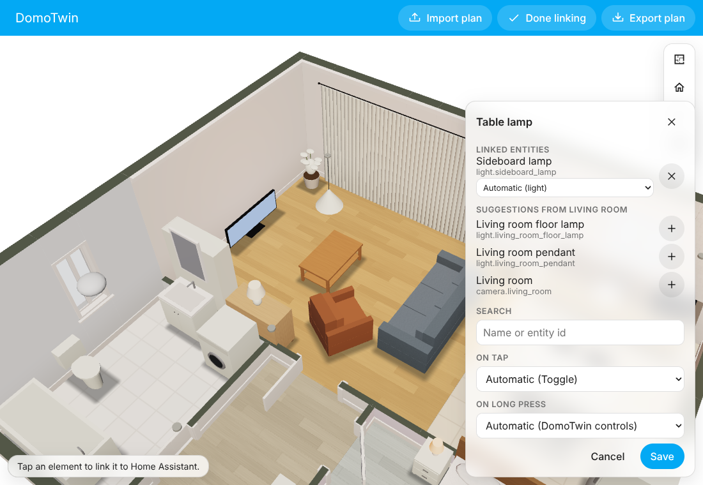

# Bindings

A binding links an element of the plan (a lamp, a door, a window, a curtain, a room…) to one or more
Home Assistant entities and says what a tap and a long press do. Bindings are stored by the
integration beside the plan, keyed by element id, so re-importing an updated plan keeps them.

> Status: the stored format below has not changed since M0. Since M2 the scene follows the bound
> entities, taps and long presses act on them, and administrators link elements from the panel.
> Since M3 the panel's editor also sets roles and the long-press action, runs an action or opens a
> page. Since M16 a tap leaves a bubble over the piece, the editor offers each device's plain
> actions first, and rooms get actions of their own (`DECISIONS.md`, D-047).


## Stored format

```json
{
  "version": 1,
  "rooms": {
    "living": {
      "area": "living_room",
      "actions": [
        {
          "name": "Evening",
          "action": {
            "action": "perform-action",
            "perform_action": "scene.turn_on",
            "target": { "entity_id": "scene.living_room_evening" }
          }
        }
      ]
    }
  },
  "elements": {
    "pendant-living": {
      "entities": [{ "entity_id": "light.living_room_pendant" }],
      "tap_action": { "action": "toggle" },
      "hold_action": { "action": "controls" }
    },
    "floor-lamp": {
      "entities": [
        { "entity_id": "light.living_room_floor_lamp" },
        { "entity_id": "sensor.floor_lamp_power", "role": "power" }
      ]
    }
  }
}
```

A complete example for the demo apartment is in
[`examples/demo-apartment.bindings.json`](../examples/demo-apartment.bindings.json).

### `rooms`

| Field     | Type   | Notes                                                                   |
| --------- | ------ | ----------------------------------------------------------------------- |
| `area`    | string | Home Assistant area id. Room panels and layers use the area's entities. |
| `actions` | array  | At most 8 `{ name, action }`: buttons of the room, besides its lights and blinds (D-047). A name is 1 to 40 characters; an action is one of those below. |

A room is kept with either: an area, actions of its own, or both.

### `elements`

| Field         | Type   | Default              | Notes                                                 |
| ------------- | ------ | -------------------- | ----------------------------------------------------- |
| `entities`    | array  | required (1–16; 0–16 with `device`) | `{ entity_id, role? }`, see roles below. |
| `device`      | string 1–64 | none            | A Home Assistant device id (its registry id): where the network map places that device, even one without entities, such as a Zigbee coordinator. |
| `tap_action`  | object | from the first role  | See actions.                                          |
| `hold_action` | object | `{ "action": "controls" }` | Long press.                                     |
| `fov`         | number 10–180 | 90            | A linked camera's angle of view (degrees).            |
| `range`       | number 50–3 000 | 600         | A linked camera's reach (cm).                         |

A device is linked from the network map (*Place*, in the panel) and shown, with a button that
removes it, in the link editor. A device id is not kept in the integration's diagnostics.

**Roles.** When `role` is absent it is derived from the domain and the device class:

| Role       | Derived from                                                  | Used for                       |
| ---------- | ------------------------------------------------------------- | ------------------------------ |
| `light`    | `light.*`                                                     | glow, colour, brightness       |
| `switch`   | `switch.*`, `input_boolean.*`                                 | on/off look                    |
| `fan`      | `fan.*`                                                       | on/off, blades                 |
| `cover`    | `cover.*`                                                     | curtains, blinds, position     |
| `media`    | `media_player.*`                                              | TV screen glow, media controls |
| `contact`  | `binary_sensor.*` with class `door`, `window`, `opening`, `garage_door` | doors and windows open |
| `lock`     | `lock.*`                                                      | badge (locked, unlocked…)      |
| `camera`   | `camera.*`                                                    | what it sees, badge, live view |
| `power`    | `sensor.*` with class `power`                                 | power layer                    |
| `climate`  | `climate.*`                                                   | room panel                     |
| `sensor`   | any other entity                                              | labels, layers                 |

A `vacuum.*` entity linked to a `robot-vacuum` piece (its role derived as `sensor`) draws the
piece's robot on the floor, doing what the vacuum does (D-049).

### Actions

The same shape as Home Assistant dashboard actions:

| `action`         | Other fields                                   | Effect                                       |
| ---------------- | ---------------------------------------------- | -------------------------------------------- |
| `toggle`         | `entity_id?`                                   | Toggles the primary entity (or the one given). |
| `more-info`      | `entity_id?`                                   | Opens Home Assistant's more-info dialog.     |
| `perform-action` | `perform_action`, `data?`, `target?`           | Calls a service (`call-service` and `service` are accepted as aliases). |
| `navigate`       | `navigation_path`                              | Navigates inside Home Assistant.             |
| `controls`       | –                                              | DomoTwin's controls: a bubble over the piece on a tap, its sheet on a long press. |
| `none`           | –                                              | Does nothing.                                |

Default tap: `toggle` for lights, switches, fans and covers, `more-info` for a camera (its live
picture), `controls` otherwise (a TV, a thermostat, a sensor: its bubble).

**Plain actions.** What the link editor offers first for each device (D-047), each written as one
of the actions above, so it works anywhere:

| Domain | Plain actions |
| --- | --- |
| `light` | switch on or off, on, off, brighter, dimmer (`brightness_step_pct` ±20) |
| `switch`, `input_boolean`, `humidifier`, `siren` | switch on or off, on, off |
| `fan` | switch on or off, on, off, faster, slower |
| `cover`, `valve` | open or close, open, close, stop (covers) |
| `media_player` | switch on or off (`media_player.toggle`), on, off, play or pause, volume up, volume down, mute, sound back on, next |
| `lock` | lock or unlock, lock, unlock |
| `climate`, `water_heater` | on, off |
| `vacuum` | start cleaning, pause, back to its base, find it |
| `lawn_mower` | start mowing, pause, back to its base |
| `scene`, `script` | activate, run |
| `button`, `input_button` | press |

## In the scene

The engine receives only the bound entities, and only when their state changes. What it shows:

| Element | Entities | What changes |
| --- | --- | --- |
| Lamp (any light kind) | `light` | Glows in the light's colour (`rgb_color`, else `color_temp_kelvin`), at its brightness × the lamp's `light.power`; lights its own room. Fades in and out. |
| Lamp | `switch` | On or off, in the plan's light colour. |
| TV | `media` | The screen glows while playing, dimmer when paused or idle, and lights the room in front of it. |
| Your own 3D model (`model`) | `light` | Its glowing (emissive) parts light up and it lights its room, as a lamp does (D-021). |
| Your own 3D model (`model`) | `media` | Its glowing parts light up like a screen, and it lights the room around it. |
| Curtain | `cover` | Opens with `current_position` (else open/closed). |
| Window | `cover` | A roller blind comes down as the cover closes. |
| Window | `contact` | Open (casements inward) while the contact is on. |
| Door | `contact`, `cover` | Opens while the contact is on, or with the cover's position. |
| Any | all entities of a shown role `unavailable` or missing | Greyed out, gives no light. |

Lamps not bound keep the plan's state (`light.on`). Lamps count less in daylight: a lamp lit at noon
barely shows, at night it lights its room (`DECISIONS.md`, D-016). At most 16 lamps light the scene
at once, the strongest first.

## Devices

Each linked element can carry badges for what its devices are doing (`DECISIONS.md`, D-024),
shown over it in 3D and 2D; a tap on them does what a tap on the element does. At most two show
on one element, the most urgent first.

| Badge | From | Look |
| --- | --- | --- |
| Lock | a `lock` entity: locked, unlocked, locking or unlocking, open, jammed | green when locked, red when jammed, amber when open |
| Camera | a `camera` entity: idle or streaming, recording, unavailable | red and pulsing while it records |
| Playing | a `media` entity playing (its title in the label) | |
| Battery low | a `sensor` with class `battery` at 20 % or less, or a `binary_sensor` battery on | amber, with the level |
| Running | a washing machine, dryer, dishwasher, cooker, hood or printer whose power sensors read more than 10 W, or whose `binary_sensor` with class `running` is on | its own icon, pulsing |

**What a camera sees.** A piece linked to a camera shows what it sees on the floor: from the
centre of the piece towards its front (the `y + h` side, the way it faces), `fov` wide and `range`
long, in the piece's room, its walls hiding what is behind them. It is a fan on the floor, behind
the furniture and the people, fading out with distance, with a ring every metre and its two side
rays drawn as lines. It is blue, red while recording, grey when the camera is unavailable; faint
until the camera is tapped, then whole for 15 seconds. It is not drawn while walking. The
camera on the bookcase of the demo apartment looks into the living room. A tap opens Home
Assistant's more-info dialog, with the live picture. The card's `badges: false` and
`cameras: false` turn them off; so does the layer menu.

## Tap and long press

- **Tap** a bound element: its `tap_action`, with a short blue flash. A failed action shows a short
  message with Home Assistant's reason. After a switch or an action, and for DomoTwin's controls,
  a **bubble** shows over the piece for 8 seconds: its device as it is now with its main control
  (a lamp's switch and brightness, a fan's speed, a blind's buttons and position, a TV's power,
  play, volume down, mute and volume up, a robot vacuum's start, pause and base, a lock, a
  thermostat), and a way to everything about it. Over a piece linked to nothing, an administrator
  gets the devices of its room that fit it, each linked with one tap, and **Link…**.
- **Tap** anything else: frames its room. Its name appears at the bottom with what the room does
  with a tap: its lights on and off, its blinds open and closed (never a garage door or a gate),
  its media off while one plays (those that can switch off), and its own actions. Tap the name (or press Enter) for the room panel.
- A tip says once, on each device, what a tap and a long press do.
- **Long press** a bound element: its `hold_action`, by default DomoTwin's controls: a switch,
  brightness, warmth and colours for lights, open/stop/close and position for covers, media
  buttons and volume, lock, climate target, scene activation, the state of sensors.
- **Long press** the floor of a room: the room panel: what the room does together and its own
  actions, then from the room's area (below) its lights, scenes, blinds and curtains, climate,
  media and other devices; **Later**, to switch its lights or its blinds at a time
  ([actions done later](later.md)); its automations. A room's lights are those of its area and
  those linked to its pieces (a lamp on a smart plug linked as a light counts).
- **Double tap**: the whole home.

### The room's area

A room uses the area of its `rooms` binding. Without one, an area with the same name as the room
(ignoring case and accents) is used, so "Living room" finds the area "Living room" without any
setup. Hidden entities and configuration or diagnostic entities are left out.

## Layers

The layers (`DECISIONS.md`, D-023) read the room's area too, with no binding needed:

| Layer | Entities of the room's area | What shows |
| --- | --- | --- |
| Temperature | `sensor` with device class `temperature` (°C, °F or K), else a `climate` entity's `current_temperature` | The mean, as a heatmap from 14 °C (blue) to 30 °C (red), green around 22 °C. |
| Humidity | `sensor` `humidity`, else a `climate` entity's `current_humidity` | The mean, from 20 % (orange, dry) to 85 % (blue). |
| CO₂ | `sensor` `carbon_dioxide` (ppm) | The mean, from 400 ppm (green) to 2 000 ppm (red). Over 1 500 ppm: a warning. |
| Fine particles | `sensor` `pm25` (µg/m³) | The mean, from 0 (green) to 150 (purple). |
| Alerts (always) | `binary_sensor` `smoke`, `gas`, `carbon_monoxide`, `moisture`, `safety` on; `alarm_control_panel` triggered | A danger: the floor pulses red, the banner names it. |
| Alerts (always) | `binary_sensor` `window` or `opening` on while a `weather` entity says rain, pouring, storm, snow or hail | A warning: the floor pulses amber. |
| Presence (always) | `binary_sensor` `occupancy`, `motion` or `presence` on | The floor glows warm. |

The **power** layer uses the entities linked to each piece with the `power` role (a `sensor` with
device class `power`, in W, kW or MW): pieces drawing more than 3 W are tinted from yellow to red
and labelled. The card's `alerts: false` and `presence: false` turn those off. Who is in a room
is another matter: see [people in their rooms](people.md).

The **network** layer, offered to administrators when ZHA is set up, draws the Zigbee mesh over
the home: see [the network map](network.md). The **automations** layer, for administrators,
draws every automation as wires between the pieces linked to what it involves: see [automation
wires](automations.md).

## Linking in the panel

Administrators get **Link entities** in the DomoTwin panel. In this mode a tap picks an element
instead of acting on it, and opens its editor:

- **Linked entities**, each with its role (automatic from its domain and device class, or chosen:
  a switch that powers a lamp can be shown as a light), and a button to unlink it.
- **Suggestions** from the room's area: the entities that fit the element, best first, those
  already linked left out. Lamps take lights and switches, fans fans and lights, curtains covers,
  TVs media players, doors door contacts, locks and garage covers, windows window contacts and
  covers, appliances power sensors and switches, shelves, frames, spots and models cameras.
- **Search** by name or entity id, accents ignored.
- **On tap** and **On long press**: automatic (on tap from the first role, on long press
  DomoTwin's controls), the **plain actions** of each linked device (above: switch on, volume up,
  open…), DomoTwin's controls, more info, or nothing.
- **Advanced mode**: also toggle the main device, **run an action** (`domain.action`, for example
  `scene.turn_on`, on one of the linked entities or none, with its data as JSON), **open a page**
  (a path of Home Assistant such as `/lovelace/0`). The fields are checked before saving. An
  action the plain choices cannot show opens the editor in this mode; one written by hand with
  fields the editor does not show (another kind of target) is kept as it is.
- For a camera: **what it sees**, its angle of view and reach (empty: 90° and 600 cm).
- For a room: its **Home Assistant area**, with the one found by name preselected, and its
  **actions**: up to eight, each a name and what it does, from the plain actions of the room's
  devices (a scene, a script, a speaker…) or, in the advanced mode, any action or page.

Each save applies this one change to the latest stored bindings and sends the revision it read: if
another device saved in between, the save is refused with a message instead of overwriting it.
Every view follows the new bindings at once.



## Limits

At most 2 000 bound elements and 16 entities per element; ids up to 100 characters.
