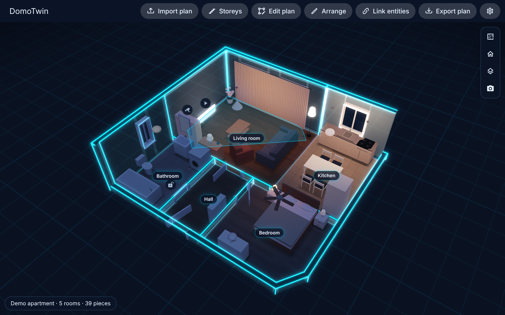

# Looks

DomoTwin draws your home in one of five looks. All five show the same live home: lights, covers,
layers, devices, people and alerts work the same way in each.


- **Neon**: a night view. The walls are tinted glass, the outlines of the home glow in the accent
  colour, the furniture takes night blues, and lamps and screens shine. A grid on the ground fades
  into the dark.
- **Blueprint**: white lines on blue, like an architect's drawing in 3D.
- **Day**: the home as it is, its furniture, floors and paint, in the light of the time of day
  (morning, day, evening, night) with the sun's shadows. It stands on a ground that dims at night.
- **Cartoon**: flat bright colours in two steps of sunlight, black ink around the walls, the
  furniture and the people, under a blue sky on a lawn. It follows the time of day.
- **Clay model**: the home as an architect's model in matte clay, every piece the same warm colour,
  in soft light with the sun's shadows. Lamps still glow at night. It follows the time of day.


**Automatic**, the default, shows neon when Home Assistant is in dark mode, and day otherwise.

The 2D plan follows the look too: glowing wall outlines on dark floors in neon, white walls on blue
in blueprint, thick dark walls on bright floors in cartoon, and the same clay throughout in the clay
model.



## Choosing

- **For the home**: in the panel, the cog opens the settings. **Look** and **Accent colour** apply
  to the panel and to every card that does not choose its own. The view changes as you choose;
  **Save** keeps the choice and **Cancel** goes back.
- **For a card**: the visual editor's **Look** and **Accent colour**, or in YAML:

```yaml
type: custom:domotwin-card
theme: neon        # auto, day, neon, blueprint, cartoon or clay; absent: the home's look
accent: "#ff2d95"  # the accent colour; absent: the home's
names: true        # the rooms' names on their floors (true by default)
```

The accent tints neon's outlines and grid, and the buttons of the view in neon.

## What makes them

- **Outlines**: the tops and corners of the walls, the frames of doors and windows and the
  outlines of the floors are drawn as lines a few pixels wide, whatever the zoom, lowered with the
  walls when they are cut away. In day they are thin and dark; in neon and blueprint they glow;
  in cartoon they are thick black ink; in the clay model, faint.
- **Glass walls** (neon and blueprint): you see into every room from any angle, and a tap goes
  through a wall to what is behind it. The tops of the walls stay solid.
- **Bloom**: lamps that are on, their halos, screens, outlines and the grid glow. It is drawn on
  GPUs that can afford it: from the Balanced quality for neon and blueprint, on High for day,
  cartoon and clay. On the Eco quality (old tablets) the looks are drawn without it, and still look
  the same otherwise.
- **Ink** (cartoon): besides the home's outlines, whatever stands in front of what is behind it
  (a sofa on the floor, a person, the home on the lawn) is inked along its edge. The ink is found
  in the depth of what is opaque, before glass, outlines, halos and wires are drawn over it, from
  the Balanced quality up, the same at any zoom and in the 2D plan. On Eco the cartoon keeps its outlines and a darker rim on curved pieces.
- **The rooms' names** stand on their floors, well inside them (in an arm of an L-shaped room). A
  layer's values take their place while the layer is shown.

The view's buttons, menus and panels, and the panel's header and dialogs, take the look's colours
whatever the dashboard's theme: dark in neon and blueprint, light in cartoon and the clay model.
Day follows the dashboard.

## For developers

- `crates/domotwin-core/src/theme.rs`: the looks as data (colours, glass walls, outlines, bloom,
  palette, light, bands, vividness, ink).
- `crates/domotwin-core/src/scene/lines.rs` and `scene/structure.rs`: the outlines of the home,
  built from the walls' layout.
- `crates/domotwin-render`: the background pass (sky, ground, grid), the glass walls pass, the
  lines, and the offscreen picture with MSAA, its bloom and the cartoon's ink from its depth
  (`docs/DECISIONS.md`, D-027 and D-036).
- The engine's `setTheme(look, accent)` and `roomLabels()`; the view's `look` attribute and
  `lookStyles` (`frontend/src/components/styles.ts`).
