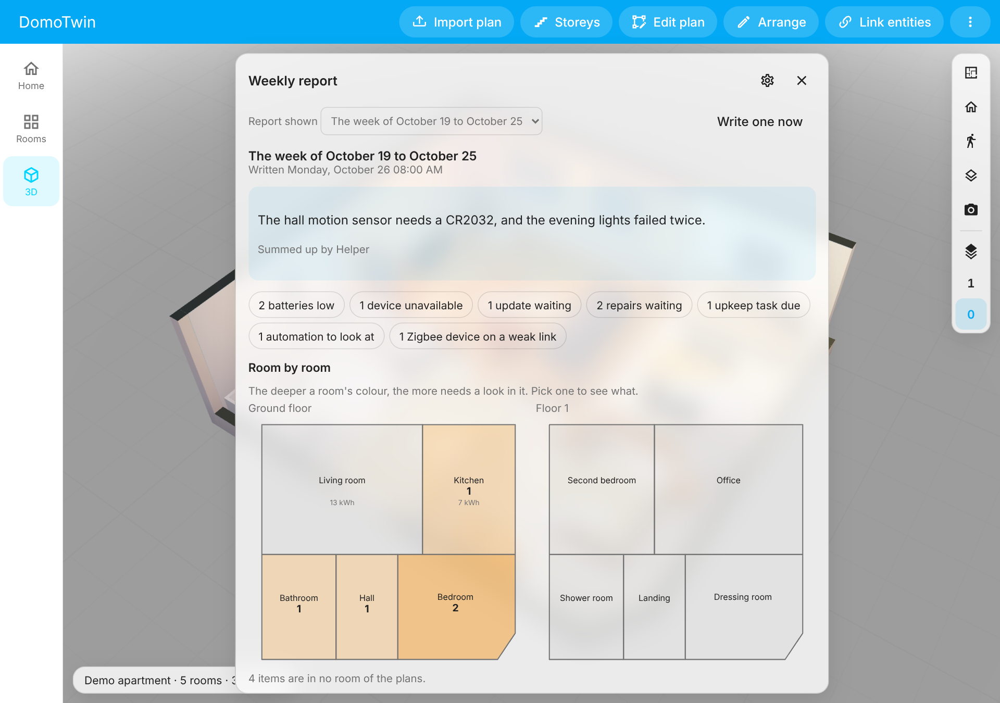

# The weekly report

Once a week, DomoTwin writes what needs a look in the home: batteries low, devices unavailable,
updates and repairs waiting, upkeep due, automations to look at, Zigbee devices on a weak link,
and the week's energy against the week before, room by room on the plans (`DECISIONS.md`, D-071).
Home Assistant's notification says it; the panel shows it.



It reads what Home Assistant and the integrations you have installed already say, rather than
working it out again: [Battery Notes](https://github.com/andrew-codechimp/HA-Battery-Notes) for the
batteries, [Watchman](https://github.com/dummylabs/thewatchman) for what your configuration names
and Home Assistant does not have, [Spook](https://github.com/frenck/spook) through the repairs it
raises. None of them is needed.

## When

On the day and at the hour you choose, Monday at 8 unless you change it, where the home is
(Home Assistant's time zone). The integration writes it: no screen needs to be open.

- **A week missed** (Home Assistant was stopped at that hour) is written once it has started
  again, within the week.
- **Just installed**, DomoTwin waits for the first day chosen.
- **Write one now**, in the report's page, writes one at once. It is kept with the others but
  neither notified nor counted as the week's: the week's is still written on its day.

## What it says

As it stands when the report is written:

| Section | What it reads |
| ------- | ------------- |
| **Batteries low** | Battery Notes' low-battery sensor where it watches a device: its own threshold, the battery to buy, its level. Otherwise, as Home Assistant's Maintenance page counts them, a battery sensor at the level chosen (20 % unless you change it) or below, unless its device is charging, or a battery binary sensor on. One a device. |
| **Devices unavailable** | A device all of whose entities have been unavailable for an hour at least, and since when (across a restart of Home Assistant too). |
| **Updates waiting** | Home Assistant's update entities that are on (one you skipped is off). |
| **Repairs waiting** | What Settings → Repairs lists, titled as it titles them (Spook's findings among them); what Watchman finds missing in your configuration. |
| **Upkeep due** | The [upkeep](upkeep.md) tasks due soon or overdue, and warranties in their last 30 days. |
| **Automations to look at** | Those whose runs failed this week (Home Assistant's traces: an error, not a condition that was false); those that cannot run (their configuration is invalid); those turned on that have never run, made a week ago at least. |
| **Zigbee devices on a weak link** | With ZHA, the devices whose best way to the coordinator goes through a weak link (an LQI below 80), or that have none, by the rules of the [network map](network.md). |

And for the week:

- **Energy**: the seven days to the midnight before the report, against the seven before them,
  from Home Assistant's energy settings and statistics: what the home used, what it drew from the
  grid, what the sun gave; and each room's, from the energy settings' individual devices in it, or,
  where the settings name none, from the energy meters of the room's area.
- **Hydro-Québec's peaks**, where hydroqc or HydroPeak reads them ([D-063](DECISIONS.md)): each
  peak of the week, and what the home drew from the grid and each room during it.

An item is **new** when the report before did not have it (an update waiting stays the same item,
whichever version it waits for); what the report before had and this one has not is listed as
**done since the last report**. The week's report is compared with last week's.

### Room by room

An item is in the room of the piece, door or window linked to it or to its device (`bindings.md`),
else in the first room whose Home Assistant area is its own (its entity's, else its device's), as
the layers read the rooms. The report's page draws each storey's plan: the more a room has to look
at, the deeper its colour; its week's energy is written in it. Pick a room to see only what is in
it, and **Show in 3D** to go there.

A [private room](privacy.md) you may not see is closed in the page as in the rest of DomoTwin:
drawn closed, what is in it counted but not shown, its energy left out. The notification names no
room, and the AI task is not told a room that is private for nobody.

## Where

- **Home Assistant's notification**, replaced each week, if you keep it on: the week, the summary,
  a line for each section, and a link to the report. Home Assistant shows its notifications to
  every user and cannot keep them to administrators, so a line names what every user may see in
  Home Assistant anyway (batteries, devices, updates, repairs, upkeep) and only counts the
  automations and the radios, which only administrators may read.
- **The panel**: **Weekly report** in the ⋮ menu, for administrators. The week shown and the ones
  kept before it, the summary, every item with where it opens in Home Assistant (a device's page,
  an entity's dialog, the repairs, an automation's trace or editor, the Maintenance page for the
  batteries), the energy as a table, the peaks, and the settings.
- **An event**, `domotwin_weekly_report`, fired after each week's report, for your own
  automations: send it to a phone, a speaker, a chat.

```yaml
# Example: the week's report on a phone, with a link to it.
triggers:
  - trigger: event
    event_type: domotwin_weekly_report
conditions:
  - condition: template
    value_template: "{{ trigger.event.data.total > 0 }}"
actions:
  - action: notify.mobile_app_my_phone
    data:
      title: "The week's report"
      message: >-
        {{ trigger.event.data.summary or (trigger.event.data.total ~ ' things to look at') }}
      data:
        url: "{{ trigger.event.data.url }}"
```

The event's data: `report` (its id), `week_start` and `week_end`, `counts` (by section), `total`,
`summary` (when an AI task wrote one) and `url` (the report in the panel).

## A summary by your AI task

If you have set up an AI task in Home Assistant (2025.8 and later; most AI integrations add one),
choose it in the report's settings: it sums the report up in a few sentences, in Home Assistant's
language, at the top of the notification and the page. Its facts are sent to that AI task, which
may be an online service; the automations and the radios are only counted, as in the
notification. Without one, or when it fails, the lists are the report and the page says why.

A conversation agent is not used: one that controls the home could act on what the report says
instead of writing about it.

## Kept

The last eight weeks' reports and the last two written by hand, in Home Assistant's storage
(`.storage/domotwin.reports`), a hundred items a section at most (the others counted). They are
not in DomoTwin's diagnostics, only the settings and how many reports are kept; they are deleted
with the integration.

## The limits

- A run that failed and has left the traces Home Assistant keeps (the last five of each
  automation) by the time the report is written is not counted.
- An automation never run is named once Home Assistant has known it for a week; one written in
  YAML without an `id` is not, since Home Assistant does not say when it was made.
- The radios are read from ZHA's own code; a version of ZHA that answers differently is left out,
  and the network map still reads it.
- The energy and the peaks need Home Assistant's recorder; the energy, its energy settings or
  energy meters in the rooms' areas.
- The demo house has reports of its own, made up for its rooms; the sandbox has none.
