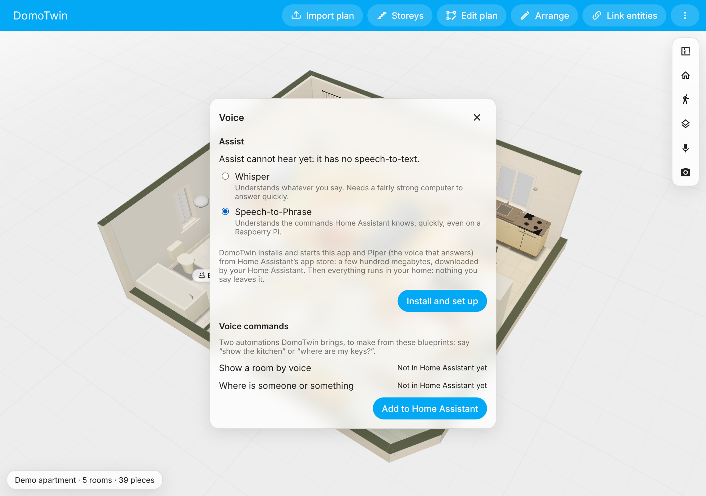

# Your voice

Speak to DomoTwin from a wall tablet or a phone: "show the kitchen", "turn off the living room
lights", "where is Alex?". DomoTwin embeds no voice engine. Home Assistant's **Assist** hears,
understands and answers, with the pipeline you chose. That can be local (Whisper and Piper,
nothing leaves your home) or a voice service of your choice.

## The microphone button

The card and the panel have a microphone button. It opens Assist already listening, with your
preferred pipeline when it can hear, else the first one that can. Assist shows what it heard and
says the answer. The button is there when Assist is (the `conversation` integration, part of
Home Assistant's default setup). The card's `voice: false` option hides it.

**Over HTTP**, browsers do not lend the microphone. Instead of a button that does nothing, a
dialog says so and how to serve Home Assistant over HTTPS:

- Home Assistant Cloud;
- the Let's Encrypt or NGINX app;
- your own reverse proxy.

The Home Assistant companion app listens itself, so it needs none of this. Meanwhile, the
dialog offers to type to Assist.

## Off on a device

A phone in a pocket, a screen in a child's or a shared room: voice can be turned off on one
device. **Voice on this device**, in the panel's voice settings (**⋮** → **Voice**) or in **Your
choices** (the button on the Home and Rooms tabs), off: no microphone button on that device, in
the panel and in its cards. It is kept on the device only, whoever signs in there; your other
devices keep theirs, and Assist stays set up for them.

A wall screen's layout has **Voice on this screen** too (administrators, see [the wall
screen](wall-screen.md)): off, the device that is that screen has no microphone button, whatever
its own choice.

## When Assist cannot hear yet

A fresh Home Assistant has Assist without speech-to-text. The microphone button then offers to
set it up, **locally**, and so do the panel's voice settings (**More** → **Voice**,
administrators). It says what will be downloaded and asks first.

- **Home Assistant OS and Supervised.** Pick what hears:
  - **Whisper** understands anything you say;
  - **Speech-to-Phrase** is much quicker on small hardware such as a Raspberry Pi, but knows
    only the sentences of your home (its devices, areas, the blueprints' sentences).

  DomoTwin then:
  1. installs and starts that app and **Piper** (the voice that answers) from Home Assistant's
     app store, in your home's language (an app you had installed keeps its settings);
  2. adds both through the Wyoming integration (only them: another Wyoming app waits for you);
  3. creates an Assist pipeline, "DomoTwin (local)", and makes it the preferred one if the
     preferred one could not hear.

  The dialog follows each step and says which one failed, if one does (for example when Home
  Assistant was once told to ignore one of these apps: it says how to stop ignoring it). The apps download a few
  hundred megabytes from Home Assistant's store, like any app you install. Then everything runs
  in your home.
- **Home Assistant Container and Core** have no apps. The dialog gives the steps instead:
  1. run the `rhasspy/wyoming-whisper` and `rhasspy/wyoming-piper` containers next to Home
     Assistant;
  2. add them through the Wyoming integration;
  3. make a pipeline with them (Settings → Voice assistants).
- **Not an administrator?** The dialog says to ask one.

## The voice blueprints, in one tap

DomoTwin ships two blueprints:

- **Show by voice**: "show the kitchen" frames it on your screens (see
  [kiosks](kiosk.md#your-voice-assist)).
- **Where by voice**: "where is Alex?", "where are my keys?" (see [people](people.md) and
  [Bluetooth locating](bluetooth.md)).

The panel's voice settings add them to Home Assistant's blueprints in one tap, from the copies
inside the integration: nothing is downloaded. A blueprint you edited there is kept unless you
choose to replace it. **Make an automation** opens Home Assistant's blueprint page, where each
becomes an automation in a few clicks. You can still import them by their link from
`blueprints/` in this repository.

## Later, by voice

With a voice assistant driven by a language model, "switch the lantern on tomorrow at 6:30 until
6:45" works: DomoTwin gives it tools to set, list and cancel actions done later. See [actions done
later](later.md).

## Privacy

DomoTwin sends nothing anywhere: it opens Home Assistant's own Assist dialog. With a local
pipeline (Whisper or Speech-to-Phrase, and Piper), what you say never leaves your home. With
Home Assistant Cloud or another voice service, it goes where that service takes it. Private
rooms stay private by voice too: the answers say "in a private room" (see
[private rooms](privacy.md)).
